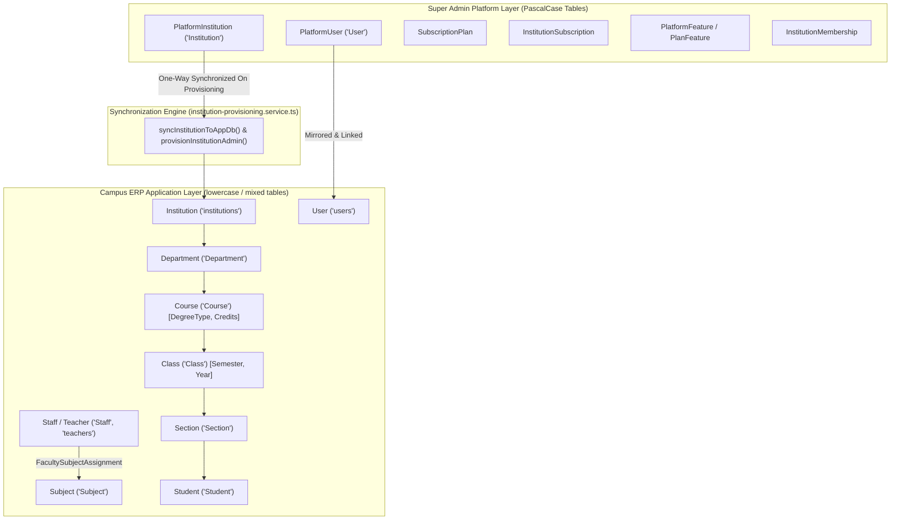
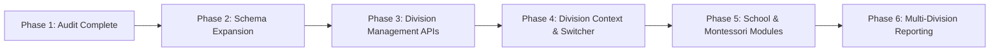

# SST-ERP — Phase 1: Existing Repository Audit (READ-ONLY)
## Multi-Division Institution Architecture Audit Report

**Audit Date:** November 25, 2026  
**Repository:** Sohan Soft Tech ERP (SST-ERP)  
**Audit Scope:** Read-Only Architectural Inspection & Multi-Division Feasibility Analysis  
**Operating Environment:** Production Next.js 16 + Prisma 6 + PostgreSQL (Supabase)  
**Security & Integrity Compliance:** No code modified, no schema changed, no migrations executed, no secrets exposed.

---

## 1. Existing Architecture Overview

SST-ERP currently implements a **dual-database multi-tenant platform architecture** designed primarily for single-type educational institutions (predominantly higher-education colleges and universities).



### Architectural Foundations & Tenancy
1. **Dual-Model Database Strategy:**
   - **Platform Management Plane:** Models using PascalCase table mapping (`"Institution"`, `"User"`, `"SubscriptionPlan"`, `"InstitutionMembership"`) managed primarily via Super Admin routes (`app/super-admin/`) and `lib/super-admin/prisma.ts`.
   - **Campus ERP Operational Plane:** Models using lowercase table mappings (`"institutions"`, `"users"`, `"enrollments"`, `"teachers"`) managed through `lib/db.ts` and operational routes (`app/admin/`, `app/student/`, `app/campus/`).
   - **Synchronization:** Initiated by `lib/services/institution-provisioning.service.ts` via `syncInstitutionToAppDb` upon institution creation or update.
2. **Tenancy Model:**
   - Tenancy is strictly single-tier: `institutionId` is the sole foreign key boundary across 117 models.
   - Isolation is enforced via database foreign keys (`onDelete: Cascade` / `Restrict`), application middleware (`proxy.ts`), session tokens (`SessionUser.institutionId`), and authorization guards (`lib/security/tenant.ts`, `lib/security/admin-auth.ts`).
3. **Core Institutional Assumption:**
   - Each institution is an isolated, monolithic tenant representing exactly one educational entity defined by a single `InstitutionType` enum value (`SCHOOL`, `COLLEGE`, or `OTHER`).
   - There is no intermediary architectural layer representing **Campuses**, **Divisions**, **Faculties**, or **Branches** between the root `Institution` and academic departments.

---

## 2. Current Prisma Model Inventory

An audit of `prisma/schema.prisma` (117 total models) was conducted. The following is an analysis of each required model against multi-division suitability:

### 2.1 Model: `Institution`
- **Database Table:** `institutions` (Application Layer)
- **Important Fields:** `id`, `code`, `name`, `slug`, `type` (`InstitutionType`), `status`, `address`, `phone`, `email`, `website`, `isActive`, `city`, `state`, `country`.
- **Relationships:** Root parent of all academic entities: `departments`, `courses`, `classes`, `students`, `staff`, `academicYears`, `feeStructures`, `users`.
- **Ownership:** Top-level tenant container.
- **Constraints & Indexes:** `@id @default(uuid())`, `@unique code`, `@unique slug`, `@@index([status, isActive])`.
- **Multi-Division Support:** **No.** Represents a single institution with a single `type` enum. Cannot represent an umbrella institution containing both a School and a College division without sub-entities.
- **Change Required:** Add relationship to a proposed `InstitutionDivision` entity, or allow child divisions linked to this parent institution.

### 2.2 Model: `PlatformInstitution`
- **Database Table:** `Institution` (Platform Management Layer)
- **Important Fields:** `id`, `name`, `code`, `slug`, `type`, `status`, `provisioningStatus`, `postalCode`, `subscriptions`, `memberships`.
- **Relationships:** Links to `InstitutionSubscription`, `InstitutionMembership`, `InstitutionFeatureOverride`, `PlatformAuditLog`.
- **Ownership:** Platform-level root.
- **Constraints & Indexes:** `@id @default(uuid())`, `@unique code`, `@unique slug`.
- **Multi-Division Support:** **No.** Designed for single tenant provisioning.
- **Change Required:** Introduce division provisioning metadata or child division configuration.

### 2.3 Model: `User` & `PlatformUser`
- **Database Table:** `users` (Application Layer) & `User` (Platform Layer)
- **Important Fields:** `id`, `institutionId`, `email`, `fullName`, `role`, `platformRole`, `status`, `isActive`.
- **Relationships:**
  - In `User`: 1-to-1 with `Student` (`UserStudentProfile`), 1-to-1 with `Teacher`, 1-to-1 with `Staff`. Single foreign key `institutionId`.
  - In `PlatformUser`: 1-to-many with `InstitutionMembership`.
- **Ownership:** Owned by single `institutionId`.
- **Constraints & Indexes:** `@unique email` within `users` / `User`, `@@index([institutionId, role])`.
- **Multi-Division Support:** **No.** A user is bound to exactly one `institutionId` with exactly one primary role in the ERP application. A teacher cannot teach in both a School division and a College division with different designations without duplicate accounts.
- **Change Required:** Allow division-scoped assignments or division memberships while retaining global user identity.

### 2.4 Model: `Student`
- **Database Table:** `Student`
- **Important Fields:** `id`, `institutionId`, `userId`, `admissionNumber`, `rollNumber`, `currentDepartmentId`, `currentCourseId`, `currentClassId`, `currentSectionId`, `currentSemester` (Int, default 1), `status`.
- **Relationships:** Bound to `Institution`, `Course`, `Department`, `Class`, `Section`, `AcademicYear`, `StudentEnrollmentHistory`.
- **Ownership:** Owned by `institutionId`.
- **Constraints & Indexes:** `@@unique([institutionId, admissionNumber])`, `@@unique([institutionId, rollNumber])`, `@unique userId`.
- **Multi-Division Support:** **No.** Schema hardcodes college attributes: `currentCourseId` (requires a degree course) and `currentSemester` (integer semester 1-8). School students do not have semesters or degree courses.
- **Change Required:** Introduce an optional `divisionId` foreign key. Make `currentCourseId` optional for non-college divisions, or provide standard/grade-level mapping.

### 2.5 Model: `Teacher` & `Staff`
- **Database Table:** `teachers` (Legacy/Campus portal) & `Staff` (Main ERP)
- **Important Fields:**
  - `Staff`: `id`, `institutionId`, `userId`, `staffEmployeeId`, `departmentId`, `designation`, `employmentType`, `status`.
  - `Teacher`: `id`, `institutionId`, `userId`, `employeeId`, `department` (String), `designation`.
- **Relationships:** `Staff` links to `Department`, `Section` (as class teacher), `FacultySubjectAssignment`, `TimetableSlot`.
- **Ownership:** Owned by `institutionId` and strictly tied to a single `departmentId`.
- **Constraints & Indexes:** `@@unique([institutionId, staffEmployeeId])`, `@unique userId`.
- **Multi-Division Support:** **No.** A staff member cannot be assigned to multiple divisions or departments across divisions.
- **Change Required:** Introduce multi-division assignment mappings (`StaffDivisionAssignment` or optional `divisionId` list).

### 2.6 Model: Roles & Permissions
- **Database Tables:** `Role`, `Permission`, `InstitutionMembership`, `MembershipRole`, `RolePermission`
- **Important Fields:**
  - `Role`: `id`, `institutionId`, `code`, `name`, `isSystem`.
  - `InstitutionMembership`: `id`, `userId`, `institutionId`, `status`.
  - `MembershipRole`: `membershipId`, `roleId`, `institutionId`.
- **Ownership:** Scoped by `institutionId`.
- **Constraints & Indexes:** `@@unique([userId, institutionId])` on `InstitutionMembership`, `@@unique([institutionId, code])` on `Role`.
- **Multi-Division Support:** **No.** `InstitutionMembership` is strictly 1 membership per `userId` per `institutionId`. A user cannot have the role "PRINCIPAL" in Division A (School) and "PROFESSOR" in Division B (College) within the same institution.
- **Change Required:** Add optional `divisionId` to `MembershipRole` or create `DivisionMembership` to enable division-scoped RBAC.

### 2.7 Model: Campus
- **Database Table:** Zero dedicated `Campus` entity exists. Only `CampusInOutLog` exists for physical gate logging.
- **Ownership:** N/A.
- **Multi-Division Support:** **Missing.**
- **Change Required:** If physical campuses need to be distinguished from educational divisions, a `Campus` model can be introduced or modeled as a physical attribute of a Division.

### 2.8 Model: `AcademicYear` & `AcademicTerm`
- **Database Tables:** `academic_years`, `academic_terms`
- **Important Fields:** `id`, `institutionId`, `name` (e.g. "2026-2027"), `code`, `startDate`, `endDate`, `status`, `isCurrent`.
- **Relationships:** Linked to classes, enrollments, fee structures, timetable slots.
- **Ownership:** Owned by `institutionId`.
- **Constraints & Indexes:** `@@unique([institutionId, code])`, `@@index([institutionId, isCurrent])`.
- **Multi-Division Support:** **Partially.** Academic years can technically be shared across divisions if calendars align, but School calendars (e.g. April-March) often differ from University/College calendars (e.g. August-July or July-June).
- **Change Required:** Add optional `divisionId` to allow division-specific academic calendars where required.

### 2.9 Model: `Department`
- **Database Table:** `Department`
- **Important Fields:** `id`, `institutionId`, `name`, `code`, `status`, `hodStaffId`.
- **Relationships:** Parent of `Course` and `Staff`.
- **Ownership:** Owned by `institutionId`.
- **Constraints & Indexes:** `@@unique([institutionId, code])`, `@@index([institutionId, status])`.
- **Multi-Division Support:** **Partially.** In colleges, departments are academic (Computer Science, Mechanical). In schools, departments are either absent or subject-based (Science Department, Languages).
- **Change Required:** Add optional `divisionId` to scope departments by educational division.

### 2.10 Model: `Course` (Programme & Course)
- **Database Table:** `Course`
- **Important Fields:** `id`, `institutionId`, `departmentId`, `name`, `code`, `degreeType` (`DegreeType` enum), `totalCredits`, `totalSemesters`, `regulationYear`.
- **Relationships:** Child of `Department`, parent of `Class`, `Subject`.
- **Ownership:** Owned by `institutionId`.
- **Constraints & Indexes:** `@@unique([institutionId, code])`.
- **Multi-Division Support:** **No.** Rigidly modeled for college degrees (requires `degreeType`, `totalCredits`, `totalSemesters`). Schools do not offer degree courses.
- **Change Required:** For School divisions, either create a `GradeLevel` / `Standard` model, or generalize `Course` with nullable degree attributes.

### 2.11 Model: `Class` & `Section`
- **Database Tables:** `Class`, `Section`
- **Important Fields:**
  - `Class`: `id`, `institutionId`, `courseId` (REQUIRED), `academicYearId`, `semester` (REQUIRED Int), `regulationYear`.
  - `Section`: `id`, `institutionId`, `classId`, `name` (e.g. "A"), `capacity`, `classTeacherStaffId`.
- **Relationships:** `Class` belongs to `Course`; `Section` belongs to `Class`.
- **Ownership:** Owned by `institutionId`.
- **Constraints & Indexes:** `@@unique([institutionId, courseId, academicYearId, semester])` on `Class`; `@@unique([institutionId, classId, name])` on `Section`.
- **Multi-Division Support:** **No.** Because `Class` enforces `courseId` (foreign key to `Course`) and `semester` (Int), a school class like "Grade 5 Section A" cannot be created without creating a dummy "Degree Course" and assigning it an arbitrary semester number.
- **Change Required:** Allow `Class` to belong directly to a `Division` or `GradeLevel` without requiring a College degree `courseId` or `semester`.

### 2.12 Model: `Subject`
- **Database Table:** `Subject`
- **Important Fields:** `id`, `institutionId`, `departmentId`, `courseId` (Optional), `name`, `code`, `subjectType`, `credits`, `isElective`.
- **Relationships:** Belongs to `Department`, optionally to `Course`. Assigned to faculty via `FacultySubjectAssignment`.
- **Ownership:** Owned by `institutionId`.
- **Constraints & Indexes:** `@@unique([institutionId, code])`.
- **Multi-Division Support:** **Partially.** Subjects can be reused across divisions (e.g. Mathematics, English), but code uniqueness (`institutionId_code`) prevents having subject code `MATH-01` in both School and College divisions.
- **Change Required:** Scope subject uniqueness to `@@unique([institutionId, divisionId, code])`.

### 2.13 Model: `Enrollment` & `StudentEnrollmentHistory`
- **Database Tables:** `enrollments`, `StudentEnrollmentHistory`
- **Important Fields:**
  - `Enrollment`: `studentId`, `classId`, `academicYearId`, `enrollmentDate`, `status`.
  - `StudentEnrollmentHistory`: `studentId`, `classId`, `semester` (Int), `academicYearId`, `sgpa`, `cgpa`, `carriedBacklogsCount`.
- **Ownership:** Owned by `institutionId`.
- **Multi-Division Support:** **No.** Enrollment history assumes a semester-based grading system with SGPA/CGPA and backlogs.
- **Change Required:** Support non-semester, term-based or annual grading for School divisions.

### 2.14 Model: Staff Assignments (`FacultySubjectAssignment`, `TimetableSlot`)
- **Database Tables:** `FacultySubjectAssignment`, `TimetableSlot`
- **Important Fields:**
  - `FacultySubjectAssignment`: `staffId`, `subjectId`, `classId`, `sectionId`, `academicYearId`.
  - `TimetableSlot`: `dayOfWeek`, `periodNumber`, `classId`, `sectionId`, `subjectId`, `staffId`.
- **Ownership:** Owned by `institutionId`.
- **Multi-Division Support:** **Partially.** The structure is highly reusable for School and College once `Class` and `Section` are freed from strict College degree prerequisites.

### 2.15 Models: Subscription, Billing & Feature Entitlements
- **Database Tables:** `SubscriptionPlan`, `PlatformFeature`, `PlanFeature`, `InstitutionFeatureOverride`, `InstitutionSubscription`, `Invoice`, `Payment`
- **Important Fields:**
  - `SubscriptionPlan`: `code`, `name`, `price`, `billingCycle`, `studentCapacity`.
  - `InstitutionSubscription`: `institutionId`, `planId`, `status`, `startsAt`, `endsAt`.
  - `PlatformFeature` & `PlanFeature`: `code`, `name`, `enabled`, `limitValue`.
  - `InstitutionFeatureOverride`: `institutionId`, `featureId`, `enabled`, `expiresAt`.
- **Ownership:** Owned strictly by `institutionId` at the platform level.
- **Multi-Division Support:** **Yes (Architecturally Independent).** Billing and entitlements are managed at the umbrella Institution level. A single subscription covers the entire institution regardless of its internal educational divisions.
- **Change Required:** No breaking change required. Optionally, feature overrides or usage caps could track division-specific quotas in future phases.

---

## 3. Audit of Institution Management Workflow

Inspected files:
- `app/super-admin/(protected)/institutions/actions.ts`
- `lib/services/institution-provisioning.service.ts`
- `app/super-admin/(protected)/institutions/page.tsx`
- `app/super-admin/(protected)/institutions/[id]/page.tsx`

### Findings
1. **Creation Flow:**
   - Super Admin submits: `name`, `code`, `slug`, `type` (`SCHOOL | COLLEGE | OTHER`), `planId`, `adminName`, `adminEmail`, `adminPassword`.
   - Creation executes in a PostgreSQL transaction in `PlatformInstitution`.
   - Immediately sets `primary_institution_id` and `primary_institution_name` in `platform_settings`.
   - Calls `syncInstitutionToAppDb(institution.id)` to duplicate the institution into the `institutions` table.
   - Calls `provisionInstitutionAdmin` to create the primary administrator user.
2. **Synchronization Mechanism:**
   - `syncInstitutionToAppDb` executes raw SQL (`INSERT INTO institutions ... ON CONFLICT (id) DO UPDATE`).
   - Copies name, code, slug, type, address, phone, email, status.
3. **Type Selection Limitation:**
   - `type` is a single radio or select choice in the UI. An institution is created as *either* a School *or* a College.
   - There is no option to create a "Composite Educational Institution" or "Trust / Group of Institutions" with multiple divisions.
4. **Administrator Provisioning Constraint:**
   - In `provisionInstitutionAdmin`:
     ```typescript
     if (otherMembership) throw new Error("This administrator email is already associated with another institution.");
     if (existingAppUser?.institutionId && existingAppUser.institutionId !== institution.id) {
       throw new Error("This administrator email is already associated with another institution.");
     }
     ```
   - An administrator is rigidly bound to one institution. There is no concept of a "Chief Executive Officer / Trust Admin" managing multiple divisions or institutions, nor division-specific administrators.
5. **Campus Management:**
   - **Completely absent.** There is no UI, API, or action for creating or managing campuses or divisions.

---

## 4. Audit of Authentication and Access Control

Inspected files:
- `app/api/auth/login/route.ts`
- `app/api/auth/me/route.ts`
- `lib/auth/session.ts`
- `lib/security/admin-auth.ts`
- `lib/security/authorize.ts`
- `proxy.ts`

### Findings
1. **Login & Session Payload:**
   - `app/api/auth/login/route.ts` signs a JWT containing:
     ```typescript
     {
       userId: string,
       email: string,
       role: string,
       institutionId: string,
       institutionName: string,
       studentId?: string,
       guardianId?: string,
       passwordSig: string
     }
     ```
   - **Single Tenant Token:** The token contains only one `institutionId`. There is no `divisionId` or `activeDivisionId`.
2. **User Identity Resolution:**
   - Users are looked up by email: `db.user.findFirst({ where: { email, ...(institutionId ? { institutionId } : {}) } })`.
   - Because `User.institutionId` is singular, a user cannot switch institutions or divisions without separate credentials or schema modification.
3. **Server-Side Access Validation:**
   - Authorization is verified on the server:
     - `resolveAdminContext` in `lib/security/admin-auth.ts` validates the session, password signature, and role against the database on each request.
     - `assertTenant` in `lib/security/tenant.ts` throws `ForbiddenError` if `session.institutionId !== resource.institutionId`.
     - `authorizeStudentOrParentAccess` in `lib/security/authorize.ts` checks IDOR protection for student and parent access.
4. **Multi-Division RBAC Support:**
   - **Currently impossible.** The RBAC tables (`Role`, `MembershipRole`, `InstitutionMembership`) have no `divisionId` field.
   - An administrator cannot be granted permissions restricted solely to Division A (e.g. School) while being denied access to Division B (e.g. College).

---

## 5. Audit of Academic Functionality (College vs Reusable)

| Module | Existing Implementation | College-Specific Attributes | Multi-Division Reusability |
| :--- | :--- | :--- | :--- |
| **Academic Years** | `academic_years`, `academic_terms` | Minor (terms can be semesters or quarters) | **High:** Can be shared or scoped by division. |
| **Departments** | `Department` | Tied to faculty and degrees | **Medium:** Colleges use academic depts; Schools use grade wings or subject groups. |
| **Programs & Courses** | `Course` | `degreeType`, `totalCredits`, `totalSemesters`, `regulationYear` | **Low:** Specific to higher education degrees. Unusable for Montessori/Primary/Secondary. |
| **Classes & Sections** | `Class`, `Section` | Mandatory `courseId` and `semester` on `Class` | **Medium:** `Section` is fully reusable; `Class` requires removing mandatory degree constraints. |
| **Admissions & Enrolment** | `AdmissionApplication`, `enrollments` | Application documents, quota, entrance ranks | **High:** Workflows (forms, reviews, verification) are 85% reusable. |
| **Attendance** | `StudentAttendance`, `attendance-calculator.ts` | Day/period attendance, condonation | **High:** Completely reusable across School, College, and Academy. |
| **Timetable** | `TimetableSlot`, `timetable.service.ts` | Days, periods, room, staff, subject | **High:** 90% reusable across all divisions. |
| **Internal Assessment & Exams** | `IAAssessment`, `ExamSubjectSlot`, `SemesterResult` | Theory tests, labs, SGPA/CGPA, backlogs | **Low to Medium:** Core exam scheduling is reusable; semester GPA/backlog calculations are College-specific. |
| **Fees & Payments** | `FeeStructure`, `FeeCategory`, `StudentFeeAllocation`, `FeePaymentTransaction` | Tuitions, exam fees, installments | **High:** 95% reusable across all educational divisions. |
| **Certificates** | `CertificateApplication`, `IssuedCertificate` | Bonafide, Transfer, Degree, Transcript | **High:** Transfer (TC) and Bonafide are universally required. |
| **Campus Operations** | Transport, Hostel, Gate, Grievances, Library | Bus routes, hostel beds, RFID gate logs | **High:** Universally reusable across all divisions. |

---

## 6. Audit of Dashboard Architecture

Inspected files:
- `components/layout/AdminSidebar.tsx`
- `components/super-admin/navigation-items.ts`
- `app/admin/page.tsx`
- `app/dashboard/page.tsx` (Student Dashboard)
- `app/campus/[slug]/teacher/` (Teacher Workspace)

### Findings
1. **Single Admin Dashboard Routing:**
   - All Institution Admins are routed to `/admin`.
   - The layout (`components/layout/AdminSidebar.tsx`) displays fixed college-centric links:
     - *Programs & Courses* (`/admin/academics/courses`)
     - *Departments* (`/admin/academics/departments`)
     - *Internal Assessment* (`/admin/ia`)
     - *Results* (`/admin/results`)
     - *Promotions* (`/admin/promotions`)
2. **Lack of Dynamic Division Navigation:**
   - There is no division context switcher in the admin header or sidebar.
   - If a School Administrator logs in, they see University/College terminology ("Courses", "Semesters", "Credits").
3. **Student & Parent Portals:**
   - `app/student/dashboard` and `app/dashboard/page.tsx` display "Semester 1", "Batch", "Roll Number", "Course Progress & Academic Performance".
   - There is no branch or condition to render Grade-based school report cards or Montessori developmental checklists.
4. **Teacher Portal Multi-Role Pattern:**
   - `app/campus/[slug]/teacher` does have an active role switcher (`teacher`, `class_teacher`, `hod`) managed via `sst_teacher_session`.
   - **Key Finding:** This role-switching design pattern is a candidate for how the future **Division Switcher** could operate for administrators and multi-division faculty.

---

## 7. Audit of Subscription Architecture

Inspected files:
- `lib/billing/initial-subscription.ts`
- `lib/billing/student-capacity.ts`
- `lib/billing/student-usage.ts`
- `lib/billing/subscription-period.ts`
- `lib/services/subscription.service.ts`
- `lib/super-admin/feature-access.ts`
- `app/admin/subscriptions/page.tsx`

### Findings
1. **Tenancy of Subscriptions:**
   - Subscriptions are attached to `Institution.id` (`InstitutionSubscription.institutionId`).
   - Feature overrides (`InstitutionFeatureOverride`) are attached to `institutionId`.
2. **Usage Caps:**
   - `assertStudentRegistrationCapacity` checks student count across the entire institution:
     ```typescript
     export async function countInstitutionStudents(client, institutionId: string) {
       return client.student.count({ where: { institutionId } });
     }
     ```
3. **Multi-Division Independence:**
   - **Architectural Advantage:** Because subscriptions, payments, and invoices are attached strictly at the parent `institutionId` level, introducing sub-divisions will **not** require redesigning the billing engine or breaking current Razorpay/invoice flows.
   - A single institutional subscription can license 1,000 students across 3 divisions (e.g. 400 School + 500 College + 100 Montessori) without changing billing models.

---

## 8. Existing Reusable Components and Services

The repository contains enterprise-grade services and UI components that should be preserved and reused across all divisions:

1. **Authentication & Session Infrastructure:**
   - `lib/auth/jwt.ts`, `lib/auth/session.ts`, `lib/security/admin-auth.ts`.
2. **Financial Engine:**
   - `lib/services/payment.service.ts`, `lib/services/payment-gateway.service.ts`, `lib/billing/razorpay.ts`.
   - Comprehensive student fee structure, discount codes, receipts, and allocations.
3. **Attendance & Biometrics:**
   - `lib/services/attendance-calculator.ts`, `lib/services/biometric-attendance.service.ts`.
   - Daily attendance, session-based attendance, RFID/biometric device sync.
4. **Campus Facilities & Operations:**
   - Hostel room allocations, transport vehicle tracking, campus gate in/out logs (`CampusInOutLog`), grievance redressal (`lib/services/query-management.service.ts`).
5. **Communication & Notifications:**
   - `lib/services/email.service.ts`, `lib/services/notification.service.ts`.
6. **Teacher Multi-Role Framework:**
   - `lib/teacher/teacher-auth.ts` role-switching mechanics and homeroom class assignments.

---

## 9. Single-Institution-Type Assumptions (Inventory of Hardcoded Constraints)

The audit revealed the following hardcoded single-institution assumptions in the existing codebase:

1. **Prisma Enum:** `enum InstitutionType { SCHOOL, COLLEGE, OTHER }` is single-choice per tenant.
2. **Single Primary Institution Platform Setting:**
   - `platform_settings` uses `primary_institution_id` and `primary_institution_name` as global scalars.
3. **Mandatory College Degree Structure on `Class`:**
   - `Class.courseId` and `Class.semester` are non-nullable foreign keys.
4. **Mandatory Semester Structure on `Student`:**
   - `Student.currentSemester` defaults to `1` (integer).
5. **Single Institution Membership:**
   - `InstitutionMembership` enforces `@@unique([userId, institutionId])`.
6. **Administrator Provisioning Assertion:**
   - `lib/services/institution-provisioning.service.ts` rejects an admin email if already present in any institution.
7. **Single Sidebar Navigation:**
   - `components/layout/AdminSidebar.tsx` renders one static list with "Programs & Courses" and "Internal Assessment" hardcoded for all users.
8. **Tenant Isolation Assertion:**
   - `assertTenant(session, institutionId)` checks equality between two UUID strings with no hierarchy or division awareness.

---

## 10. Multi-Division Gap Analysis

Detailed evaluation against the 10 proposed multi-division requirements:

| # | Requirement | Classification | Evidence & File References |
| :---: | :--- | :--- | :--- |
| **1** | **One institution with multiple divisions** | **MISSING** | No `Division` or `SchoolDivision` model in `prisma/schema.prisma`. `InstitutionType` enum is singular. Only 1 table (`CampusInOutLog`) mentions campus. |
| **2** | **Separate division dashboards** | **MISSING** | `components/layout/AdminSidebar.tsx` and `app/admin/page.tsx` only provide one college-centric layout. No division routing (`/admin/school`, `/admin/college`). |
| **3** | **Multiple division administrators** | **MISSING** | `lib/services/institution-provisioning.service.ts` (line 125) enforces 1 admin membership per institution. No division-scoped admin roles. |
| **4** | **Users assigned to multiple divisions** | **MISSING** | `User.institutionId` is a single foreign key. `InstitutionMembership` has `@@unique([userId, institutionId])`. 1-to-1 relations to `Student`, `Teacher`, `Staff`. |
| **5** | **Separate student enrolments** | **PARTIALLY SUPPORTED** | `Enrollment` and `StudentEnrollmentHistory` exist, but are hardcoded to `courseId` and integer `semester` with SGPA/CGPA. |
| **6** | **Staff assignments across divisions** | **MISSING** | `Staff` has singular `institutionId` and singular `departmentId`. `FacultySubjectAssignment` requires `classId` (which requires `courseId`). |
| **7** | **Division-specific academic structures** | **MISSING** | No models for Grades, Standards, Stages (Montessori), or Academic Terms for non-college divisions. Everything flows through `Course` (Degree). |
| **8** | **Division-level authorization** | **MISSING** | `lib/security/admin-auth.ts` and `lib/security/tenant.ts` enforce `session.institutionId === resource.institutionId`. No division scope exists in session tokens. |
| **9** | **Institution-level reporting** | **EXISTING (Single) / MISSING (Multi)** | Single-institution reports exist (`app/admin/page.tsx`, `lib/super-admin/dashboard.ts`). Aggregated cross-division rollups do not exist. |
| **10** | **Subscription entitlements independent of divisions** | **EXISTING** | `SubscriptionPlan`, `InstitutionSubscription`, and `PlatformFeature` are attached to `institutionId` at the root level, independent of division models. |

---

## 11. Potential Database Changes (Proposal Only — Non-Breaking)

> [!IMPORTANT]
> This section is an architectural proposal only. No schema changes or migrations have been created or executed.

To support multiple educational divisions without breaking existing College functionality, the following non-destructive schema additions are proposed:

```mermaid
erDiagram
    Institution ||--o{ InstitutionDivision : "has many divisions"
    InstitutionDivision ||--o{ Department : "scopes (optional)"
    InstitutionDivision ||--o{ Class : "scopes directly"
    InstitutionDivision ||--o{ Student : "assigns (optional)"
    InstitutionDivision ||--o{ StaffDivisionAssignment : "assigns staff"
    InstitutionDivision ||--o{ DivisionMembership : "scoped roles"

    InstitutionDivision {
        uuid id PK
        uuid institutionId FK
        string name
        string code
        enum DivisionType "COLLEGE, SCHOOL, MONTESSORI, PRE_UNIVERSITY, ACADEMY"
        string status
        boolean isActive
    }
```

### Proposed Additions:
1. **New Model: `InstitutionDivision`**
   - Fields: `id` (UUID), `institutionId` (UUID, FK to `Institution`), `name` (e.g. "College of Engineering", "High School Wing"), `code` (e.g. "ENG", "SEC"), `type` (`COLLEGE`, `SCHOOL`, `MONTESSORI`, `PRE_UNIVERSITY`, `ACADEMY`), `status` (`ACTIVE`, `INACTIVE`), `isDefault` (Boolean), `createdAt`, `updatedAt`.
   - Constraints: `@@unique([institutionId, code])`, `@@index([institutionId, status])`.
2. **Additive Non-Breaking Columns on Operational Models:**
   - `Department.divisionId` (`String? @db.Uuid`): Optional foreign key.
   - `Class.divisionId` (`String? @db.Uuid`): Optional foreign key.
   - `Class.courseId` made **optional** (`String? @db.Uuid`) so School classes (e.g. "Grade 10-A") do not require a degree course.
   - `Class.semester` made **optional** (`Int?`) so non-semester divisions do not store fake semesters.
   - `Class.gradeLevel` (`String?`): e.g. "Grade 10", "UKG", "Stage 2".
   - `Student.divisionId` (`String? @db.Uuid`): Optional foreign key.
   - `Staff.divisionId` (`String? @db.Uuid`): Optional primary division foreign key.
3. **Staff Cross-Division Junction: `StaffDivisionAssignment`**
   - Fields: `id`, `staffId`, `divisionId`, `roleInDivision`, `isPrimary`.
4. **Division Scoped RBAC: `DivisionMembership`**
   - Fields: `id`, `membershipId`, `divisionId`, `roleId`.

---

## 12. Potential API Changes (Proposal Only)

1. **Division Management Endpoints (Super Admin & Institution Admin):**
   - `GET /api/admin/divisions` — List divisions for the current institution.
   - `POST /api/admin/divisions` — Create a division under the institution.
   - `GET /api/admin/divisions/[id]` — Retrieve division details and academic metrics.
   - `PATCH /api/admin/divisions/[id]` — Update division configuration.
2. **Context Resolution & Switcher:**
   - Update `resolveAdminContext` (`lib/security/admin-auth.ts`) to read optional `x-division-id` header or cookie `sst_active_division`.
   - Return `activeDivisionId` in `ResolvedAdminContext`.
3. **Backwards-Compatible API Filtering:**
   - Existing endpoints (`/api/students`, `/api/classes`, `/api/attendance`) accept optional query param `?divisionId=...`.
   - If `divisionId` is omitted, return records across all divisions (for institution admin) or default division (preserving current behavior).

---

## 13. Potential Dashboard Changes (Proposal Only)

1. **Header Division Switcher:**
   - In `components/layout/AdminSidebar.tsx` and `components/admin/Header.tsx`, add a dropdown:
     - `[ All Divisions (Executive View) ]`
     - `[ College of Engineering & Tech (College) ]`
     - `[ SST Public School (High School) ]`
     - `[ Little Stars Montessori (Pre-Primary) ]`
2. **Adaptive Division Navigation:**
   - If `activeDivision === 'COLLEGE'`: Render current College navigation unchanged (*Departments, Programs & Courses, Semesters, Internal Assessment, Promotions*).
   - If `activeDivision === 'SCHOOL'`: Dynamically render School navigation (*Academic Wings, Grades & Standards, Subject Master, Term Exams, Report Cards*).
   - If `activeDivision === 'ALL'`: Render Consolidated Executive Dashboard (*Total Enrolled across Divisions, Consolidated Fee Collection, Cross-Division Staff*).

---

## 14. Migration and Backward-Compatibility Risks

| Risk Area | Severity | Mitigation Strategy |
| :--- | :---: | :--- |
| **Existing College Data Corruption** | High | Make all new `divisionId` columns **strictly optional/nullable** in Prisma schema. In migration script, automatically create a default `COLLEGE` division for each existing institution and backfill existing classes/students. |
| **Dual-DB Synchronization Failure** | High | Update `syncInstitutionToAppDb` only after the base schema is verified. Never alter the primary keys or required fields of `institutions` or `users`. |
| **Constraint Violation on `Class`** | High | Existing unique index `@@unique([institutionId, courseId, academicYearId, semester])` will fail if `courseId` or `semester` are null. Must update constraint to handle nullable columns cleanly or use a partial index. |
| **Session Invalidation** | Medium | Keep `institutionId` as primary tenant ID in JWT. Store `activeDivisionId` in a separate cookie or optional claim. Existing sessions remain valid without re-login. |

---

## 15. Existing College Dashboard Regression Risks

1. **Breakage of `getDashboardSummary`:**
   - The Super Admin and College Admin dashboards execute complex metric aggregations. Changing relations on `db.class.findMany` or `db.student.findMany` could cause queries to return 0 or throw Prisma errors.
   - **Protection:** All existing Prisma relation names must remain intact.
2. **Breakage of College Course/Semester Logic:**
   - Timetable generation, exam hall allocation, and semester promotion logic depend on `course.totalSemesters` and `class.semester`.
   - **Protection:** Do not modify the `Course` model for College divisions. Only bypass it when `divisionType !== 'COLLEGE'`.
3. **Teacher Portal Disruption:**
   - The campus teacher portal (`app/campus/[slug]/teacher`) expects `teachers` and `departments`.
   - **Protection:** Retain legacy `teachers` table mapping and keep teacher session resolution unchanged.

---

## 16. Recommended Implementation Sequence

To ensure zero downtime, zero data corruption, and 100% backward compatibility, the following phased sequence is recommended:



- **Phase 1: Existing Repository Audit (CURRENT — READ-ONLY)**
  - Comprehensive documentation of existing models, workflows, and gaps.
- **Phase 2: Additive Database Schema & Backfill Migration**
  - Add `InstitutionDivision` model and optional `divisionId` foreign keys.
  - Write non-destructive data migration script backfilling existing institutions to default divisions.
- **Phase 3: Division Management & Provisioning APIs**
  - Super Admin division creation and configuration UI.
  - Update `syncInstitutionToAppDb` to support division synchronization.
- **Phase 4: Admin Context & Navigation Switcher**
  - Implement Division Switcher in Admin header.
  - Implement adaptive sidebar rendering based on selected division type.
- **Phase 5: School & Non-College Academic Adaptation**
  - Add grade-level and term-based workflows for School and Montessori divisions.
  - Preserve College workflows completely untouched.
- **Phase 6: Consolidated Multi-Division Reporting & End-to-End Verification**
  - Implement umbrella institution reporting and run cross-portal regression tests.

---

## 17. Questions Requiring Product-Owner Approval

Before initiating Phase 2 implementation, the following architectural decisions require Product Owner approval:

1. **Division Entity Hierarchy:**
   - *Option A (Recommended):* Model divisions as child entities of an `Institution` (`Institution` -> `InstitutionDivision`). This preserves a single billing plan, single domain, and single primary database tenant.
   - *Option B:* Model divisions as separate independent `Institutions` linked by a new `Trust` / `ParentOrganization` entity.
   - *Decision Needed:* Should divisions share a single student registration capacity quota and subscription plan?
2. **Class & Academic Structure for Schools:**
   - *Option A (Recommended):* Make `courseId` and `semester` optional on `Class`, adding `gradeLevel` (e.g. "Grade 10").
   - *Option B:* Introduce a dedicated `SchoolGrade` and `SchoolSection` table hierarchy completely separate from `Class`.
   - *Decision Needed:* Should School and College share the `Class` table or use separate tables?
3. **User Multi-Division Access:**
   - Can a student or parent belong to multiple divisions simultaneously (e.g. a parent with one child in Kindergarten/School and another in College)?
   - Can a faculty member teach in the High School wing and also lecture in the College division under a single login?
4. **Branding & Portal Identity:**
   - Should each division have its own distinct sub-branding (e.g. "Apex Public School" vs "Apex Institute of Technology") while sharing the same root ERP domain?
