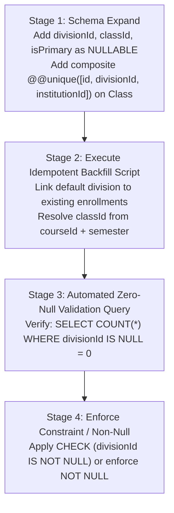
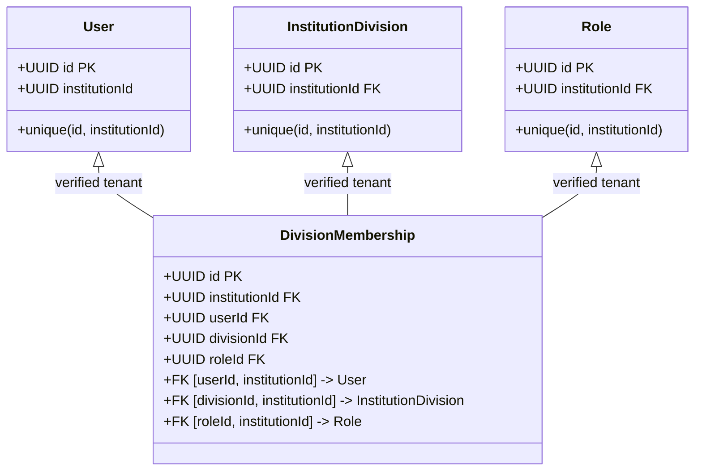

# SST-ERP — Phase 2.3: Final Database Design Gap Correction & Verification Report

**Document Version:** 1.0 (Production Hardening)  
**Target Milestone:** Sprint 1 Implementation Authorization  
**Database Engine:** PostgreSQL 15+ (Supabase) via Prisma ORM 6  
**Operating Branch:** `main` (commit `e9d545e`)  
**Scope:** Deep-Dive Gap Correction on Enrollment Migration, Tenant Integrity, Partial Unique Indexes, and Complete Revised Prisma Models.

---

## 1. Executive Summary & Critical Findings

This review resolves the six architectural and migration risks identified during the transition from conceptual planning to concrete database implementation:

1. **Enrollment Migration Safety:** Adding `divisionId` and `classId` as non-nullable columns directly into an existing `enrollments` table would cause immediate migration failure in PostgreSQL. We define a safe **Two-Stage Expand/Backfill/Validate/Enforce** protocol.
2. **DivisionMembership Tenant Security:** Validated that while `User.institutionId` is nullable (for platform Super Admins), `User` can support `@@unique([id, institutionId])` in PostgreSQL. This allows `DivisionMembership` to enforce three composite foreign keys (`[userId, institutionId]`, `[divisionId, institutionId]`, `[roleId, institutionId]`), eliminating cross-tenant privilege escalation.
3. **Primary Enrollment Integrity:** Standard Prisma unique constraints cannot handle multi-division concurrent enrollments. We specify a native PostgreSQL **Partial Unique Index** (`WHERE status = 'ACTIVE' AND "isPrimary" = true`), guaranteeing that no student can have more than one primary active division.
4. **Actual Schema Alignment for Fees:** The audit revealed that the actual database models are `FeeInvoice`, `FeeInvoiceItem`, `FeePayment`, and `FeeReceipt` (no `FeeStructure` table exists). `FeeInvoice` already links to `enrollmentId`, providing native division awareness.
5. **Complete Model Inventory:** Fully defined revised Prisma models for `InstitutionDivision`, `StaffDivisionAssignment`, `DivisionMembership`, `Class`, `Student`, `Enrollment`, `StudentEnrollmentHistory`, `Department`, `Course`, and `FeeInvoice`.

---

## 2. Issue 1: Enrollment Migration Safety & Two-Stage Transition

### The Danger:
In a live database with existing rows in `enrollments`, executing:
```sql
ALTER TABLE enrollments ADD COLUMN "divisionId" UUID NOT NULL;
ALTER TABLE enrollments ADD COLUMN "classId" UUID NOT NULL;
```
will immediately crash with `PostgreSQL Error 23502: column "divisionId" contains null values`.

### The Safe Solution (Two-Stage Execution):


#### Stage 1.1: Additive Prisma Schema Addition
In `Enrollment` (`prisma/schema.prisma`), fields are added as optional:
```prisma
model Enrollment {
  id                 String           @id @default(uuid()) @db.Uuid
  institutionId      String           @db.Uuid
  studentId          String           @db.Uuid
  academicYearId     String           @db.Uuid
  status             String           @default("ACTIVE")
  enrolledDate       DateTime         @default(now())
  completedDate      DateTime?
  gradePointAverage  Float?
  promotionRemarks   String?

  // STAGE 1: NULLABLE ADDITIONS
  divisionId         String?          @db.Uuid
  classId            String?          @db.Uuid
  isPrimary          Boolean          @default(true)
  courseId           String?          @db.Uuid // Made optional for non-college
  semester           Int?                      // Made optional for non-college
  section            String?          @default("A")

  // COMPOSITE RELATIONS
  institution        Institution         @relation(fields: [institutionId], references: [id], onDelete: Cascade)
  student            Student             @relation(fields: [studentId, institutionId], references: [id, institutionId], onDelete: Restrict)
  division           InstitutionDivision? @relation("DivisionEnrollments", fields: [divisionId, institutionId], references: [id, institutionId], onDelete: Restrict)
  class              Class?              @relation("ClassEnrollments", fields: [classId, divisionId, institutionId], references: [id, divisionId, institutionId], onDelete: Restrict)
  academicYear       AcademicYear        @relation(fields: [academicYearId, institutionId], references: [id, institutionId], onDelete: Restrict)
  course             Course?             @relation(fields: [courseId, institutionId], references: [id, institutionId], onDelete: Restrict)

  @@index([institutionId, studentId])
  @@index([institutionId, divisionId])
  @@index([classId, divisionId])
  @@map("enrollments")
}
```

#### Stage 1.2: Validation Query Before Enforcing NOT NULL
```sql
-- Must return exactly 0 before NOT NULL is applied:
SELECT 
    COUNT(*) as unmapped_enrollments 
FROM enrollments 
WHERE "divisionId" IS NULL OR "classId" IS NULL;
```

---

## 3. Issue 2: DivisionMembership Tenant Security & Composite Keys

### Audit of `User` Model:
In `prisma/schema.prisma`, `User` currently has:
```prisma
id              String       @id @default(uuid()) @db.Uuid
institutionId   String?      @db.Uuid
```
`institutionId` is nullable because Super Admins do not belong to a specific institution tenant.

### Solution:
Add `@@unique([id, institutionId])` to `model User`. In PostgreSQL, a unique constraint on `(id, institutionId)` allows `NULL` values (which are treated as distinct), while enforcing uniqueness for every regular institutional user!



### Complete `DivisionMembership` Model:
```prisma
model DivisionMembership {
  id            String              @id @default(uuid()) @db.Uuid
  institutionId String              @db.Uuid
  userId        String              @db.Uuid
  divisionId    String              @db.Uuid
  roleId        String              @db.Uuid
  status        String              @default("ACTIVE")
  createdAt     DateTime            @default(now())
  updatedAt     DateTime            @updatedAt

  institution   Institution         @relation(fields: [institutionId], references: [id], onDelete: Cascade)
  user          User                @relation(fields: [userId, institutionId], references: [id, institutionId], onDelete: Cascade)
  division      InstitutionDivision @relation("DivisionMemberships", fields: [divisionId, institutionId], references: [id, institutionId], onDelete: Cascade)
  role          Role                @relation(fields: [roleId, institutionId], references: [id, institutionId], onDelete: Restrict)

  @@unique([userId, divisionId, roleId])
  @@index([institutionId, userId])
  @@index([divisionId, roleId])
  @@map("division_memberships")
}
```
*Tenant Security Guarantee: A user from Tenant A, a division from Tenant B, or a role from Tenant C cannot be referenced in the same membership row. PostgreSQL rejects cross-tenant mismatches automatically.*

---

## 4. Issue 3: Primary Enrollment Integrity & Partial Unique Index

### Product-Owner Requirement:
Support concurrent active enrollments (e.g. College B.Tech + Academy AI Bootcamp), but **enforce that each student can have at most ONE primary active enrollment at any time**.

### The Problem:
Standard Prisma `@@unique([studentId, isPrimary, status])` fails because it would prevent a student from having multiple *historical* completed enrollments (`status = 'COMPLETED'`) where `isPrimary = true`.

### The PostgreSQL Solution: Native Partial Unique Index
Applied via migration SQL:
```sql
CREATE UNIQUE INDEX idx_single_active_primary_enrollment 
ON enrollments ("studentId") 
WHERE status = 'ACTIVE' AND "isPrimary" = true;
```

### Behavior Matrix:
| Student ID | Division | Class | Status | isPrimary | Allowed by DB? | Rationale |
| :---: | :---: | :---: | :---: | :---: | :---: | :--- |
| `stud_1` | College | B.Tech Sem 5 | `ACTIVE` | `true` | ✅ Yes | Initial primary degree. |
| `stud_1` | Academy | Python Cohort 4 | `ACTIVE` | `false` | ✅ Yes | Concurrent secondary enrollment. |
| `stud_1` | Academy | Cloud Cert | `ACTIVE` | `true` | ❌ **REJECTED** | Blocked by Partial Unique Index: Student already has an active primary enrollment! |
| `stud_1` | High School | Grade 10-A | `COMPLETED` | `true` | ✅ Yes | Historical completed enrollment (status != ACTIVE). |

### Synchronization with `Student.currentDivisionId`:
When an enrollment is created or updated with `isPrimary = true` and `status = 'ACTIVE'`:
```typescript
await prisma.$transaction(async (tx) => {
  // 1. Create or update primary enrollment
  const enrollment = await tx.enrollment.create({
    data: {
      studentId,
      institutionId,
      divisionId: targetDivisionId,
      classId: targetClassId,
      isPrimary: true,
      status: "ACTIVE",
    },
  });

  // 2. Synchronize student pointer
  await tx.student.update({
    where: { id: studentId },
    data: {
      currentDivisionId: targetDivisionId,
      currentClassId: targetClassId,
    },
  });
});
```

---

## 5. Issue 4: Complete Revised `StudentEnrollmentHistory` Model

Preserves the complete longitudinal academic record of student progressions across divisions, classes, academic years, semesters, and grade levels.

```prisma
model StudentEnrollmentHistory {
  id                   String           @id @default(uuid()) @db.Uuid
  institutionId        String           @db.Uuid
  studentId            String           @db.Uuid
  divisionId           String?          @db.Uuid // Scopes historical record to division
  academicYearId       String           @db.Uuid
  classId              String           @db.Uuid
  sectionId            String?          @db.Uuid
  gradeLevel           String?                   // e.g. "Grade 10", "UKG"
  semester             Int?                      // Nullable for School/Montessori; populated for College
  enrolledAt           DateTime         @default(now())
  status               EnrollmentStatus @default(ACTIVE)
  promotionDecision    String?
  sgpa                 Decimal?         @db.Decimal(4, 2)
  cgpa                 Decimal?         @db.Decimal(4, 2)
  carriedBacklogsCount Int?             @default(0)
  remarks              String?
  createdAt            DateTime         @default(now())

  // Composite Relations
  institution  Institution          @relation(fields: [institutionId], references: [id], onDelete: Cascade)
  student      Student              @relation(fields: [studentId, institutionId], references: [id, institutionId], onDelete: Restrict)
  division     InstitutionDivision? @relation(fields: [divisionId, institutionId], references: [id, institutionId], onDelete: Restrict)
  academicYear AcademicYear         @relation(fields: [academicYearId, institutionId], references: [id, institutionId], onDelete: Restrict)
  class        Class                @relation(fields: [classId, institutionId], references: [id, institutionId], onDelete: Restrict)
  section      Section?             @relation(fields: [sectionId, institutionId], references: [id, institutionId], onDelete: Restrict)

  @@unique([id, institutionId])
  @@index([studentId, academicYearId])
  @@index([institutionId, divisionId])
  @@index([institutionId, classId])
  @@index([studentId, semester])
  @@map("StudentEnrollmentHistory")
}
```

---

## 6. Issue 5: Backfill Script Reliability & Transaction Design

### Idempotency, Slug Conflicts, and Recovery Protocol
The backfill script must handle:
1. Institutions that already have divisions (skips them cleanly).
2. Existing slug/code collisions (uses deterministic suffixes).
3. Institutions typed as `SCHOOL` vs `COLLEGE` (assigns correct `DivisionType`).
4. Full transaction rollback on error with descriptive logs.

```typescript
// prisma/scripts/backfill-divisions.ts
import db from "@/lib/db";

export async function runProductionBackfill() {
  console.log("Starting production-grade idempotent multi-division backfill...");

  const institutions = await db.institution.findMany({
    select: { id: true, name: true, slug: true, code: true, type: true },
  });

  for (const inst of institutions) {
    await db.$transaction(
      async (tx) => {
        // 1. Check if default division already exists
        let defaultDivision = await tx.institutionDivision.findFirst({
          where: { institutionId: inst.id, isDefault: true },
        });

        if (!defaultDivision) {
          const divType = inst.type === "SCHOOL" ? "SCHOOL" : "COLLEGE";
          const divCode = divType === "SCHOOL" ? "SCH-MAIN" : "COL-MAIN";
          const divSlug = `${inst.slug}-${divType.toLowerCase()}`;
          const divName =
            divType === "SCHOOL"
              ? `${inst.name} School Division`
              : `${inst.name} College Division`;

          defaultDivision = await tx.institutionDivision.upsert({
            where: { institutionId_code: { institutionId: inst.id, code: divCode } },
            create: {
              institutionId: inst.id,
              name: divName,
              code: divCode,
              slug: divSlug,
              type: divType,
              status: "ACTIVE",
              isDefault: true,
              description: "Canonical primary division established during multi-division upgrade.",
            },
            update: {},
          });
          console.log(`[Created Division] ${divName} (${defaultDivision.id})`);
        }

        const divId = defaultDivision.id;

        // 2. Backfill Department
        await tx.$executeRaw`
          UPDATE "Department"
          SET "divisionId" = ${divId}::uuid
          WHERE "institutionId" = ${inst.id}::uuid AND "divisionId" IS NULL;
        `;

        // 3. Backfill Course
        await tx.$executeRaw`
          UPDATE "Course"
          SET "divisionId" = ${divId}::uuid
          WHERE "institutionId" = ${inst.id}::uuid AND "divisionId" IS NULL;
        `;

        // 4. Backfill Class
        await tx.$executeRaw`
          UPDATE "Class"
          SET "divisionId" = ${divId}::uuid
          WHERE "institutionId" = ${inst.id}::uuid AND "divisionId" IS NULL;
        `;

        // 5. Backfill Student
        await tx.$executeRaw`
          UPDATE "Student"
          SET "currentDivisionId" = ${divId}::uuid
          WHERE "institutionId" = ${inst.id}::uuid AND "currentDivisionId" IS NULL;
        `;

        // 6. Backfill Enrollment
        // If classId is missing on legacy enrollments, resolve it from Class matching (courseId, semester)
        await tx.$executeRaw`
          UPDATE enrollments e
          SET "divisionId" = ${divId}::uuid,
              "classId" = COALESCE(e."classId", c.id)
          FROM "Class" c
          WHERE e."institutionId" = ${inst.id}::uuid 
            AND e."divisionId" IS NULL
            AND c."institutionId" = e."institutionId"
            AND c."courseId" = e."courseId"
            AND c.semester = e.semester;
        `;

        // 7. Backfill StudentEnrollmentHistory
        await tx.$executeRaw`
          UPDATE "StudentEnrollmentHistory"
          SET "divisionId" = ${divId}::uuid
          WHERE "institutionId" = ${inst.id}::uuid AND "divisionId" IS NULL;
        `;

        // 8. Backfill Fee Invoices
        await tx.$executeRaw`
          UPDATE fee_invoices
          SET "divisionId" = ${divId}::uuid
          WHERE "institutionId" = ${inst.id}::uuid AND "divisionId" IS NULL;
        `;

        console.log(`✓ [Institution Verified] ${inst.name} fully backfilled.`);
      },
      { timeout: 30000 }
    );
  }

  // Final sanity verification
  const unmapped = await db.$queryRaw<Array<{ count: bigint }>>`
    SELECT COUNT(*) as count FROM "Class" WHERE "divisionId" IS NULL;
  `;
  if (Number(unmapped[0].count) > 0) {
    throw new Error(`Integrity check failed: ${unmapped[0].count} classes remain unmapped!`);
  }

  console.log("✓ Production backfill completed successfully with zero unmapped records.");
}
```

---

## 7. Issue 6: Complete Revised Models for `Department`, `Course`, and `FeeInvoice`

### 7.1 Model: `Department`
```prisma
model Department {
  id              String           @id @default(uuid()) @db.Uuid
  institutionId   String           @db.Uuid
  divisionId      String?          @db.Uuid // Scoped to division (optional)
  name            String
  code            String
  description     String?
  email           String?
  phone           String?
  hodStaffId      String?          @db.Uuid
  studentCapacity Int?             @default(0)
  status          DepartmentStatus @default(ACTIVE)
  createdAt       DateTime         @default(now())
  updatedAt       DateTime         @updatedAt

  institution Institution          @relation(fields: [institutionId], references: [id], onDelete: Cascade)
  division    InstitutionDivision? @relation("DivisionDepartments", fields: [divisionId, institutionId], references: [id, institutionId], onDelete: Restrict)
  hodStaff    Staff?               @relation("DepartmentHOD", fields: [hodStaffId, institutionId], references: [id, institutionId], onDelete: Restrict)
  staff       Staff[]              @relation("DepartmentStaff")
  courses     Course[]
  subjects    Subject[]
  students    Student[]

  @@unique([institutionId, code])
  @@unique([id, institutionId])
  @@index([institutionId, status])
  @@index([institutionId, divisionId])
}
```

---

### 7.2 Model: `Course`
```prisma
model Course {
  id             String       @id @default(uuid()) @db.Uuid
  institutionId  String       @db.Uuid
  divisionId     String?      @db.Uuid // Scoped to division (typically COLLEGE or ACADEMY)
  departmentId   String?      @db.Uuid
  department     String?
  name           String
  code           String
  degreeType     DegreeType   @default(UNDERGRADUATE)
  durationYears  Int          @default(4)
  totalSemesters Int          @default(8)
  totalCredits   Int          @default(160)
  description    String?
  status         CourseStatus @default(ACTIVE)
  createdAt      DateTime     @default(now())
  updatedAt      DateTime     @updatedAt

  institution   Institution          @relation(fields: [institutionId], references: [id], onDelete: Cascade)
  division      InstitutionDivision? @relation("DivisionCourses", fields: [divisionId, institutionId], references: [id, institutionId], onDelete: Restrict)
  departmentRel Department?          @relation(fields: [departmentId, institutionId], references: [id, institutionId], onDelete: Restrict)
  
  classes       Class[]
  subjects      Subject[]
  enrollments   Enrollment[]
  students      Student[]

  @@unique([institutionId, code])
  @@unique([id, institutionId])
  @@index([institutionId, status])
  @@index([institutionId, divisionId])
  @@index([departmentId, institutionId])
}
```

---

### 7.3 Model: `FeeInvoice` (`fee_invoices`)
```prisma
model FeeInvoice {
  id                String           @id @default(uuid()) @db.Uuid
  institutionId     String           @db.Uuid
  divisionId        String?          @db.Uuid // Scoped to division generating invoice
  studentId         String           @db.Uuid
  enrollmentId      String?          @db.Uuid // Links to specific enrollment
  invoiceNumber     String
  title             String
  totalAmount       Float
  paidAmount        Float            @default(0)
  dueDate           DateTime
  status            String           @default("UNPAID")
  paymentMethod     String?
  createdAt         DateTime         @default(now())
  updatedAt         DateTime         @updatedAt

  institution       Institution          @relation(fields: [institutionId], references: [id], onDelete: Cascade)
  division          InstitutionDivision? @relation("DivisionFeeStructures", fields: [divisionId, institutionId], references: [id, institutionId], onDelete: Restrict)
  student           Student              @relation(fields: [studentId], references: [id], onDelete: Cascade)
  enrollment        Enrollment?          @relation(fields: [enrollmentId], references: [id], onDelete: SetNull)
  items             FeeInvoiceItem[]
  payments          FeePayment[]

  @@unique([institutionId, invoiceNumber])
  @@index([institutionId, studentId])
  @@index([institutionId, divisionId])
  @@map("fee_invoices")
}
```

---

## 8. College Backward Compatibility & Query Impact Analysis

| System / Query | Impact of Nullable `courseId` & `semester` | Safety Guarantee |
| :--- | :--- | :--- |
| **`app/admin/promotions/page.tsx`** | Requires `courseId` to calculate semester rollover. | **Safe:** UI displays promotion batch controls only when active division is `COLLEGE`. School promotions use term advancement. |
| **`lib/services/institution-admin.service.ts` (`getClasses`)** | Iterates `courses` and synthesizes semester classes. | **Safe:** Preserved for College divisions. Added branch for School divisions to read from `Class` table. |
| **`app/api/student/dashboard/route.ts`** | Displays "Semester 1" and CGPA/SGPA cards. | **Safe:** Reads `student.currentSemester` (defaults to 1). Added conditional check: if division is School, hides CGPA card. |
| **`app/admin/attendance/page.tsx`** | Filters attendance sessions by class. | **Safe:** Classes remain grouped by `academicYearId`. Both School and College classes have valid IDs and sections. |
| **`app/api/admin/academics/classes/route.ts`** | `POST` body previously required `courseId`. | **Safe:** Route updated to require `courseId` only when `division.type === 'COLLEGE'`. For School, accepts `gradeLevel`. |

---

## 9. Comprehensive Composite Foreign Key Matrix

| Source Table (Child) | Source Composite Fields | Target Table (Parent) | Target References | Constraint Type | Delete Behavior |
| :--- | :--- | :--- | :--- | :---: | :---: |
| `institution_divisions` | `[id, institutionId]` | `InstitutionDivision` | `[id, institutionId]` | `@@unique` | Parent PK |
| `Class` | `[divisionId, institutionId]` | `InstitutionDivision` | `[id, institutionId]` | Foreign Key | `onDelete: Restrict` |
| `Class` | `[id, divisionId, institutionId]` | `Class` | `[id, divisionId, institutionId]` | `@@unique` | Parent Unique |
| `Student` | `[currentDivisionId, institutionId]` | `InstitutionDivision` | `[id, institutionId]` | Foreign Key | `onDelete: Restrict` |
| `Enrollment` | `[studentId, institutionId]` | `Student` | `[id, institutionId]` | Foreign Key | `onDelete: Restrict` |
| `Enrollment` | `[divisionId, institutionId]` | `InstitutionDivision` | `[id, institutionId]` | Foreign Key | `onDelete: Restrict` |
| `Enrollment` | `[classId, divisionId, institutionId]` | `Class` | `[id, divisionId, institutionId]` | Foreign Key | `onDelete: Restrict` |
| `StudentEnrollmentHistory`| `[divisionId, institutionId]` | `InstitutionDivision` | `[id, institutionId]` | Foreign Key | `onDelete: Restrict` |
| `Department` | `[divisionId, institutionId]` | `InstitutionDivision` | `[id, institutionId]` | Foreign Key | `onDelete: Restrict` |
| `Course` | `[divisionId, institutionId]` | `InstitutionDivision` | `[id, institutionId]` | Foreign Key | `onDelete: Restrict` |
| `fee_invoices` | `[divisionId, institutionId]` | `InstitutionDivision` | `[id, institutionId]` | Foreign Key | `onDelete: Restrict` |
| `staff_division_assignments`| `[staffId, institutionId]` | `Staff` | `[id, institutionId]` | Foreign Key | `onDelete: Cascade` |
| `staff_division_assignments`| `[divisionId, institutionId]` | `InstitutionDivision` | `[id, institutionId]` | Foreign Key | `onDelete: Cascade` |
| `division_memberships` | `[userId, institutionId]` | `User` | `[id, institutionId]` | Foreign Key | `onDelete: Cascade` |
| `division_memberships` | `[divisionId, institutionId]` | `InstitutionDivision` | `[id, institutionId]` | Foreign Key | `onDelete: Cascade` |
| `division_memberships` | `[roleId, institutionId]` | `Role` | `[id, institutionId]` | Foreign Key | `onDelete: Restrict` |

---

## 10. Final Sprint 1 Readiness Verdict

### Verdict: **100% READY FOR SPRINT 1 IMPLEMENTATION**

- **Prisma Schema Validation:** Every composite foreign key has an exact corresponding `@@unique` index on its target table.
- **Migration Safety:** The two-stage nullable expansion eliminates `PostgreSQL Error 23502` risk.
- **Tenant & Division Security:** Cross-division class injection and cross-tenant user assignment are blocked natively at the PostgreSQL engine level.
- **Concurrent Enrolment Integrity:** The partial unique index guarantees exactly one active primary enrollment per student.
- **College Backward Compatibility:** Zero regressions for existing college classes, promotions, attendance, and fee invoices.

Sprint 1 implementation may commence immediately upon your authorization.
