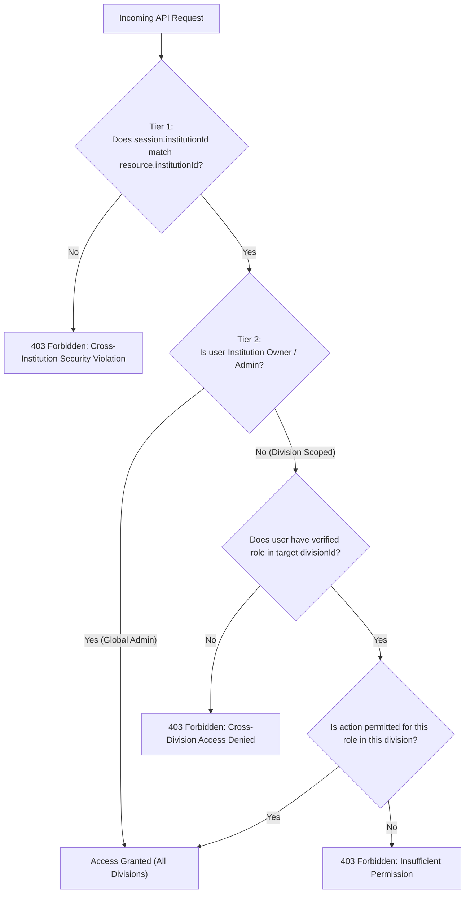

# SST-ERP — Phase 2: Multi-Division Role & Access Control Matrix (RBAC)

**Document Version:** 1.0  
**Phase:** Phase 2 Technical Planning (Security Specification)  
**Target Audience:** Single-Developer Full-Stack Implementation Workflow  
**Security Boundary:** Multi-Tenant Isolation with Two-Tier Division Scoping  

---

## 1. Access Control Architecture & Principles

The security model operates on a **Two-Tier Hierarchical RBAC** architecture:
1. **Tier 1 (Institution Level):** The root tenant boundary (`institutionId`). Enforces total data isolation between different institutions/trusts. Under no circumstances can a user cross this boundary.
2. **Tier 2 (Division Level):** Scoped educational boundaries (`divisionId`) within the same institution. Restricts academic records, classes, and marks to authorized divisions.



---

## 2. Multi-Division Access Control Matrix

| Role | Scope | Institution-Level Permissions | Division-Level Permissions | Student Data Access | Staff Data Access | Administrative Rights |
| :--- | :---: | :--- | :--- | :--- | :--- | :--- |
| **Super Admin** | Platform | Global platform administration across all tenants. | Full access across all institutions & divisions. | Platform-level inspection only (no operational edits). | Platform user management. | Platform config, tenant creation, billing plans. |
| **Institution Owner / Trust Admin** | Institution | Full ownership of root tenant. Manage billing, domains, global settings. | Read & write access across **all** divisions. | View and aggregate student data across all divisions. | View all staff across all divisions. | Full administrative rights over all divisions and divisions creation. |
| **Institution Admin** | Institution | Day-to-day institution management. Settings, operational defaults. | Read & write access across **all** divisions. | Manage student records across all divisions. | Manage staff records across all divisions. | Configure all divisions, academic years, campus services. |
| **Division Admin (e.g. Principal / Dean)** | Division | Read-only view of shared campus facilities (Hostel, Transport). | Full administrative control **strictly within assigned division(s)**. | Manage students in **own division only**. Cross-division access strictly blocked. | Manage teachers and timetable in **own division only**. | Configure classes, sections, exams, grading within **own division**. |
| **Teacher / Faculty** | Division / Class | Zero institution-level administrative access. | Access restricted to assigned classes, sections, and subjects. | View students & record attendance/marks for **assigned classes only**. | Read-only directory of peers in the same division. | Grade submission, attendance recording, homework upload. |
| **Staff (Non-Teaching)** | Division / Facility | Access to assigned facility module (e.g., Gate, Hostel, Library). | Operational access to facility module within assigned division. | View relevant student profile info (e.g., RFID, room number). | None. | Process check-ins, book issues, fee counter receipts. |
| **Student** | Personal | Zero administrative access. Access to shared student amenities. | View personal enrolled academic records in **current division**. | Strict IDOR: Can view **only own** grades, attendance, and timetable. | View names of assigned class teachers only. | View syllabus, submit assignments, pay fees, raise grievances. |
| **Parent / Guardian** | Personal / Ward | Zero administrative access. | View academic records of verified wards in their respective divisions. | Strict IDOR: Can view **only verified wards'** records. | View contact details of ward's class teacher only. | View ward progress, pay ward fees, submit leave requests. |

---

## 3. Multi-Division User Assignment Scenarios

### Scenario A: Staff Teaching Across Multiple Divisions
- **User:** Priya Sharma (ID: `usr_priya`)
- **Assignments:**
  - Division A (High School): `role = "TEACHER"`, classes: `Grade 9 Physics`, `Grade 10 Physics`.
  - Division B (College): `role = "TEACHER"`, classes: `B.Tech Semester 1 Applied Physics`.
- **Enforcement:**
  - When accessing `/api/campus/apex/school/marks`, backend checks `division_memberships` for Division A.
  - When accessing `/api/campus/apex/college/marks`, backend checks `division_memberships` for Division B.
  - If Priya attempts to access High School Biology or College Mechanical Engineering marks, access is denied.

### Scenario B: Administrator with Multiple Scoped Portals
- **User:** Dr. Anand Rao (ID: `usr_anand`)
- **Assignments:**
  - Division 1 (High School): `role = "DIVISION_ADMIN"` (Principal of High School).
  - Division 2 (Montessori): `role = "DIVISION_ADMIN"` (Director of Early Childhood).
  - Division 3 (College): `No Membership`.
- **Enforcement:**
  - Dr. Anand can access High School and Montessori administration portals via the header Division Switcher.
  - If Dr. Anand attempts to navigate to `/admin/academics/courses` (College degrees) or query College examination results, the server throws `403 Forbidden: Cross-Division Access Denied`.

### Scenario C: Parent with Children in Different Divisions
- **User:** Sunita Patel (ID: `usr_sunita`)
- **Assignments:**
  - Child 1: Aarav Patel (Enrolled in Montessori Primary Group).
  - Child 2: Riya Patel (Enrolled in Grade 8 High School).
- **Enforcement:**
  - Parent portal header renders a **Child Switcher**.
  - Selecting Aarav loads Montessori developmental milestones and daily activity logs.
  - Selecting Riya loads Grade 8 timetable, subject marks, and report cards.
  - Both children belong to `inst_apex`, so only one parent account and login is required.

---

## 4. Server-Side Enforcement Architecture

To guarantee security, division access control is **never trusted from client-side state or URLs**. It is validated cryptographically on the server.

### 4.1 Enhanced Context Resolution Function (`lib/security/admin-auth.ts`)
```typescript
export interface ResolvedDivisionContext extends ResolvedAdminContext {
  activeDivisionId?: string;
  activeDivisionType?: DivisionType;
  isInstitutionWideAdmin: boolean;
  permittedDivisionIds: string[];
}

export async function resolveDivisionContext(
  req: NextRequest,
  requestedDivisionId?: string
): Promise<ResolvedDivisionContext> {
  const adminContext = await resolveAdminContext(req);
  const userId = adminContext.userId!;
  const institutionId = adminContext.institutionId;

  // 1. Check if user is Institution Owner or Global Institution Admin
  const isGlobalAdmin = ["ADMIN", "INSTITUTION_ADMIN", "SUPER_ADMIN"].includes(
    adminContext.userRole.toUpperCase()
  );

  if (isGlobalAdmin) {
    // Global admins have access to all divisions under this institution
    const allDivisions = await db.institutionDivision.findMany({
      where: { institutionId, status: "ACTIVE" },
      select: { id: true },
    });
    const permittedIds = allDivisions.map((d) => d.id);
    const activeDivId = requestedDivisionId || permittedIds[0];

    return {
      ...adminContext,
      activeDivisionId: activeDivId,
      isInstitutionWideAdmin: true,
      permittedDivisionIds: permittedIds,
    };
  }

  // 2. For Division-scoped users, resolve verified division memberships
  const memberships = await db.divisionMembership.findMany({
    where: {
      userId,
      institutionId,
      status: "ACTIVE",
    },
    select: { divisionId: true, roleCode: true },
  });

  const permittedIds = memberships.map((m) => m.divisionId);

  if (permittedIds.length === 0) {
    throw new ForbiddenError("Access denied: You have no active division assignments in this institution.");
  }

  // 3. Verify requested division is strictly within permitted IDs
  const targetDivisionId = requestedDivisionId || permittedIds[0];
  if (!permittedIds.includes(targetDivisionId)) {
    throw new ForbiddenError("Security Violation: You are not authorized to access this educational division.");
  }

  return {
    ...adminContext,
    activeDivisionId: targetDivisionId,
    isInstitutionWideAdmin: false,
    permittedDivisionIds: permittedIds,
  };
}
```

### 4.2 Guarding Data Mutations (`assertDivisionTenant`)
```typescript
export function assertDivisionTenant(
  context: ResolvedDivisionContext,
  resourceDivisionId: string | null | undefined
) {
  if (!resourceDivisionId) return; // Unscoped or shared resource

  if (context.isInstitutionWideAdmin) {
    // Permitted if resource belongs to same institution
    return;
  }

  if (!context.permittedDivisionIds.includes(resourceDivisionId)) {
    throw new ForbiddenError("IDOR protection: Resource belongs to an unauthorized educational division.");
  }
}
```

---

## 5. Summary of Cross-Division Protection Guarantees

1. **No URL Manipulation:** Typing a different division ID or slug into the browser URL triggers server validation. If the authenticated session lacks a verified record in `division_memberships`, the request immediately aborts with `403 Forbidden`.
2. **Database Level Isolation:** All division-level mutations enforce `where: { institutionId, divisionId }`. Cross-tenant and cross-division tampering is impossible at the database query level.
3. **Session Signature Verification:** The user's password signature (`passwordSig`) is validated on every server mutation. Revoking a staff member's credentials immediately terminates their session across all divisions.
