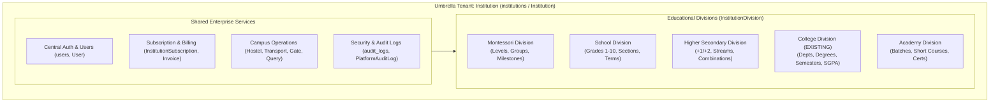
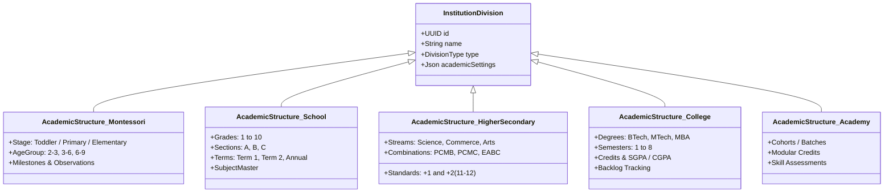

# SST-ERP — Phase 2: Multi-Division Database Design & Technical Specification

**Document Version:** 1.0  
**Phase:** Phase 2 Technical Planning (Design Only)  
**Target Audience:** Single-Developer Full-Stack Implementation Workflow  
**Database Engine:** PostgreSQL 15+ (Supabase) via Prisma ORM 6  
**Backward Compatibility Guarantee:** 100% preservation of existing College ERP, Student, Teacher, Parent, and Super Admin functionality.

---

## 1. Architectural Foundations & Strategy

### 1.1 Single-Developer Design Philosophy
To ensure long-term maintainability for a single developer, this architecture avoids over-engineering, unnecessary micro-tables, and polymorphic complexity. It uses an **Additive Single-Tenant, Multi-Division Core**:
- One root **Institution** remains the primary security and billing boundary.
- Multiple **Divisions** represent distinct educational units under that institution.
- Shared services (Identity, Auth, Billing, Gate, Transport, Hostel) remain at the Institution level.
- Academic operations (Grading, Timetable, Enrolments, Curricula) are scoped to an active **Division**.



---

## 2. Evaluation of Conceptual Entities & Reuse Decision Matrix

| Conceptual Entity | Strategy | Reused Model | New Model Required | Technical Justification |
| :--- | :---: | :---: | :---: | :--- |
| **InstitutionDivision** | **NEW** | N/A | `InstitutionDivision` | No entity currently represents divisions. A dedicated table provides clean foreign key scoping, division types, and branding without mutating the parent tenant. |
| **DivisionAcademicConfiguration** | **REUSE / EXTEND** | `PlatformSetting` / JSON on `InstitutionDivision` | No separate table | A dedicated table for configuration introduces unnecessary joins. A structured `academicSettings Json?` field directly on `InstitutionDivision` allows flexible division-specific rules (e.g. grading scales, attendance thresholds). |
| **UserDivisionAssignment** | **NEW** | `InstitutionMembership` (Platform) | `DivisionMembership` (ERP) | A user (e.g. Principal or Teacher) needs distinct roles in different divisions. `InstitutionMembership` has a hard `@@unique([userId, institutionId])` that cannot support division-scoped permissions without breaking. |
| **StudentDivisionEnrolment** | **REUSE & ENHANCE** | `Student`, `Enrollment`, `StudentEnrollmentHistory` | None | Creating a separate student table would fragment identity and fees. Instead, add optional `divisionId` to `Student` and `Enrollment`, allowing historical transitions between divisions. |
| **StaffDivisionAssignment** | **NEW** | `Staff` (Core ERP) | `StaffDivisionAssignment` | `Staff` currently enforces a single `departmentId` and single `institutionId`. A light junction table allows a single teacher to teach in both School and College divisions. |

---

## 3. Concrete Prisma Schema Specification (Additive & Non-Breaking)

### 3.1 New Enum: `DivisionType`
```prisma
enum DivisionType {
  MONTESSORI       // Playgroup, Nursery, LKG, UKG, Early Childhood
  SCHOOL           // Grade 1 through Grade 10 (Primary & Secondary)
  HIGHER_SECONDARY // +1 and +2 / Grades 11-12 (PUC / Junior College)
  COLLEGE          // Higher Education (Undergrad, Postgrad, Doctoral)
  ACADEMY          // Professional Certifications, Executive, Vocational
}

enum DivisionStatus {
  ACTIVE
  INACTIVE
  ARCHIVED
}
```

---

### 3.2 New Model: `InstitutionDivision`
This model is the central anchor for all division-scoped academic records.

```prisma
model InstitutionDivision {
  id              String         @id @default(uuid()) @db.Uuid
  institutionId   String         @db.Uuid
  name            String         // e.g., "Apex High School Wing", "Apex College of Engineering"
  code            String         // e.g., "SCH", "ENG", "MONT", "PUC"
  slug            String         // e.g., "apex-school", "apex-engineering"
  type            DivisionType   @default(COLLEGE)
  status          DivisionStatus @default(ACTIVE)
  isDefault       Boolean        @default(false)
  description     String?
  logoUrl         String?
  academicSettings Json?         // Flexible rules: term vs semester, passing criteria, attendance rules
  createdAt       DateTime       @default(now())
  updatedAt       DateTime       @updatedAt

  // Relationships
  institution         Institution               @relation(fields: [institutionId], references: [id], onDelete: Cascade)
  departments         Department[]              @relation("DivisionDepartments")
  classes             Class[]                   @relation("DivisionClasses")
  courses             Course[]                  @relation("DivisionCourses")
  students            Student[]                 @relation("DivisionStudents")
  enrollments         Enrollment[]              @relation("DivisionEnrollments")
  staffAssignments    StaffDivisionAssignment[] @relation("DivisionStaffAssignments")
  divisionMemberships DivisionMembership[]      @relation("DivisionMemberships")
  feeStructures       FeeStructure[]            @relation("DivisionFeeStructures")

  @@unique([institutionId, code])
  @@unique([institutionId, slug])
  @@unique([id, institutionId]) // Required for composite foreign key integrity
  @@index([institutionId, status])
  @@index([institutionId, type])
  @@map("institution_divisions")
}
```

---

### 3.3 New Model: `StaffDivisionAssignment` (Cross-Division Faculty)
Allows one staff member to hold distinct designations, workloads, and permissions across multiple divisions, protected by composite tenant keys.

```prisma
model StaffDivisionAssignment {
  id              String   @id @default(uuid()) @db.Uuid
  institutionId   String   @db.Uuid
  staffId         String   @db.Uuid
  divisionId      String   @db.Uuid
  designation     String   // e.g. "Senior Science Teacher" in School, "Visiting Lecturer" in College
  isPrimary       Boolean  @default(false)
  status          String   @default("ACTIVE")
  createdAt       DateTime @default(now())
  updatedAt       DateTime @updatedAt

  institution Institution         @relation(fields: [institutionId], references: [id], onDelete: Cascade)
  // Composite foreign key guarantees staff and division belong to the same institution:
  staff       Staff               @relation(fields: [staffId, institutionId], references: [id, institutionId], onDelete: Cascade)
  division    InstitutionDivision @relation("DivisionStaffAssignments", fields: [divisionId, institutionId], references: [id, institutionId], onDelete: Cascade)

  @@unique([staffId, divisionId])
  @@index([institutionId, divisionId])
  @@map("staff_division_assignments")
}
```

---

### 3.4 New Model: `DivisionMembership` (Division-Scoped RBAC)
Allows users to have distinct administrative and operational roles scoped strictly to one division, linked to database-backed roles.

```prisma
model DivisionMembership {
  id              String   @id @default(uuid()) @db.Uuid
  institutionId   String   @db.Uuid
  userId          String   @db.Uuid
  divisionId      String   @db.Uuid
  roleId          String   @db.Uuid // Linked to Role model (reusing permissions)
  status          String   @default("ACTIVE")
  joinedAt        DateTime @default(now())
  createdAt       DateTime @default(now())
  updatedAt       DateTime @updatedAt

  institution Institution         @relation(fields: [institutionId], references: [id], onDelete: Cascade)
  user        User                @relation(fields: [userId], references: [id], onDelete: Cascade)
  division    InstitutionDivision @relation("DivisionMemberships", fields: [divisionId, institutionId], references: [id, institutionId], onDelete: Cascade)
  role        Role                @relation(fields: [roleId, institutionId], references: [id, institutionId], onDelete: Restrict)

  @@unique([userId, divisionId, roleId])
  @@index([institutionId, userId])
  @@index([divisionId, roleId])
  @@map("division_memberships")
}
```

---

## 4. Additive Enhancements to Existing Models (Non-Breaking)

Every modification to existing models is strictly **additive and nullable**, ensuring that 100% of existing College queries continue to run without error.

### 4.1 Model: `Class` (`classes` / `Class`)
**Problem in Phase 1:** `Class.courseId` and `Class.semester` were mandatory foreign keys. School, Montessori, and Academy classes do not have degree courses or semester numbers.  
**Additive Fix:**
- Add `divisionId String? @db.Uuid` (FK to `InstitutionDivision`).
- Add `gradeLevel String?` (e.g., "Grade 10", "UKG", "+2 Science").
- Make `courseId String? @db.Uuid` **nullable** (populated for College, null for School/Montessori).
- Make `semester Int?` **nullable** (populated for College, null for School/Montessori).
- Update unique index to include division: `@@index([institutionId, divisionId])`.

### 4.2 Model: `Department` (`departments` / `Department`)
- Add `divisionId String? @db.Uuid` (FK to `InstitutionDivision`).
- For College: Departments represent academic faculties (e.g. Mechanical, Computer Science).
- For School: Departments represent subject wings (e.g. Science Wing, Humanities, Primary Wing) or can be omitted if not required.

### 4.3 Model: `Student` (`students` / `Student`)
- Add `divisionId String? @db.Uuid` (FK to `InstitutionDivision`).
- Preserves existing `userId`, `admissionNumber`, `rollNumber`, and `institutionId`.
- When a student moves from School to College, their `divisionId` is updated to College, while historical records are permanently logged in `StudentEnrollmentHistory`.

### 4.4 Model: `Enrollment` (`enrollments`)
- Add `divisionId String? @db.Uuid` (FK to `InstitutionDivision`).
- Preserves historical trail of which division the student was enrolled in for any given academic year.

### 4.5 Model: `FeeStructure` (`fee_structures`)
- Add `divisionId String? @db.Uuid` (FK to `InstitutionDivision`).
- Allows tuition fees to be set specifically for School Grade 1-10 vs College B.Tech Semester 1-8 without cross-contamination.

---

## 5. Academic Subsystems by Educational Division



### 5.1 Montessori Division Architecture
- **Structure:** Developmental Stages (Toddler: 1.5–3 yrs, Primary: 3–6 yrs, Lower Elementary: 6–9 yrs).
- **Class Model Representation:** `Class` with `divisionId = MONTESSORI_ID`, `gradeLevel = "Primary 3-6"`, `courseId = null`, `semester = null`.
- **Assessment Model:** Montessori does not use numerical marks or SGPA. It uses qualitative developmental observations stored in `StudentComponentScore` or JSON progress records (`academicSettings`).

### 5.2 School Division Architecture (Grades 1–10)
- **Structure:** Standards / Grades (Grade 1 through Grade 10) subdivided into Sections (A, B, C).
- **Class Model Representation:** `Class` with `divisionId = SCHOOL_ID`, `gradeLevel = "Grade 10"`, `courseId = null`, `semester = null`.
- **Academic Periods:** Managed by `AcademicTerm` (`termType = "QUARTER" | "TERM_1" | "TERM_2" | "ANNUAL"`).
- **Assessment:** Theory and practical marks, percentage, and letter grades (A1, A2, B1, etc.) reusing `IAAssessment` and `StudentAssessmentMark`.

### 5.3 Higher Secondary Division Architecture (+1 and +2)
- **Structure:** 11th and 12th Grade divided by **Streams** (Science, Commerce, Arts/Humanities).
- **Class Model Representation:** `Class` with `divisionId = PUC_ID`, `gradeLevel = "Grade 11 Science"`, `stream = "SCIENCE"`.
- **Elective Combinations:** Reuses existing `FacultySubjectAssignment` and `Student` elective course mappings.

### 5.4 College Division Architecture (Existing Unchanged)
- **Structure:** Preserved 100% as currently deployed.
- **Class Model Representation:** `Class` with `divisionId = COLLEGE_ID`, `courseId = BTech_UUID`, `semester = 1..8`.
- **Assessment:** Exact SGPA/CGPA, credits, semester results, backlogs.

### 5.5 Academy Division Architecture (Short Courses & Certifications)
- **Structure:** Cohorts/Batches (e.g. "Spring 2027 Full Stack Cohort").
- **Class Model Representation:** `Class` with `divisionId = ACADEMY_ID`, `gradeLevel = "Cohort 12"`.
- **Completion:** Reuses `CertificateApplication` and `IssuedCertificate` with `CertificateType.COURSE_COMPLETION`.

---

## 6. Cascade, Deletion, and Data Integrity Rules

1. **Root Institution Cascade:**
   - Deleting an `Institution` cascades (`onDelete: Cascade`) to its `InstitutionDivision` records, which cascades to division-scoped classes and assignments.
2. **Division Deletion Safeguard (`Restrict`):**
   - An `InstitutionDivision` cannot be deleted if active students (`Student.divisionId`) or paid transactions (`FeeStructure.divisionId`) are associated with it. Soft deletion (`status = ARCHIVED`) must be enforced.
3. **Student Lifecycle Across Divisions:**
   - When a student graduates from School and enters Higher Secondary or College, the student record (`Student.id`) is updated to the new `divisionId`.
   - The historical completion in the prior division is permanently recorded in `StudentEnrollmentHistory` with `status = "COMPLETED"`.
4. **Staff Deletion Independence:**
   - Deleting a staff assignment (`StaffDivisionAssignment`) removes access to that specific division without deleting the staff member's core identity in `Staff` or `User`.

---

## 7. Performance & Indexing Strategy

To guarantee rapid queries for a single developer maintaining production databases:
1. **Composite Indexes for Multitenancy:**
   - `@@index([institutionId, divisionId])` on `Class`, `Student`, `Enrollment`, `FeeStructure`.
   - Prevents table scans when filtering data by active division.
2. **Slug and Code Lookups:**
   - `@@unique([institutionId, slug])` on `InstitutionDivision` allows zero-overhead routing (`/campus/:institutionSlug/:divisionSlug`).
3. **Partition-Free Simplicity:**
   - Table partitioning is not needed at this stage. Standard B-tree composite indexes on `(institutionId, divisionId)` can effortlessly support up to 500,000 student records on standard Supabase compute without performance degradation.
