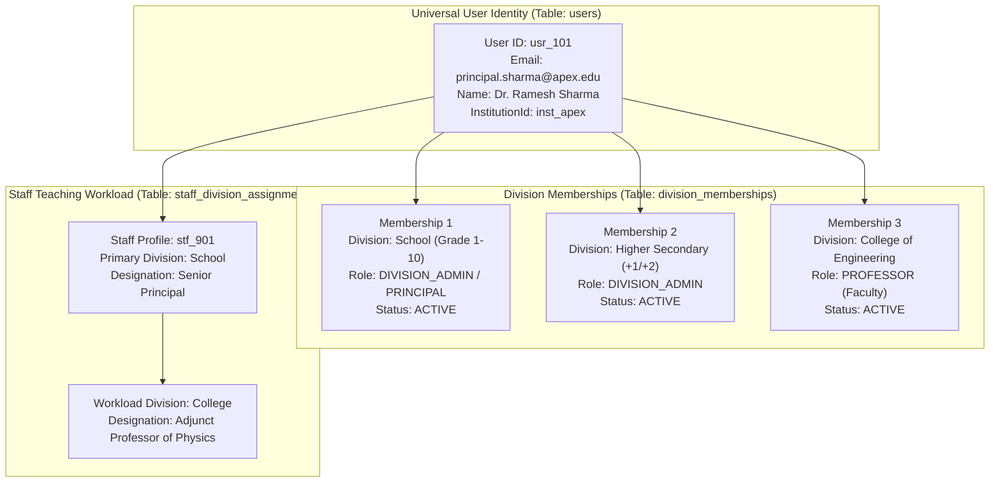
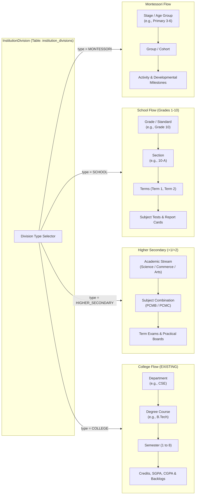
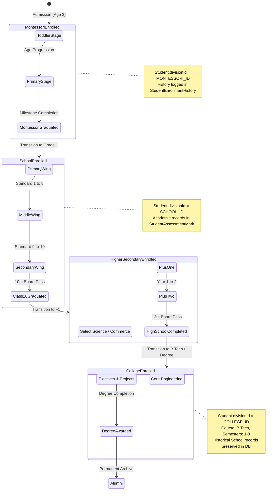
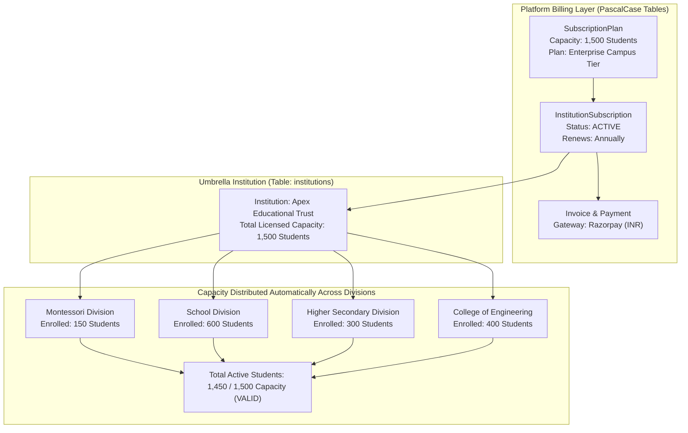

# SST-ERP — Phase 2: Multi-Division Architectural Entity-Relationship Diagrams

**Document Version:** 1.0  
**Phase:** Phase 2 Technical Planning (Visual Specification)  
**Target Audience:** Single-Developer Full-Stack Implementation Workflow  
**Specification Standard:** Mermaid GFM Syntax  

---

## 1. Master Multi-Division Entity-Relationship Diagram

This diagram displays the complete entity architecture, illustrating how multiple divisions exist under a single parent institution tenant without duplicating core identity or billing subsystems.

```mermaid
erDiagram
    %% Core Tenancy & Divisions
    institutions ||--o{ institution_divisions : "owns multiple"
    institutions ||--o{ users : "hosts"
    institutions ||--o{ academic_years : "schedules"
    institutions ||--o{ fee_structures : "bills"
    institutions ||--o{ CampusInOutLog : "monitors"
    institutions ||--o{ audit_logs : "records"

    %% Division Scoping
    institution_divisions ||--o{ Department : "scopes (optional)"
    institution_divisions ||--o{ Course : "scopes (college only)"
    institution_divisions ||--o{ Class : "groups"
    institution_divisions ||--o{ Student : "currently enrolls"
    institution_divisions ||--o{ enrollments : "tracks"
    institution_divisions ||--o{ staff_division_assignments : "assigns"
    institution_divisions ||--o{ division_memberships : "authorizes"
    institution_divisions ||--o{ fee_structures : "customizes"

    %% Identity & RBAC
    users ||--o| Student : "identifies (1:1)"
    users ||--o| Staff : "identifies (1:1)"
    users ||--o| teachers : "legacy link (1:1)"
    users ||--o{ division_memberships : "holds roles in"

    %% Staff Cross-Division
    Staff ||--o{ staff_division_assignments : "serves in"
    Staff ||--o{ FacultySubjectAssignment : "teaches"
    Staff ||--o{ TimetableSlot : "conducts"
    Staff ||--o{ Section : "heads (class teacher)"

    %% Academic Hierarchy
    Department ||--o{ Course : "offers"
    Course ||--o{ Class : "structures (college)"
    Class ||--o{ Section : "divides into"
    Section ||--o{ Student : "contains"
    Class ||--o{ enrollments : "registers"
    Class ||--o{ TimetableSlot : "schedules"

    %% Student Enrolments & History
    Student ||--o{ enrollments : "has"
    Student ||--o{ StudentEnrollmentHistory : "archives"
    Student ||--o{ StudentAttendance : "logs"
    Student ||--o{ StudentFeeAllocation : "charged"
    Student ||--o{ StudentAssessmentMark : "earns"

    %% Subscriptions (Institution Level)
    institutions ||--o{ InstitutionSubscription : "subscribes"
    SubscriptionPlan ||--o{ InstitutionSubscription : "defines"
    SubscriptionPlan ||--o{ PlanFeature : "entitles"
    PlatformFeature ||--o{ PlanFeature : "specifies"
    institutions ||--o{ Invoice : "invoiced"
    Invoice ||--o{ Payment : "settled"

    %% Entities attributes
    institutions {
        uuid id PK
        string code UK
        string name
        string slug UK
        enum type
        string status
        boolean isActive
    }

    institution_divisions {
        uuid id PK
        uuid institutionId FK
        string name
        string code UK
        string slug UK
        enum type "MONTESSORI, SCHOOL, HIGHER_SECONDARY, COLLEGE, ACADEMY"
        string status
        boolean isDefault
        json academicSettings
    }

    division_memberships {
        uuid id PK
        uuid institutionId FK
        uuid userId FK
        uuid divisionId FK
        string roleCode
        string status
    }

    staff_division_assignments {
        uuid id PK
        uuid institutionId FK
        uuid staffId FK
        uuid divisionId FK
        string designation
        boolean isPrimary
    }

    Class {
        uuid id PK
        uuid institutionId FK
        uuid divisionId FK "NEW"
        uuid courseId FK "Nullable for non-college"
        int semester "Nullable for non-college"
        string gradeLevel "NEW (e.g. Grade 10)"
        uuid academicYearId FK
    }

    Student {
        uuid id PK
        uuid institutionId FK
        uuid divisionId FK "NEW (Current Division)"
        uuid userId FK
        string admissionNumber UK
        string rollNumber UK
        uuid currentClassId FK
        int currentSemester
    }
```

---

## 2. Shared Identity & Multi-Division RBAC Subsystem

This subsystem illustrates how a single user identity is reused across multiple divisions, eliminating duplicate credentials while maintaining isolated authorization barriers.



### Key Architectural Benefits:
1. **Single Login Credentials:** Dr. Sharma logs in once via `/login`. The session JWT contains his verified identity.
2. **Context Switching:** When Dr. Sharma accesses the School Portal, the server validates `M1`. When he switches to College to record physics marks, the server validates `M3`.
3. **No Cross-Contamination:** A user who is only a Teacher in the School division cannot read College examination grades or modify Higher Secondary fee concessions.

---

## 3. Academic Structure Subsystem by Division Type



---

## 4. Student Progression Lifecycle Across Divisions

This diagram shows how a single student progresses through all educational stages under the same institution without data loss or duplicate profiles.



---

## 5. Centralized Financial & Subscription Subsystem

Shows the complete decoupling of licensing and billing from educational divisions:



### Key Billing Finding:
The billing capacity check in `lib/billing/student-capacity.ts` calls `countInstitutionStudents(client, institutionId)`. Because it counts students where `institutionId = institutionId`, it **already automatically calculates the sum across all divisions**! Zero billing changes are needed.
