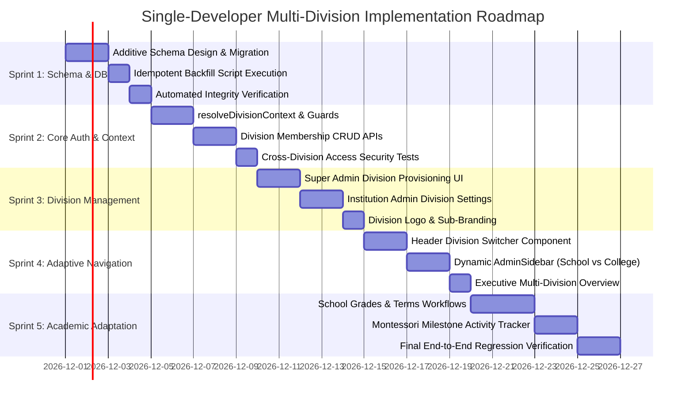

# SST-ERP — Phase 2: Single-Developer Implementation Roadmap & Test Plan

**Document Version:** 1.0  
**Phase:** Phase 2 Technical Planning (Implementation Roadmap)  
**Target Audience:** Single-Developer Full-Stack Implementation Workflow  
**Total Estimated Implementation Stages:** 5 Sprints (Sequential, Modular, Zero-Regression)  

---

## 1. Single-Developer Implementation Strategy

When working as the sole developer, attempting massive full-stack rewrites causes bugs, context switching, and deployment risk. To guarantee rapid, confident execution, this roadmap uses a **Vertical Modular Delivery Model**:
1. Schema & Migration first (fully tested locally).
2. Backend Services & Context Guards second.
3. Division Management UI third.
4. Adaptive Division Navigation & Dashboards fourth.
5. School & Montessori specialized workflows last.

Every sprint produces a working, testable, deployable increment. At no point is the existing College ERP broken.

---

## 2. Sprint-by-Sprint Implementation Roadmap

---

### Sprint 1: Database Foundation & Safe Backfill (3-4 Days)
- **Goal:** Establish division tables without touching application code or frontend UI.
- **Tasks:**
  1. Add `InstitutionDivision`, `StaffDivisionAssignment`, and `DivisionMembership` to `prisma/schema.prisma`.
  2. Add nullable `divisionId` to `Class`, `Department`, `Student`, `Enrollment`, `FeeStructure`.
  3. Make `Class.courseId` and `Class.semester` nullable.
  4. Generate and test Prisma migration locally.
  5. Run `backfill-divisions.ts` on local/staging database.
  6. Verify all existing tests pass (`npm run test`, `tests/test-super-admin-dashboard-pool.ts`).
- **Acceptance Criteria:** Database contains default College divisions for all institutions; 100% of existing tests pass with zero regressions.

---

### Sprint 2: Context Resolution & Security Guards (3-4 Days)
- **Goal:** Implement server-side division resolution and cross-division protection.
- **Tasks:**
  1. Create `lib/security/division-context.ts` implementing `resolveDivisionContext()`.
  2. Create `assertDivisionTenant()` guard in `lib/security/tenant.ts`.
  3. Support active division selection via `sst_active_division` cookie or `x-division-id` header.
  4. Write automated unit tests for cross-division access prevention.
- **Acceptance Criteria:** Division admins are strictly confined to their own division; global admins can access all divisions; unauthorized cross-division queries return `403 Forbidden`.

---

### Sprint 3: Division Management & Super Admin Integration (3-4 Days)
- **Goal:** Allow Super Admin and Institution Admins to create and configure divisions.
- **Tasks:**
  1. Create `/api/admin/divisions` route handlers (`GET`, `POST`, `PATCH`, `DELETE`).
  2. Add Division Management tab under Super Admin Institution Details (`app/super-admin/(protected)/institutions/[id]/page.tsx`).
  3. Add Division Configuration page under `/admin/divisions`.
  4. Support division type selection (`MONTESSORI`, `SCHOOL`, `HIGHER_SECONDARY`, `COLLEGE`, `ACADEMY`).
- **Acceptance Criteria:** Admin can create a new "School Wing" or "Montessori Wing" under an existing College institution with custom codes and names.

---

### Sprint 4: Header Switcher & Adaptive Navigation (4-5 Days)
- **Goal:** Seamless UI switching between division dashboards.
- **Tasks:**
  1. Build `DivisionSwitcher.tsx` component in the admin header.
  2. Update `components/layout/AdminSidebar.tsx`:
     - If `activeDivision.type === 'COLLEGE'`: Render current College navigation (*Departments, Courses, Semesters, IA, Results*).
     - If `activeDivision.type === 'SCHOOL'`: Render School navigation (*Grades & Standards, Sections, Terms, Subject Master*).
     - If `activeDivision.type === 'MONTESSORI'`: Render Montessori navigation (*Stages, Activity Milestones, Progress Observations*).
     - If `activeDivision === 'ALL'`: Render Consolidated Executive Overview.
  3. Build Consolidated Executive Overview on `/admin` showing cross-division totals (Total Students, Total Fee Collection, Division Breakdown).
- **Acceptance Criteria:** Clicking the Division Switcher instantly updates the sidebar navigation and dashboard metrics to reflect the selected division.

---

### Sprint 5: School & Montessori Module Adaptation (4-5 Days)
- **Goal:** Complete specialized academic workflows for School and Montessori.
- **Tasks:**
  1. Adapt `/admin/academics/classes` to support Grades without courses for School divisions.
  2. Create School Term Report Card generator.
  3. Implement Montessori Milestone Progress Tracker.
  4. Execute full cross-portal test suite (Super Admin, Admin, Teacher, Student, Parent).
- **Acceptance Criteria:** A School Administrator can create Grade 1-10 classes, assign teachers, record term marks, and generate report cards without any college concepts.

---

## 3. Comprehensive Verification & Test Scenario Matrix

Every scenario below must be validated prior to production release:

| Test Scenario | Test Description & Steps | Expected Result | Pass Criteria |
| :--- | :--- | :--- | :---: |
| **1. College-Only Institution** | Log into an existing institution with only a College division. | Dashboard renders exact existing College navigation and metrics. | 100% identical to pre-Phase 2 behavior. |
| **2. School-Only Institution** | Create a new institution configured strictly with a School division. | Dashboard renders School navigation (Grades, Terms) with zero College links. | No "Courses", "Degrees", or "Semesters" visible. |
| **3. Montessori-Only Institution** | Create a Montessori institution. | Dashboard renders Stages (Toddler, Primary) and qualitative progress records. | Qualitative evaluation cards render properly. |
| **4. Composite Institution (School + College)** | Institution with both High School and College divisions. | Switcher shows both divisions. Switching toggles between School and College views. | Instant context toggle with state persistence. |
| **5. Full Multi-Division Institution** | Institution with all 5 divisions enabled. | Executive view displays aggregate rollups across all 5 divisions. | Consolidated metrics match sum of division metrics. |
| **6. User in Multiple Divisions** | Faculty member teaching in both High School and College. | User can switch active role/division; marks entry displays appropriate classes. | No permission errors; workload filtered cleanly. |
| **7. Separate Division Admins** | School Principal tries accessing College courses or degree settings. | Server throws `403 Forbidden: Cross-Division Access Denied`. | Strict IDOR barrier verified on server. |
| **8. Student Progression** | Student graduates from School Grade 10 and enrolls in Higher Secondary +1. | New enrollment created; historical Grade 10 records preserved in history. | Complete longitudinal academic history maintained. |
| **9. Cross-Institution Denial** | User in Institution A attempts to supply division ID from Institution B. | Server throws `403 Forbidden: Cross-Institution Security Violation`. | Root tenant isolation unconditionally enforced. |
| **10. Subscription Restrictions** | Institution exceeds total student capacity across all divisions combined. | Registration blocks with `StudentCapacityError (403)`. | Consolidated capacity limit enforced. |
| **11. College Regression Test** | Run existing Phase A-D test suites, pool tests, and Super Admin dashboard query. | All 31 dashboard queries return valid data with exit code 0. | Zero breaking changes. |

---

## 4. Single-Developer Risk Minimization Checklist

- [ ] **Checklist 1:** Keep migrations purely additive. Never drop a legacy column until at least two releases after all data has been safely moved.
- [ ] **Checklist 2:** Keep client components thin. Centralize all division resolution logic in `lib/security/division-context.ts` rather than duplicating checks in individual page files.
- [ ] **Checklist 3:** Run `npx prisma generate` and `npx tsc --noEmit` after every schema edit to catch typing discrepancies before testing in browser.
- [ ] **Checklist 4:** Test with real database data using the automated `verifyDataIntegrity()` script after backfilling.
