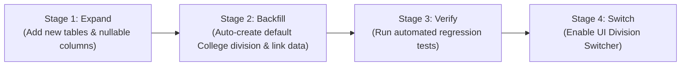
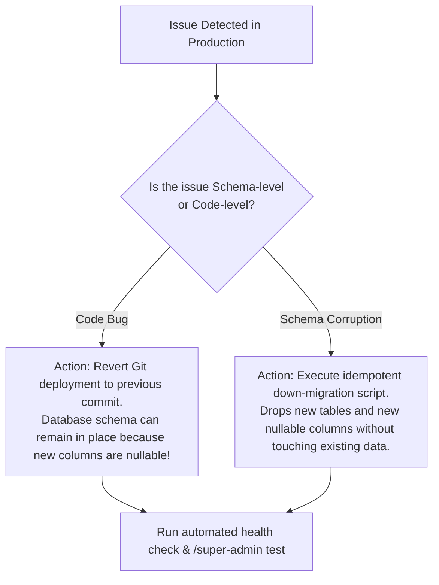

# SST-ERP — Phase 2: Safe Database Migration & Rollback Strategy

**Document Version:** 1.0  
**Phase:** Phase 2 Technical Planning (Migration Specification)  
**Target Audience:** Single-Developer Full-Stack Implementation Workflow  
**Zero-Downtime Guarantee:** 100% backward compatibility for existing College data, students, teachers, and admins.

---

## 1. Migration Strategy Overview

As a single developer managing production systems, the primary risk is data corruption or downtime during schema transitions. Therefore, this plan employs an **Additive 3-Stage Expand/Contract Pattern**:



### Safety Principles:
1. **Never drop or rename existing columns** in Phase 2.
2. **All new columns on existing tables are strictly nullable** (`String? @db.Uuid`).
3. **Existing queries continue running unchanged** without requiring immediate code refactoring.
4. **Idempotent backfill script** can be executed multiple times safely without duplicate records.

---

## 2. Step-by-Step Migration Execution Sequence

### Step 1: Additive Schema Generation (Prisma)
- Add new tables:
  - `institution_divisions`
  - `staff_division_assignments`
  - `division_memberships`
- Add nullable columns to existing tables:
  - `Class.divisionId` (`String? @db.Uuid`)
  - `Class.gradeLevel` (`String?`)
  - `Department.divisionId` (`String? @db.Uuid`)
  - `Student.divisionId` (`String? @db.Uuid`)
  - `Enrollment.divisionId` (`String? @db.Uuid`)
  - `FeeStructure.divisionId` (`String? @db.Uuid`)
- Adjust `Class.courseId` and `Class.semester` to be optional (`String?` and `Int?`).
- Run `npx prisma migrate dev --create-only --name add_multi_division_core` to inspect the generated SQL before execution.

---

### Step 2: Idempotent Backfill Script (`prisma/scripts/backfill-divisions.ts`)

The backfill script ensures that every existing institution receives a **Default College Division**, and all existing academic records are linked to it seamlessly:

```typescript
import db from "@/lib/db";

export async function backfillExistingInstitutionsToDefaultDivisions() {
  console.log("Starting safe multi-division backfill...");

  const institutions = await db.institution.findMany({
    select: { id: true, name: true, slug: true, code: true, type: true },
  });

  for (const inst of institutions) {
    console.log(`Processing institution: ${inst.name} (${inst.id})`);

    // 1. Determine division type based on existing institution.type
    const defaultType = inst.type === "SCHOOL" ? "SCHOOL" : "COLLEGE";
    const defaultName =
      defaultType === "SCHOOL"
        ? `${inst.name} School Division`
        : `${inst.name} College Division`;
    const defaultCode = defaultType === "SCHOOL" ? "SCH-DEF" : "COL-DEF";
    const defaultSlug = `${inst.slug}-main`;

    // 2. Upsert default division
    const division = await db.institutionDivision.upsert({
      where: {
        institutionId_code: { institutionId: inst.id, code: defaultCode },
      },
      create: {
        institutionId: inst.id,
        name: defaultName,
        code: defaultCode,
        slug: defaultSlug,
        type: defaultType as any,
        status: "ACTIVE",
        isDefault: true,
        description: "Auto-generated default division preserving existing operational data.",
      },
      update: {},
    });

    // 3. Backfill Departments
    const updatedDepts = await db.$executeRaw`
      UPDATE "Department"
      SET "divisionId" = ${division.id}::uuid
      WHERE "institutionId" = ${inst.id}::uuid AND "divisionId" IS NULL;
    `;

    // 4. Backfill Classes
    const updatedClasses = await db.$executeRaw`
      UPDATE "Class"
      SET "divisionId" = ${division.id}::uuid
      WHERE "institutionId" = ${inst.id}::uuid AND "divisionId" IS NULL;
    `;

    // 5. Backfill Students
    const updatedStudents = await db.$executeRaw`
      UPDATE "Student"
      SET "divisionId" = ${division.id}::uuid
      WHERE "institutionId" = ${inst.id}::uuid AND "divisionId" IS NULL;
    `;

    // 6. Backfill Enrollments
    const updatedEnrollments = await db.$executeRaw`
      UPDATE enrollments
      SET "divisionId" = ${division.id}::uuid
      WHERE "institutionId" = ${inst.id}::uuid AND "divisionId" IS NULL;
    `;

    // 7. Backfill Fee Structures
    const updatedFees = await db.$executeRaw`
      UPDATE fee_structures
      SET "divisionId" = ${division.id}::uuid
      WHERE "institutionId" = ${inst.id}::uuid AND "divisionId" IS NULL;
    `;

    console.log(`✓ Backfilled ${inst.name}: Depts, Classes, Students, Enrollments, Fees mapped to Division [${division.id}].`);
  }

  console.log("Backfill completed successfully.");
}
```

---

## 3. Backward Compatibility for Legacy API Routes

Existing client components and tests query endpoints such as `/api/students`, `/api/classes`, and `/api/academics/departments` without passing a `divisionId`.

### Backward-Compatibility Guard Pattern:
```typescript
// Inside GET /api/classes or server action
export async function getClasses(req: NextRequest) {
  const context = await resolveDivisionContext(req);
  const url = new URL(req.url);
  const requestedDivisionId = url.searchParams.get("divisionId");

  // If divisionId is passed, filter strictly by it
  // If NOT passed, default gracefully to context.activeDivisionId (or all if Global Admin)
  const divisionFilter = requestedDivisionId
    ? { divisionId: requestedDivisionId }
    : context.activeDivisionId
    ? { divisionId: context.activeDivisionId }
    : {};

  const classes = await db.class.findMany({
    where: {
      institutionId: context.institutionId,
      ...divisionFilter,
    },
    include: {
      course: true, // Remains 100% working for College classes
      sections: true,
    },
  });

  return NextResponse.json({ success: true, data: classes });
}
```

---

## 4. Rollback and Disaster Recovery Plan

If any unforeseen error occurs in production during or after schema deployment, this fast rollback protocol ensures restoration within **under 2 minutes**:



### Emergency Reversal SQL (`prisma/migrations/rollback_multi_division.sql`):
```sql
-- 1. Remove nullable foreign keys without dropping legacy tables
ALTER TABLE "Class" DROP COLUMN IF EXISTS "divisionId";
ALTER TABLE "Class" DROP COLUMN IF EXISTS "gradeLevel";
ALTER TABLE "Department" DROP COLUMN IF EXISTS "divisionId";
ALTER TABLE "Student" DROP COLUMN IF EXISTS "divisionId";
ALTER TABLE enrollments DROP COLUMN IF EXISTS "divisionId";
ALTER TABLE fee_structures DROP COLUMN IF EXISTS "divisionId";

-- 2. Drop additive junction and division tables
DROP TABLE IF EXISTS "staff_division_assignments" CASCADE;
DROP TABLE IF EXISTS "division_memberships" CASCADE;
DROP TABLE IF EXISTS "institution_divisions" CASCADE;
DROP TYPE IF EXISTS "DivisionType";
DROP TYPE IF EXISTS "DivisionStatus";
```
*Note: Because no legacy columns or tables are deleted in Stage 1, executing the reversal SQL immediately returns the database to its exact prior state with zero data loss.*

---

## 5. Automated Data Integrity Verification Script

Before declaring migration success, run an automated verification query:

```typescript
export async function verifyDataIntegrity() {
  const orphanStudents = await db.$queryRaw`
    SELECT COUNT(*) as count FROM "Student" WHERE "divisionId" IS NULL;
  `;
  const orphanClasses = await db.$queryRaw`
    SELECT COUNT(*) as count FROM "Class" WHERE "divisionId" IS NULL;
  `;
  const invalidDivisions = await db.$queryRaw`
    SELECT COUNT(*) as count FROM institution_divisions d
    LEFT JOIN institutions i ON d."institutionId" = i.id
    WHERE i.id IS NULL;
  `;

  console.log({
    orphanStudents,
    orphanClasses,
    invalidDivisions,
  });

  if (Number(orphanStudents[0].count) > 0 || Number(orphanClasses[0].count) > 0) {
    throw new Error("Data Integrity Failure: Found unmapped records!");
  }
  console.log("✓ Data Integrity 100% Verified.");
}
```
