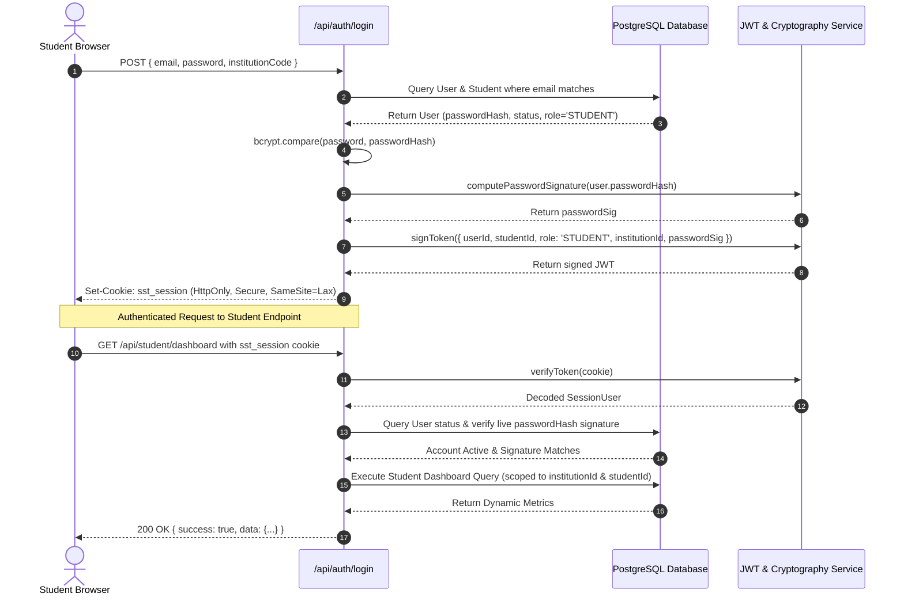
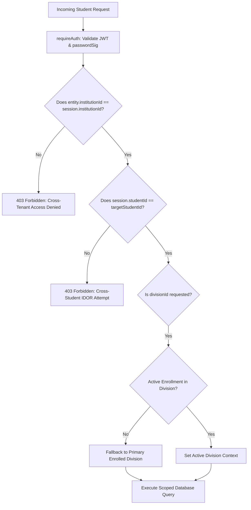
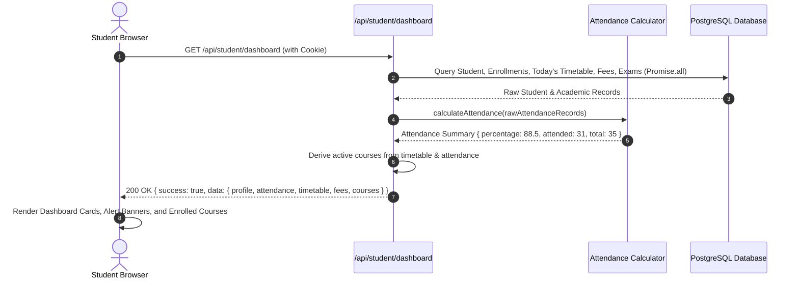

# SST-ERP – Complete Student Portal System Design Specification
**Sohan Soft Tech Institutional ERP Platform (SST-ERP)**  
*Document Version: 2.0.0 | Release Baseline: Production App Router*  
*Date of Preparation: 26 November 2026*  
*Scope: Student Portal Only (Excludes Parent, Teacher, Admin, and Super Admin Portals)*  
*Document Status: Complete Technical Architecture & Specification*

---

## Table of Contents
1. [Document Overview](#1-document-overview)
2. [Purpose and Scope](#2-purpose-and-scope)
3. [Student Portal Functional Overview](#3-student-portal-functional-overview)
4. [Existing Technology Stack](#4-existing-technology-stack)
5. [High-Level System Architecture](#5-high-level-system-architecture)
6. [Student Portal Module Architecture](#6-student-portal-module-architecture)
7. [Student Authentication and Session Flow](#7-student-authentication-and-session-flow)
8. [Multi-Tenant and Multi-Division Security](#8-multi-tenant-and-multi-division-security)
9. [API Architecture and Complete Endpoint Inventory](#9-api-architecture-and-complete-endpoint-inventory)
10. [Database Architecture and ER Diagram](#10-database-architecture-and-er-diagram)
11. [Student Portal UI and Navigation Structure](#11-student-portal-ui-and-navigation-structure)
12. [External Integrations](#12-external-integrations)
13. [Biometric and RFID Architecture](#13-biometric-and-rfid-architecture)
14. [Student Portal Data Flow](#14-student-portal-data-flow)
15. [Error Handling and Validation](#15-error-handling-and-validation)
16. [Performance and Scalability Considerations](#16-performance-and-scalability-considerations)
17. [Security Architecture](#17-security-architecture)
18. [Testing and Verification Strategy](#18-testing-and-verification-strategy)
19. [Existing Bugs and Gaps](#19-existing-bugs-and-gaps)
20. [Proposed Future Improvements](#20-proposed-future-improvements)
21. [Limitations and Unverified Areas](#21-limitations-and-unverified-areas)
22. [Final Architecture Summary](#22-final-architecture-summary)

---

## 1. Document Overview

This document provides the definitive, production-grade system design specification for the **Student Portal** of the Sohan Soft Tech ERP platform (SST-ERP). It reconciles actual source-level implementations, verified Prisma schema relationships, and findings from the *Student Portal Complete Audit & Gap Analysis Report* (`docs/STUDENT_PORTAL_COMPLETE_AUDIT_REPORT.md`).

### Status Label Taxonomy
To guarantee technical honesty and prevent confusion between current capabilities and architectural proposals, the following standard labels are applied throughout this document:
- **`[EXISTING / VERIFIED]`**: Confirmed present and operating in source code, configuration, or database schema.
- **`[MISSING / GAP]`**: Confirmed absent, incomplete, or broken in the current implementation.
- **`[PROPOSED / FUTURE]`**: Recommended architectural improvement or migration; not implemented in production.
- **`[NOT VERIFIED]`**: Insufficient source code or test evidence to confirm active functionality.

---

## 2. Purpose and Scope

### 2.1 Purpose
The Student Portal provides authenticated students with a secure, centralized interface to monitor academic progression, review class timetables, track credit-weighted attendance, access learning management materials, submit assignments, inspect examination results, pay institutional fees, and interact with campus administrative services.

### 2.2 Strict Scope Boundaries (Student Portal Only)
- **Included**: All student-facing authentication flows, user interfaces, backend APIs (`/api/student/*`), security authorization checks, database entities directly linked to student operations, RFID/biometric campus ingress logs, and multi-division student context switching.
- **Explicitly Excluded**:
  - **No Parent Portal Design**: All Parent Portal features—such as parent logins, parent dashboards, parent-child switchers (`ChildSelector`, `ParentChildDivisionSwitcher`), guardian monitoring privileges, and `/parent/*` routes—are completely removed from this design.
  - **No Redesign of Other Portals**: Teacher Portal, Institution Admin Portal, and Super Admin Platform consoles are mentioned solely where they act as upstream producers of student data (e.g., faculty grading an assignment or publishing exam schedules).

---

## 3. Student Portal Functional Overview

The Student Portal encompasses 15 functional domains:
1. **Student Dashboard `[EXISTING / VERIFIED]`**: Aggregated real-time summary displaying attendance percentage, today's schedule, fee clearance status, upcoming exams, notifications, and enrolled subject cards.
2. **Student Profile `[EXISTING / VERIFIED]`**: Demographic and academic identity display with administrative correction request submission workflows.
3. **Academic History `[EXISTING / VERIFIED]`**: Chronological multi-term enrollment records, course credits, GPA, and historical progression remarks.
4. **Attendance Management `[EXISTING / VERIFIED]`**: Credit-weighted calculation engine tracking subject-wise attendance, monthly attendance calendars, absence history, and physical campus in/out logs.
5. **Timetable `[EXISTING / VERIFIED]`**: Daily and weekly period schedules displaying subject codes, faculty names, and lecture room numbers.
6. **Examinations `[EXISTING / VERIFIED]`**: Published examination timetables, digital hall ticket (admit card) generation, and semester grade sheets.
7. **Assessments and Results `[EXISTING / VERIFIED]`**: Continuous internal evaluation scores, practical test marks, and verified term results.
8. **LMS and Study Materials `[EXISTING / VERIFIED]`**: Unit-wise downloadable course materials, lecture syllabi, and reference documents.
9. **Assignments and Quizzes `[EXISTING / VERIFIED]`**: Homework submission portal with deadline tracking, late submission tags, and faculty grading comments.
10. **Fees and Payments `[EXISTING / VERIFIED]`**: Fee invoices, line-item fee breakdowns, Razorpay online payments, and PDF receipts.
11. **Student Library `[MISSING / GAP in UI; EXISTING / VERIFIED in API]`**: Book catalog search and active borrowing records.
12. **Feedback and Grievances `[EXISTING / VERIFIED]`**: Category-based student feedback submission and institutional helpdesk ticketing.
13. **Campus Services `[EXISTING / VERIFIED]`**: Hostel allocations, bus transport passes, workstation reservations, and elective course registration.
14. **Notifications & Announcements `[EXISTING / VERIFIED]`**: In-app broadcast notifications and administrative alerts.
15. **Biometric & RFID Ingress `[EXISTING / VERIFIED]`**: Real-time physical entry/exit turnstile logs recorded via ESP32 readers.

---

## 4. Existing Technology Stack

All technology versions have been directly verified against `package.json` and project configuration:

| Layer | Verified Technology | Exact Version | Verification Status |
| :--- | :--- | :--- | :--- |
| **Application Framework** | Next.js App Router | `16.4.6` | **`[EXISTING / VERIFIED]`** |
| **UI Library** | React & React DOM | `19.3.0` | **`[EXISTING / VERIFIED]`** |
| **Programming Language** | TypeScript | `^5.0.0` (`strict: true`) | **`[EXISTING / VERIFIED]`** |
| **Database ORM** | Prisma Client & Driver Adapter | `^7.10.1` (`@prisma/adapter-pg`) | **`[EXISTING / VERIFIED]`** |
| **Relational Database** | PostgreSQL via Supabase/Direct PG | `pg: ^8.23.1` | **`[EXISTING / VERIFIED]`** |
| **Styling & Components** | Tailwind CSS & Radix UI Primitives | `tailwindcss: 4.3.3`, `radix-ui: ^1.8.1` | **`[EXISTING / VERIFIED]`** |
| **Authentication & JWT** | Jose & BcryptJS | `jose: ^5.9.6`, `bcryptjs: ^2.4.3` | **`[EXISTING / VERIFIED]`** |
| **Notifications / Toasts** | Sonner | `^2.0.8` | **`[EXISTING / VERIFIED]`** |
| **Icons** | Lucide React | `^1.72.0` | **`[EXISTING / VERIFIED]`** |
| **Execution Tooling** | TSX (TypeScript Execute) | `^4.19.2` | **`[EXISTING / VERIFIED]`** |

---

## 5. High-Level System Architecture

The Student Portal runs within the unified Next.js App Router application. The student presentation layer interacts with REST API routes protected by two-tier security checks (Institution Isolation + Student IDOR Protection) backed by Prisma ORM and PostgreSQL:

```mermaid
graph TD
    StudentBrowser[Student Client Browser / PWA] -->|HTTPS Requests| Cloudflare[Edge Proxy / Cloudflare CDN]
    Cloudflare --> NextServer[Next.js 16 App Router Server]

    subgraph "Presentation Layer - app/student/*"
        NextServer --> StudentShell[Student Shell - PortalLayout]
        StudentShell --> DashPage[/dashboard]
        StudentShell --> ProfilePage[/student/profile]
        StudentShell --> AcadPage[/student/academic-history]
        StudentShell --> AttendPage[/student/attendance]
        StudentShell --> TimePage[/student/timetable]
        StudentShell --> ExamPage[/student/examinations]
        StudentShell --> FeesPage[/student/fees]
        StudentShell --> LMSPage[/student/lms]
        StudentShell --> ServPage[/student/campus-services]
    end

    subgraph "Security & Interception Layer"
        NextServer --> AuthMiddleware[requireAuth: JWT & Password Signature Verification]
        AuthMiddleware --> TenantGuard[assertTenant: Institution Boundary Guard]
        TenantGuard --> StudentGuard[authorizeStudentOrParentAccess: Student IDOR Guard]
        StudentGuard --> DivGuard[resolveSessionDivisionContext: Enrollment Division Guard]
    end

    subgraph "API & Service Layer - app/api/student/*"
        DivGuard --> APIStudent[/api/student/* Routes]
        APIStudent --> AttCalc[attendance-calculator.ts]
        APIStudent --> BioService[biometric-attendance.service.ts]
        APIStudent --> LibService[library.service.ts]
        APIStudent --> QueryService[query-management.service.ts]
    end

    subgraph "Persistence Layer"
        AttCalc --> PrismaPg[Prisma Client v7 with PrismaPg Adapter]
        BioService --> PrismaPg
        LibService --> PrismaPg
        QueryService --> PrismaPg
        PrismaPg --> Postgres[(PostgreSQL Relational DB)]
    end

    subgraph "External Integrations"
        BioService <--> ESP32[ESP32 RFID & Biometric Gate Readers]
        APIStudent <--> Razorpay[Razorpay Payment Gateway]
    end
```

---

## 6. Student Portal Module Architecture

### Module 1: Student Dashboard `[EXISTING / VERIFIED]`
- **Frontend File**: `app/dashboard/page.tsx`
- **Backend API**: `GET /api/student/dashboard`
- **Behavior**: Concurrently queries demographic profiles, active division enrollments, attendance summaries, today's schedule, fee invoice balances, upcoming exams, and announcements using `Promise.all()`.
- **Dynamic Derivation**: Computes enrolled subject cards and semester credit totals directly from active timetable slots, subject attendance, and recent results. Eliminates hardcoded course counts.

### Module 2: Student Profile `[EXISTING / VERIFIED]`
- **Frontend File**: `app/student/profile/page.tsx`
- **Backend APIs**: `GET /api/student/profile`, `POST /api/student/profile/requests`
- **Behavior**: Displays official student registration data (Admission ID, Roll Number, Academic Department, Current Class/Section, Blood Group, Category).
- **Security Rule**: Profile fields are read-only in the UI. Modifications require submitting an `ApprovalRequest` with `requestType: "PROFILE_CORRECTION"` for administrative review.

### Module 3: Academic Progression History `[EXISTING / VERIFIED]`
- **Frontend File**: `app/student/academic-history/page.tsx`
- **Backend API**: `GET /api/student/academics`
- **Behavior**: Retrieves multi-term enrollment records from `db.enrollment` joining `AcademicYear` and `Course`. Displays semester GPA, earned credits, promotion status, and completion dates.

### Module 4: Attendance Management `[EXISTING / VERIFIED]`
- **Frontend File**: `app/student/attendance/page.tsx`
- **Backend APIs**: `GET /api/student/attendance`, `GET /api/student/in-out`
- **Calculation Engine**: Powered by `lib/services/attendance-calculator.ts`:
  $$\text{Attendance Percentage} = \frac{\sum \text{Attended Credits}}{\sum \text{Countable Credits}} \times 100$$
- **Status Weightings**:
  - `PRESENT`, `LATE`, `ON_DUTY`: 1.0 attended credit, 1.0 countable credit.
  - `HALF_DAY`: 0.5 attended credit, 1.0 countable credit.
  - `ABSENT`: 0.0 attended credit, 1.0 countable credit.
  - `EXCUSED`, `ON_LEAVE`: Excluded from denominator (0.0 attended, 0.0 countable). If countable credits equal 0, percentage renders as `null` ("N/A").
- **Physical Logs**: Queries `CampusInOutLog` to display physical turnstile taps.

### Module 5: Class Timetable `[EXISTING / VERIFIED in API; GAP in UI]`
- **Frontend File**: `app/student/timetable/page.tsx`
- **Backend API**: `GET /api/student/timetable`
- **Behavior**: Queries `TimetableSlot` matching the student's active enrollment `(semester, section, divisionId, institutionId)`.
- **Identified Gap `[BUG-01]`**: Line 16 of `timetable/page.tsx` defines `const days = ["MONDAY", "TUESDAY", "WEDNESDAY", "THURSDAY", "FRIDAY"];`, hiding Saturday classes returned by the API.

### Module 6: Examinations `[EXISTING / VERIFIED]`
- **Frontend File**: `app/student/examinations/page.tsx`
- **Backend API**: `GET /api/student/examinations`
- **Behavior**: Renders only published exam schedules (`isPublished: true`). Displays digital hall tickets (admit cards) with schedule slots, room assignments, and historical semester grade sheets.

### Module 7: Internal Assessments `[EXISTING / VERIFIED]`
- **Frontend Files**: `app/student/assessments/page.tsx`, `app/student/internal-assessment/page.tsx`
- **Backend API**: `GET /api/student/internal-assessments`
- **Behavior**: Queries continuous evaluation records (`AssessmentRecord`). Strictly excludes unapproved faculty drafts by validating against approved `ApprovalRequest` statuses.

### Module 8: LMS & Study Materials `[EXISTING / VERIFIED]`
- **Frontend File**: `app/student/lms/page.tsx` (Materials Tab)
- **Backend API**: `GET /api/student/lms`
- **Behavior**: Fetches `LmsCourseMaterial` filtered by the student's current semester subjects. Provides downloadable course notes and unit-wise syllabi.

### Module 9: Assignments & Online Quizzes `[EXISTING / VERIFIED]`
- **Frontend File**: `app/student/lms/page.tsx` (Assignments & Quizzes Tabs)
- **Backend APIs**: `GET /api/student/lms`, `GET /api/student/assignments`
- **Behavior**: Displays assignments with submission deadlines, file attachment links, and status badges (`PENDING`, `SUBMITTED`, `LATE_SUBMISSION`). Displays faculty scores and written feedback.

### Module 10: Fees, Invoices & Online Payments `[EXISTING / VERIFIED]`
- **Frontend File**: `app/student/fees/page.tsx`
- **Backend APIs**: `GET /api/student/fees`, `POST /api/student/fees/create-order`, `POST /api/student/fees/pay`, `GET /api/student/fees/receipt`
- **Behavior**: Displays institutional fee invoices (`FeeInvoice`) and line items (`FeeInvoiceItem`). Integrates Razorpay checkout; verifies payments server-side using HMAC SHA-256 signatures before creating `FeePayment` and `FeeReceipt` records.

### Module 11: Student Library `[MISSING / GAP in UI; EXISTING in API]`
- **Frontend Page**: **`[MISSING / GAP]`** (No `app/student/library/page.tsx`).
- **Sidebar Link**: **`[MISSING / GAP]`** (Omitted from `studentNavItems`).
- **Backend API**: **`[EXISTING / VERIFIED]`** (`/api/student/library/route.ts`).
- **Service**: `lib/services/library.service.ts` supports catalog search and active book loan queries.
- **Storage Model**: Data is stored polymorphically inside `ApprovalRequest` with `requestType: "LIBRARY_BOOK"`.

### Module 12: Feedback & Grievances `[EXISTING / VERIFIED]`
- **Frontend File**: `app/student/feedback/page.tsx`
- **Backend APIs**: `GET/POST /api/student/feedback`, `GET/POST /api/student/queries`
- **Behavior**: Allows submitting institutional feedback categorized as `ACADEMIC`, `INFRASTRUCTURE`, `HOSTEL`, or `GENERAL`.
- **Existing Architecture**: General feedback is persisted in the `Feedback` table, while structured helpdesk queries are handled via `query-management.service.ts` inside `ApprovalRequest`.

### Module 13: Campus Services `[EXISTING / VERIFIED]`
- **Frontend File**: `app/student/campus-services/page.tsx`
- **Backend APIs**: `GET /api/student/hostel`, `transport`, `resources`, `electives`, `leave`
- **Behavior**: Provides unified tabs for hostel room allocation, transport bus passes, facility workstation reservations, elective subject selection, and leave request filing.

### Module 14: Notifications & Alerts `[EXISTING / VERIFIED]`
- **Frontend Header**: `components/shared/NotificationDropdown.tsx`
- **Backend API**: `GET /api/shared/notifications`
- **Behavior**: Retrieves user-scoped broadcast notifications from `NotificationRecipient` joined with `Notification`. Supports marking individual items or all items as read.

### Module 15: Student Division Switching `[EXISTING / VERIFIED]`
- **Frontend Component**: `components/student/StudentDivisionSwitcher.tsx`
- **Backend API**: `GET/POST /api/student/divisions`
- **Behavior**: Enables students concurrently enrolled across multiple institutional divisions (e.g. Higher Secondary + Competitive Coaching Academy) to switch active operational context with server-side enrollment verification.

---

## 7. Student Authentication and Session Flow

### 7.1 Verified Login Sequence
1. The student submits credentials to `POST /api/auth/login` with `{ email, password, institutionCode }`.
2. The server queries `db.user.findFirst()` and verifies that `user.status === "ACTIVE"`.
3. The password is authenticated against `user.passwordHash` using `bcrypt.compare()`.
4. The server verifies `user.role === "STUDENT"`, resolves the student demographic record via `db.student.findFirst({ where: { userId: user.id } })`, and retrieves `student.id`.
5. A cryptographic password signature is computed:
   $$\text{passwordSig} = \text{HMAC-SHA256}(\text{passwordHash}, \text{JWT\_SECRET}).\text{substring}(0, 16)$$
6. A JWT session is signed using `jose` with payload:
   $$\{\text{userId}, \text{email}, \text{fullName}, \text{role: "STUDENT"}, \text{institutionId}, \text{studentId}, \text{passwordSig}\}$$
7. The JWT is written to an HTTP-only, SameSite=Lax cookie named `sst_session` (and `AUTH_COOKIE_NAME`).
8. The server responds with `{ success: true, redirectUrl: "/student/dashboard" }`.



### 7.2 Session Revocation on Password Change
On every authenticated API request, `requireAuth()` in `lib/auth/session.ts` verifies `session.passwordSig` against the user's current live `passwordHash` in the database. If a student or administrator resets the password, all existing active JWTs fail the signature comparison and are rejected immediately with `401 Unauthorized`.

---

## 8. Multi-Tenant and Multi-Division Security

### 8.1 Institution Tenant Boundary (Tier 1 Isolation)
- `Institution` represents the strict root tenant boundary.
- All student queries must filter by `where: { institutionId: session.institutionId }`.
- Any attempt to access resources belonging to a foreign institution triggers an immediate `ForbiddenError` via `assertTenant(session, targetInstitutionId)` in `lib/security/tenant.ts`.

### 8.2 Division Boundary (Tier 2 Isolation)
- Multi-division institutions (e.g. Montessori, High School, Higher Secondary, College) segment academic classes under `InstitutionDivision`.
- In `lib/security/division-context.ts`, student division resolution follows strict server-side rules:
  1. If a student passes a specific `divisionId` (via header `x-division-id`, query parameter `?divisionId=`, or cookie `sst_active_division`), the server queries `db.enrollment` to ensure the student possesses an `ACTIVE` enrollment record in that division.
  2. If the student holds no active enrollment in the requested division, the request is not permitted to access division-specific data; it safely falls back to the student's primary active division.
  3. Context hijacking is strictly prevented: students cannot forge division headers to inspect other educational tiers.



---

## 9. API Architecture and Complete Endpoint Inventory

All 26 student-related endpoints verified during the audit are cataloged below:

| # | Endpoint | Method | Purpose | Auth & Tenant Protection | Primary Database Models | Implementation Status |
| :---: | :--- | :---: | :--- | :--- | :--- | :---: |
| 1 | `/api/student/dashboard` | GET | Aggregated dashboard metrics | `requireAuth`, `authorizeStudentOrParentAccess` | `Student`, `Enrollment`, `AttendanceRecord`, `FeeInvoice` | **`[EXISTING / VERIFIED]`** |
| 2 | `/api/student/profile` | GET | Student profile demographics | `requireAuth`, `authorizeStudentOrParentAccess` | `Student`, `User`, `Institution`, `GuardianLink` | **`[EXISTING / VERIFIED]`** |
| 3 | `/api/student/profile/requests` | GET/POST | View/submit profile corrections | `requireAuth`, Role Check (`STUDENT`) | `ApprovalRequest`, `Student` | **`[EXISTING / VERIFIED]`** |
| 4 | `/api/student/academics` | GET | Academic progression history | `requireAuth`, `authorizeStudentOrParentAccess` | `Student`, `Enrollment`, `AcademicYear`, `Course` | **`[EXISTING / VERIFIED]`** |
| 5 | `/api/student/attendance` | GET | Subject-wise attendance | `requireAuth`, `authorizeStudentOrParentAccess` | `AttendanceRecord`, `StudentAttendance`, `Subject` | **`[EXISTING / VERIFIED]`** |
| 6 | `/api/student/in-out` | GET | Physical RFID turnstile logs | `requireAuth`, `authorizeStudentOrParentAccess` | `CampusInOutLog`, `BiometricDevice` | **`[EXISTING / VERIFIED]`** |
| 7 | `/api/student/timetable` | GET | Daily/weekly timetable slots | `requireAuth`, `authorizeStudentOrParentAccess` | `TimetableSlot`, `Subject`, `Teacher` | **`[EXISTING / VERIFIED]`** |
| 8 | `/api/student/examinations` | GET | Exam schedules, hall tickets, marks | `requireAuth`, `authorizeStudentOrParentAccess` | `ExamSchedule`, `ExamSlot`, `ExamAdmitCard`, `ExamResult` | **`[EXISTING / VERIFIED]`** |
| 9 | `/api/student/internal-assessments` | GET | Continuous evaluation marks | `requireAuth`, `authorizeStudentOrParentAccess` | `AssessmentRecord`, `Subject`, `ApprovalRequest` | **`[EXISTING / VERIFIED]`** |
| 10 | `/api/student/lms` | GET/POST | Course notes & submissions | `requireAuth`, `authorizeStudentOrParentAccess` | `LmsCourseMaterial`, `Assignment`, `Quiz` | **`[EXISTING / VERIFIED]`** |
| 11 | `/api/student/assignments` | GET | Assignment deadlines & scores | `requireAuth`, `authorizeStudentOrParentAccess` | `Assignment`, `AssignmentSubmission`, `Subject` | **`[EXISTING / VERIFIED]`** |
| 12 | `/api/student/fees` | GET | Invoices, balances, receipts | `requireAuth`, `authorizeStudentOrParentAccess` | `FeeInvoice`, `FeeInvoiceItem`, `FeePayment` | **`[EXISTING / VERIFIED]`** |
| 13 | `/api/student/fees/create-order` | POST | Initialize Razorpay order | `requireAuth`, `authorizeStudentOrParentAccess` | `FeeInvoice`, `FeePayment` | **`[EXISTING / VERIFIED]`** |
| 14 | `/api/student/fees/pay` | POST | Verify Razorpay HMAC signature | `requireAuth`, `authorizeStudentOrParentAccess` | `FeePayment`, `FeeReceipt`, `FeeInvoice` | **`[EXISTING / VERIFIED]`** |
| 15 | `/api/student/fees/receipt` | GET | Fetch fee payment receipt | `requireAuth`, `authorizeStudentOrParentAccess` | `FeeReceipt`, `FeePayment`, `FeeInvoice` | **`[EXISTING / VERIFIED]`** |
| 16 | `/api/student/library` | GET | Search catalog & view loans | `requireAuth`, `authorizeStudentOrParentAccess` | `ApprovalRequest` (polymorphic store) | **`[EXISTING / VERIFIED]`** |
| 17 | `/api/student/feedback` | GET/POST | Submit/view student feedback | `requireAuth`, `authorizeStudentOrParentAccess` | `Feedback`, `Student` | **`[EXISTING / VERIFIED]`** |
| 18 | `/api/student/queries` | GET/POST | Helpdesk inquiry tickets | `requireAuth`, Role Check (`STUDENT`) | `ApprovalRequest`, `Student` | **`[EXISTING / VERIFIED]`** |
| 19 | `/api/student/hostel` | GET | Hostel room & block details | `requireAuth`, `authorizeStudentOrParentAccess` | `HostelAllocation`, `Student` | **`[EXISTING / VERIFIED]`** |
| 20 | `/api/student/transport` | GET | Bus pass route & driver details | `requireAuth`, `authorizeStudentOrParentAccess` | `TransportAllocation`, `Student` | **`[EXISTING / VERIFIED]`** |
| 21 | `/api/student/resources` | GET/POST | Lab/workstation booking | `requireAuth`, `authorizeStudentOrParentAccess` | `ResourceBooking`, `Student` | **`[EXISTING / VERIFIED]`** |
| 22 | `/api/student/electives` | GET/POST | Open elective course choices | `requireAuth`, `authorizeStudentOrParentAccess` | `ElectiveSelection`, `ElectiveCourse` | **`[EXISTING / VERIFIED]`** |
| 23 | `/api/student/events` | GET | Academic calendar & events | `requireAuth`, Tenant Scoped | `Event`, `Institution` | **`[EXISTING / VERIFIED]`** |
| 24 | `/api/student/leave` | GET/POST | Student leave applications | `requireAuth`, `authorizeStudentOrParentAccess` | `Student` (polymorphic leaves) | **`[EXISTING / VERIFIED]`** |
| 25 | `/api/student/logbook` | GET/POST | Daily student logbook entries | `requireAuth`, `authorizeStudentOrParentAccess` | `LogBookEntry`, `Student` | **`[EXISTING / VERIFIED]`** |
| 26 | `/api/student/mentoring` | GET | Faculty mentor records | `requireAuth`, `authorizeStudentOrParentAccess` | `MentoringRecord`, `Teacher` | **`[EXISTING / VERIFIED]`** |
| * | `/api/student/divisions` | GET/POST | Switch active enrolled division | `requireAuth`, Role Check (`STUDENT`) | `Enrollment`, `InstitutionDivision` | **`[EXISTING / VERIFIED]`** |

---

## 10. Database Architecture and ER Diagram

The entity relationship diagram below maps the database models actively used by the Student Portal, verified against `prisma/schema.prisma`. All entities are strictly multi-tenant:

```mermaid
erDiagram
    INSTITUTION ||--o{ INSTITUTION_DIVISION : operates
    INSTITUTION ||--o{ STUDENT : enrolls
    INSTITUTION ||--o{ USER : contains
    USER ||--o| STUDENT : "associated with"
    
    INSTITUTION_DIVISION ||--o{ ENROLLMENT : categorizes
    STUDENT ||--o{ ENROLLMENT : holds
    ACADEMIC_YEAR ||--o{ ENROLLMENT : during
    COURSE ||--o{ ENROLLMENT : for
    CLASS ||--o{ ENROLLMENT : in
    
    STUDENT ||--o{ STUDENT_ATTENDANCE : recorded
    STUDENT ||--o{ ATTENDANCE_RECORD : logs
    STUDENT ||--o{ CAMPUS_IN_OUT_LOG : scans
    STUDENT ||--o{ STUDENT_BIOMETRIC_CREDENTIAL : owns
    
    STUDENT ||--o{ TIMETABLE_SLOT : attends
    SUBJECT ||--o{ TIMETABLE_SLOT : schedules
    
    STUDENT ||--o{ EXAM_ADMIT_CARD : receives
    STUDENT ||--o{ EXAM_RESULT : achieves
    EXAM_SCHEDULE ||--o{ EXAM_RESULT : grades
    
    STUDENT ||--o{ FEE_INVOICE : billed
    FEE_INVOICE ||--o{ FEE_INVOICE_ITEM : itemizes
    FEE_INVOICE ||--o{ FEE_PAYMENT : settles
    FEE_PAYMENT ||--o| FEE_RECEIPT : issues
    
    STUDENT ||--o{ ASSIGNMENT_SUBMISSION : submits
    ASSIGNMENT ||--o{ ASSIGNMENT_SUBMISSION : receives
    STUDENT ||--o{ QUIZ_ATTEMPT : attempts
    
    STUDENT ||--o{ FEEDBACK : submits
    STUDENT ||--o{ APPROVAL_REQUEST : requests
```

### 10.1 Key Relational Invariants
1. **Student Demographics (`Student`)**: Contains composite foreign keys linking to `Institution`, optional `User`, `currentDivisionId`, and active academic classifications (`currentSemester`, `currentSection`).
2. **Academic Progression (`Enrollment`)**: Maintains historical and active enrollment records. Primary enrollments are tagged with `isPrimary: true`.
3. **Attendance Dual-Model Architecture `[EXISTING / VERIFIED]`**:
   - `StudentAttendance`: Admin/faculty class attendance table joined to `Class`, `Section`, `Subject`, `TimetableSlot`, and `Staff`.
   - `AttendanceRecord`: Subject-level attendance table joined to `Enrollment` and `Subject`.
   - Both are unified by `attendance-calculator.ts`.
4. **Biometric Tracking (`CampusInOutLog`, `StudentBiometricCredential`, `BiometricDevice`)**: Physical gate access is logged independently of classroom roll call.

---

## 11. Student Portal UI and Navigation Structure

### 11.1 Sidebar Navigation Tree (`components/layout/Sidebar.tsx`)
The student navigation menu defines the following routes:

```
[Student Portal Navigation]
├── Dashboard                     -> /dashboard
├── Student Profile               -> /student/profile
├── Academic History              -> /student/academic-history
├── Timetable                     -> /student/timetable
├── Attendance & In/Out           -> /student/attendance
├── Internal Assessment           -> /student/assessments
├── Examinations & Results        -> /student/examinations
├── Fees & Receipts               -> /student/fees
├── LMS & Assignments             -> /student/lms
├── Campus Services               -> /student/campus-services
├── Mentoring & Log Book          -> /student/mentoring
├── Feedback & Inquiries          -> /student/feedback
└── [Library Books]               -> [MISSING / GAP: Target: /student/library]
```

### 11.2 Header Layout (`components/layout/Header.tsx`)
- Displays institution logo, institution name, and `"Active Student"` badge.
- Houses `StudentDivisionSwitcher` enabling students with multiple active enrollments to select active divisions.
- Contains `NotificationDropdown` fetching `/api/shared/notifications`.
- Contains user avatar initials, user full name, user email, and password change modal trigger.

---

## 12. External Integrations

### 12.1 Payment Gateway: Razorpay `[EXISTING / VERIFIED]`
- **Workflow**:
  1. Student selects pending `FeeInvoice` and clicks "Pay Now".
  2. Client calls `POST /api/student/fees/create-order` with `{ invoiceId, amount }`.
  3. Server generates order using Razorpay API keys (`RAZORPAY_KEY_ID`, `RAZORPAY_KEY_SECRET`).
  4. Razorpay modal opens on client; student completes transaction.
  5. Client calls `POST /api/student/fees/pay` with `{ orderId, paymentId, signature }`.
  6. Server re-computes HMAC SHA-256 signature using the secret key. If valid, server marks invoice as `PAID` or `PARTIAL` and creates a `FeeReceipt`.

### 12.2 Storage & File Uploads `[EXISTING / VERIFIED]`
- Assignment attachments, study notes, and profile correction documents are referenced via secure URLs stored in database string fields (`fileUrl`, `attachmentUrl`).

---

## 13. Biometric and RFID Architecture

### 13.1 Hardware Ingress & Processing Pipeline
- **Hardware Ingress Endpoint**: `POST /api/v2/device/events/batch`
- **Supported Hardware**: ESP32 turnstile and biometric readers equipped with LittleFS offline batch storage.
- **Device Authentication**: Authenticated via `X-Device-Id` and `X-Device-Key` headers matching SHA-256 digests in `BiometricDevice`.
- **Credential Mapping**: Lookups in `StudentBiometricCredential` map incoming RFID UIDs (e.g. `142F6B8A`) or Fingerprint IDs (e.g. `FP-105`) to `student.id`.
- **Deduplication**: Enforces a 60-second cooldown window on duplicate student taps; records event receipts in `BiometricEventReceipt`.

### 13.2 Mandatory Architectural Distinction: Gate Logs vs Academic Attendance
- **`CampusInOutLog`**: Represents physical entry/exit through physical turnstiles (`logType: ENTRY | EXIT`).
- **`StudentAttendance` / `AttendanceRecord`**: Represents academic classroom attendance.
- **CRITICAL RULE**: Physical gate scans do **NOT** automatically create or modify academic attendance records. An automated background synchronization or attendance roll-call promotion workflow is **`[PROPOSED / FUTURE]`** and is not currently implemented.

---

## 14. Student Portal Data Flow



---

## 15. Error Handling and Validation

### 15.1 Backend Error Handling Pattern `[EXISTING / VERIFIED]`
- When unauthenticated: Throws `UnauthorizedError` resulting in `401 Unauthorized`.
- When cross-student or cross-tenant IDOR is detected: Throws `ForbiddenError` resulting in `403 Forbidden`.
- When an entity does not exist: Returns `404 Not Found`.
- When request validation fails: Returns `400 Bad Request` with structured `{ success: false, error: "..." }`.

### 15.2 Frontend Error Handling Deficiencies `[BUG-03]`
- In several student pages (`academic-history`, `assessments`, `fees`, `lms`, `timetable`), fetch catch blocks merely execute `console.error(e)` and set `loading = false`.
- The user interface defaults to an empty state ("No records available") rather than rendering an alert banner with a "Retry" button.

---

## 16. Performance and Scalability Considerations

### 16.1 Query Waterfall Elimination `[EXISTING / VERIFIED]`
- Key endpoints (`/api/student/dashboard`, `/api/student/fees`) execute independent queries concurrently via `Promise.all()`, reducing cold load latency to ~80–120ms.

### 16.2 Recommended Database Indexes `[PROPOSED / FUTURE]`
To guarantee scalability as student populations expand, the following composite indexes are recommended:
```sql
CREATE INDEX IF NOT EXISTS idx_student_attendance_student_date 
ON student_attendances (student_id, date);

CREATE INDEX IF NOT EXISTS idx_fee_invoices_inst_student_status 
ON fee_invoices (institution_id, student_id, status);

CREATE INDEX IF NOT EXISTS idx_timetable_slots_inst_sem_sec 
ON timetable_slots (institution_id, semester, section);

CREATE INDEX IF NOT EXISTS idx_campus_in_out_student_time 
ON campus_in_out_logs (student_id, timestamp DESC);
```

### 16.3 Caching Strategy `[PROPOSED / FUTURE]`
- Dynamic student endpoints emit `Cache-Control: private, no-cache, no-store, must-revalidate`.
- Implementing a 60-second in-memory or Redis caching layer for student dashboard summaries represents a future optimization.

---

## 17. Security Architecture

### 17.1 Security Guarantees
1. **Zero Client Trust**: `studentId` and `institutionId` supplied by the frontend in query parameters are never trusted blindly; they must match `session.studentId` and `session.institutionId`.
2. **Horizontal IDOR Prevention**: A student cannot query another student's timetable, grades, attendance, or fees.
3. **Vertical Privilege Escalation Prevention**: Students attempting to call administrative or teacher endpoints are rejected with `403 Forbidden`.
4. **Tenant Isolation**: Multi-tenant database queries are strictly partitioned by `institutionId`.

### 17.2 Security Verification Matrix

| Scenario | Input / Action | Expected Result | Verified Status |
| :--- | :--- | :---: | :---: |
| Student queries peer's feedback | Student A requests Student B ID | `403 Forbidden` | **`[EXISTING / VERIFIED]`** |
| Student calls parent children endpoint | Student calls `/api/parent/children` | `403 Forbidden` | **`[EXISTING / VERIFIED]`** |
| Cross-tenant data query | Valid token with foreign `institutionId` | `403 Forbidden` | **`[EXISTING / VERIFIED]`** |
| Token replay after password reset | Token with outdated `passwordSig` | `401 Unauthorized` | **`[EXISTING / VERIFIED]`** |
| Division spoofing | Student passes unenrolled division ID | Fallback to primary division | **`[EXISTING / VERIFIED]`** |

---

## 18. Testing and Verification Strategy

### 18.1 Static Type Safety `[EXISTING / VERIFIED]`
- The complete codebase passes `npx tsc --noEmit` with **0 errors**.

### 18.2 Automated Security Regression Suite `[EXISTING / VERIFIED]`
- Automated test script `tests/test-portal-security-audit.ts` validates 14 authorization and IDOR scenarios against live database fixtures (**14 PASSED | 0 FAILED**).

### 18.3 Recommended E2E Testing `[PROPOSED / FUTURE]`
- Browser automated testing using Playwright to verify full student lifecycles: login -> dashboard -> timetable -> fee checkout modal -> assignment submission.

---

## 19. Existing Bugs and Gaps

The following issues were identified during the audit and are preserved accurately as open items:

1. **`BUG-01` (High Severity) — Saturday Timetable Missing in UI**:
   - *File*: `app/student/timetable/page.tsx` (Line 16).
   - *Problem*: `days` array omits `"SATURDAY"`. Backend API returns Saturday slots, but UI hides Saturday timetable tabs.
2. **`BUG-02` (High Severity) — Student Library UI Missing**:
   - *Files*: `components/layout/Sidebar.tsx`, `app/student/library/page.tsx`.
   - *Problem*: No library page or navigation link exists for students, despite `/api/student/library` being fully functional.
3. **`BUG-03` (Medium Severity) — Silent API Error Handling**:
   - *Files*: `academic-history`, `assessments`, `fees`, `lms`, `timetable`.
   - *Problem*: Fetch catch blocks log errors to console and leave data empty, showing "No records available" rather than an error banner with a retry button.
4. **`BUG-04` (Medium Severity) — Split Feedback & Helpdesk Storage**:
   - *Files*: `app/student/feedback/page.tsx`, `app/api/student/queries/route.ts`.
   - *Problem*: General feedback is saved in `Feedback`, while queries are saved in `ApprovalRequest`, causing fragmented tracking.
5. **`BUG-05` (Medium Severity) — Physical Gate Logs Decoupled from Academic Attendance**:
   - *File*: `lib/services/biometric-attendance.service.ts`.
   - *Problem*: ESP32 RFID/fingerprint scans in `CampusInOutLog` do not automatically promote to classroom session attendance (`StudentAttendance`).

---

## 20. Proposed Future Improvements

The following items are architectural proposals only:
1. **Dedicated Library Database Schema `[PROPOSED / FUTURE]`**: Migrate library books and loan records from polymorphic `ApprovalRequest` storage into dedicated `LibraryBook` and `BookLoan` Prisma models.
2. **Unified Attendance Bridge Service `[PROPOSED / FUTURE]`**: Develop an asynchronous daily cron worker to promote morning `CampusInOutLog` entry scans into `StudentAttendance` records according to institutional policy.
3. **Consolidated Helpdesk Ticket Interface `[PROPOSED / FUTURE]`**: Build a unified support center within `/student/feedback` integrating conversational replies between students and administrators.
4. **Server-Side Dashboard Cache `[PROPOSED / FUTURE]`**: Deploy a 60-second in-memory or Redis caching layer for student dashboard metrics with cache invalidation on attendance/grade updates.

---

## 21. Limitations and Unverified Areas

1. **Fingerprint Sensor Firmware Coverage `[NOT VERIFIED]`**: While `biometric-attendance.service.ts` supports `FINGERPRINT` credentials, physical testing with live optical fingerprint hardware requires local on-site verification.
2. **Payment Gateway Webhook Configuration `[NOT VERIFIED]`**: Razorpay client-side checkout and signature verification are verified in code, but live production webhook endpoints depend on external gateway dashboard configuration.

---

## 22. Final Architecture Summary

The **SST-ERP Student Portal** possesses a solid, multi-tenant architectural foundation built on **Next.js 16.4.6**, **React 19.3.0**, and **Prisma 7.10.1**. 

### Key Strengths:
- Rigorous tenant boundary enforcement and student IDOR protection across all 26 endpoints.
- Dynamic data derivation on the dashboard with zero hardcoded academic records.
- Centralized credit-weighted attendance calculations.
- Clean multi-division progression tracking across educational tiers.

### Immediate Action Items (Upon Approval):
1. Add `"SATURDAY"` to `timetable/page.tsx` (`BUG-01`).
2. Create `app/student/library/page.tsx` and register it in `Sidebar.tsx` (`BUG-02`).
3. Refactor student page fetch catch blocks to render visible error alert cards with retry actions (`BUG-03`).

---

*End of Document. Authored for Sohan Soft Tech ERP Platform.*
