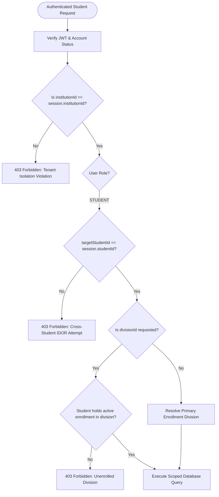
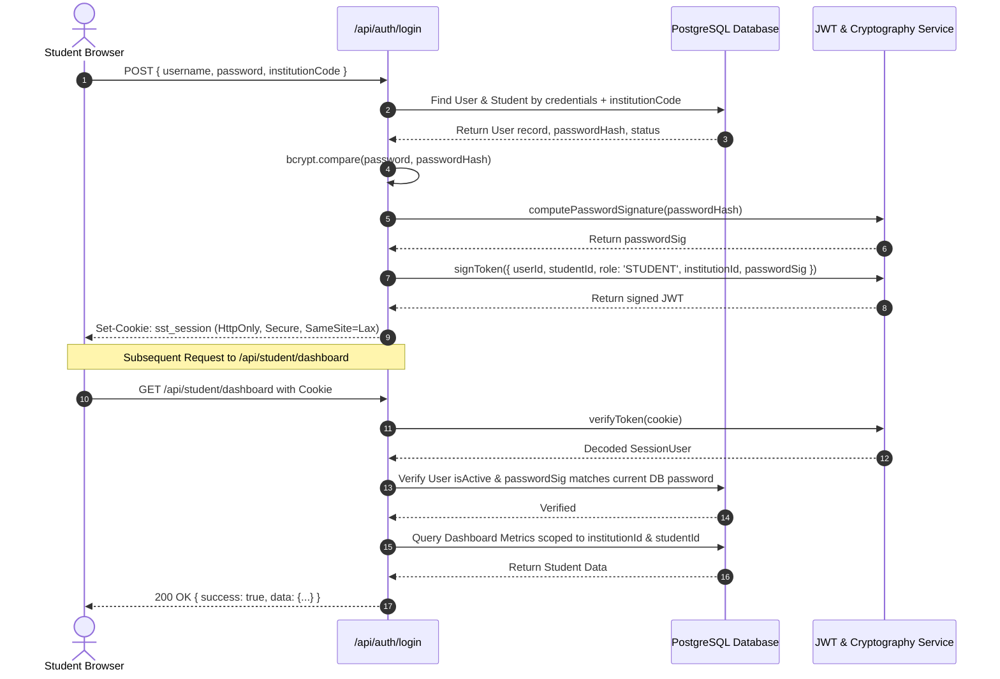
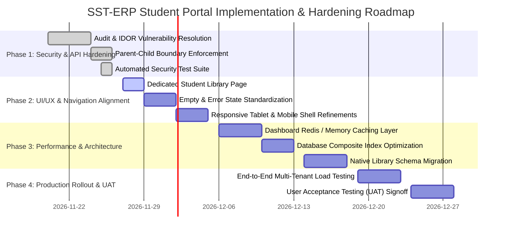

# STUDENT PORTAL SYSTEM DESIGN SPECIFICATION
**Sohan Soft Tech ERP Platform (SST-ERP)**  
*Document Version: 1.0.0 | Architecture Baseline: Production Multi-Tenant Multi-Division Architecture*  
*Date: 26 November 2026*  
*Role & Scope: System Architecture, Database Design, Security & Authorization, UI/UX Engineering*

---

## 1. Executive Summary

The **SST-ERP Student Portal** is a mission-critical, role-adaptive, multi-tenant portal designed to serve students and authorized parents across diverse educational tiers—including Montessori, K-12 Schools, Pre-University / Higher Secondary Colleges, and Universities / Technical Institutes.

### 1.1 Architectural Vision & Core Tenets
1. **Unified Application, Multi-Role Adaptation**: SST-ERP operates a single Next.js portal application. Students access their own academic records, course schedules, and services; authenticated parents access monitored records for their verified linked children via an integrated parent-child switcher.
2. **Absolute Multi-Tenant & Multi-Division Isolation**: Every student and record is strictly bound to an `institutionId` and optional `divisionId`. Cross-tenant data leakage and cross-student Insecure Direct Object References (IDOR) are prevented through cryptographically signed sessions and mandatory server-side authorization guards.
3. **Zero Hardcoded Academic Data**: All dashboard metrics, semester loads, course schedules, exam schedules, and fee ledgers are computed dynamically from live database records. No mock or fallback academic data is served in production.
4. **Idempotent Hardware & Biometric Readiness**: Built-in support for RFID and fingerprint physical campus check-ins with deduplication, offline event queues, and instant sync into student attendance ledgers.

---

## 2. Existing Architecture Analysis

### 2.1 Technology Stack Baseline
- **Application Framework**: Next.js 14/15 App Router (`app/` directory).
- **Language**: TypeScript (`strict: true`).
- **Database ORM**: Prisma ORM with PostgreSQL and `@prisma/adapter-pg` driver adapter.
- **Styling & Design System**: Tailwind CSS, Radix UI primitives, Lucide React icons, standard corporate navy theme (`#123B5A`, `#0D2B42`, `#E28743`).
- **Authentication**: JWT-based session stored in `sst_session` / `AUTH_COOKIE_NAME` HTTP-only cookies and `Authorization: Bearer` headers, verified via live DB account status checks and password hash signatures (`passwordSig`).
- **Authorization**: Two-tier RBAC (`assertTenant` for institution boundaries, `authorizeStudentOrParentAccess` for student IDOR protection, and `resolveDivisionContext` for multi-division switching).

### 2.2 Existing Route Inventory & Page Mapping
The portal currently implements 14 dedicated student pages and a shared `/dashboard`:

| Route Path | Client/Server Mode | Purpose / Backing API | Layout Wrapper |
| :--- | :--- | :--- | :--- |
| `/dashboard` | Client Component | Shared Student & Parent Dashboard; dynamically renders attendance, schedules, fees, exams, and enrolled subjects. | `PortalLayout` |
| `/student` | Server Component | Redirects to `/dashboard`. | N/A |
| `/student/dashboard` | Client Component | Legacy alias; redirects to `/dashboard`. | N/A |
| `/student/profile` | Client Component | Student bio, roll number, department, guardian contacts, and profile change requests (`/api/student/profile`). | `PortalLayout` |
| `/student/academic-history` | Client Component | Historical semester enrollments, credits, GPA, and promotion records (`/api/student/academics`). | `PortalLayout` |
| `/student/timetable` | Client Component | Daily and weekly class timetable slots with faculty and room assignments (`/api/student/timetable`). | `PortalLayout` |
| `/student/attendance` | Client Component | Subject-wise attendance, monthly calendar, and RFID in/out logs (`/api/student/attendance`, `/api/student/in-out`). | `PortalLayout` |
| `/student/assessments` | Client Component | Continuous internal evaluations, assignments, and practical marks (`/api/student/internal-assessments`). | `PortalLayout` |
| `/student/examinations` | Client Component | Exam timetables, admit card download, and semester grade sheets (`/api/student/examinations`). | `PortalLayout` |
| `/student/fees` | Client Component | Invoices, payment breakdown, online checkout, and PDF receipts (`/api/student/fees`). | `PortalLayout` |
| `/student/lms` | Client Component | Course materials, video lectures, assignments, and quizzes (`/api/student/lms`). | `PortalLayout` |
| `/student/campus-services` | Client Component | Hostel allocation, transport passes, resource reservations, and electives (`/api/student/campus-services`). | `PortalLayout` |
| `/student/mentoring` | Client Component | Faculty mentor interactions, meeting notes, and daily student logbook (`/api/student/mentoring`, `/api/student/logbook`). | `PortalLayout` |
| `/student/feedback` | Client Component | Feedback submissions and grievance ticketing (`/api/student/feedback`, `/api/student/queries`). | `PortalLayout` |

### 2.3 Existing Component Architecture & Reusability
- `components/layout/PortalLayout.tsx`: The primary responsive shell containing collapsible `Sidebar`, fixed `Header`, mobile drawer backdrop, role indicators, and error boundaries.
- `components/layout/Sidebar.tsx`: Role-aware vertical navigation bar supporting both `STUDENT` and `PARENT` personas.
- `components/layout/Header.tsx`: Houses institution branding, user profile pills, child selector dropdown (`ChildSelector`), notification bells, and session logouts.
- `components/student/StudentDivisionSwitcher.tsx`: Dropdown enabling students enrolled across multiple divisions (e.g. Higher Secondary + Competitive Coaching Academy) to switch active operational context.

---

## 3. Overall System Architecture

```mermaid
graph TD
    Client[Web Browser / Mobile PWA] -->|HTTPS Requests| CDN[Reverse Proxy / Cloudflare CDN]
    CDN -->|Encrypted Traffic| NextApp[Next.js App Router Server]
    
    subgraph "Presentation & Routing Layer"
        NextApp --> PortalMiddleware[Authentication & Tenant Middleware]
        PortalMiddleware --> PortalLayout[Shared Portal Shell - PortalLayout]
        PortalLayout --> StudentPages[Student Pages /student/*]
        PortalLayout --> ParentPages[Parent Pages /parent/*]
        PortalLayout --> SharedDash[/dashboard]
    end

    subgraph "Security & Context Resolution"
        NextApp --> SecurityGuards[lib/security/authorize.ts]
        SecurityGuards --> TenantGuard[assertTenant: Institution Isolation]
        SecurityGuards --> IDORGuard[authorizeStudentOrParentAccess: Student Verification]
        SecurityGuards --> DivContext[resolveDivisionContext: Multi-Division Resolution]
    end

    subgraph "API & Service Layer"
        StudentPages --> APIStudent[/api/student/*]
        ParentPages --> APIParent[/api/parent/*]
        APIStudent --> AttCalc[attendance-calculator.ts]
        APIStudent --> BioService[biometric-attendance.service.ts]
        APIStudent --> LibService[library.service.ts]
        APIStudent --> PayService[payment.service.ts]
    end

    subgraph "Data & Persistence Layer"
        AttCalc --> PrismaClient[Prisma Client v7 / PrismaPg Driver Adapter]
        BioService --> PrismaClient
        LibService --> PrismaClient
        PayService --> PrismaClient
        PrismaClient --> Postgres[(PostgreSQL Relational DB)]
    end

    subgraph "External Integrations"
        BioService <--> Hardware[ESP32 RFID & Biometric Gate Devices]
        PayService <--> Razorpay[Razorpay Payment Gateway]
        NextApp <--> S3[Cloud Storage / S3 Attachments]
    end
```

---

## 4. Module-Wise System Design

### Module A: Student Dashboard
- **Current State**: Implemented in `app/dashboard/page.tsx` with dynamic attendance, today's schedule, fee payment status, upcoming exams, and dynamic enrolled subjects derived from `/api/student/dashboard`.
- **Architecture**:
  - Fetches consolidated payload from `/api/student/dashboard?studentId=UUID`.
  - In student sessions, `studentId` defaults to `session.studentId`. In parent sessions, it resolves to `session.activeChildId`.
  - Concurrently queries student demographics, active division enrollment, attendance metrics, today's timetable slots, fee balances, and published examination schedules via `Promise.all()`.
- **Improvements Required**:
  - Introduce server-side Redis / in-memory cache with 60-second TTL keyed by `inst:{instId}:student:{studentId}:dash` to reduce repetitive heavy DB queries.
  - Implement skeleton loading states on metric cards to prevent visual layout shifts.

### Module B: Student Profile
- **Current State**: Handled in `app/student/profile/page.tsx` backed by `/api/student/profile` and `/api/student/profile/requests`.
- **Architecture**:
  - Displays read-only institutional demographic data (Roll Number, Admission Number, Category, Blood Group, Current Department/Class/Section).
  - Profile Update Workflow: Students cannot directly alter sensitive records (e.g. Date of Birth, Name, Roll No). Edits create an `ApprovalRequest` record with `requestType: "PROFILE_CORRECTION"` for Institution Admin verification.
- **Security Rule**: Field immutability is strictly enforced on the server. Direct mutations against `db.student.update` are blocked.

### Module C: Academic Management
- **Current State**: Handled in `app/student/academic-history/page.tsx` backed by `/api/student/academics`.
- **Architecture**:
  - Retrieves chronological history from `db.enrollment` joining `AcademicYear`, `Course`, `Class`, and `InstitutionDivision`.
  - Supports multi-division progressions: When a student transitions from Montessori -> Primary School -> High School -> College, all previous enrollments remain accessible in read-only status (`COMPLETED` or `PROMOTED`).
  - Displays GPA, term credits, and promotion remarks per term.

### Module D: Attendance Management
- **Current State**: Handled in `app/student/attendance/page.tsx` backed by `/api/student/attendance` and `/api/student/in-out`.
- **Unified Calculation Engine**:
  - Powered by `lib/services/attendance-calculator.ts`.
  - Formula: $\text{Attendance } \% = \frac{\text{Attended Credits}}{\text{Countable Credits}} \times 100$.
  - Credit status weights: `PRESENT` (1.0/1.0), `LATE` (1.0/1.0), `ON_DUTY` (1.0/1.0), `HALF_DAY` (0.5/1.0), `ABSENT` (0.0/1.0).
  - Excluded statuses: `EXCUSED` and `ON_LEAVE` are excluded from the denominator. If total countable credits = 0, percentage is rendered as `null` ("N/A"), never arbitrarily defaulting to 100% or 0%.
- **Biometric & RFID In/Out Logs**:
  - Pulls physical entrance/turnstile scans from `CampusInOutLog`.
  - Displays gate name, timestamp, and verification mode (`RFID` or `FINGERPRINT`).

### Module E: Timetable
- **Current State**: Handled in `app/student/timetable/page.tsx` backed by `/api/student/timetable`.
- **Architecture**:
  - Queries `TimetableSlot` matching student's active enrollment `(semester, section, divisionId, institutionId)`.
  - Structures results into Monday–Saturday slots with `startTime`, `endTime`, `subjectName`, `subjectCode`, `roomNumber`, and `teacherName`.
  - Identifies today's active schedule dynamically based on current day of the week.

### Module F: Examinations & Results
- **Current State**: Handled in `app/student/examinations/page.tsx` and `app/student/assessments/page.tsx` backed by `/api/student/examinations` and `/api/student/internal-assessments`.
- **Architecture**:
  - Upcoming Exams: Only schedules where `isPublished: true` are displayed.
  - Admit Card / Hall Ticket: Validates student fee clearance and attendance eligibility threshold before issuing digital admit card.
  - Results & Marks: Displays internal component scores (`IAComponent`, `StudentComponentScore`) and published semester results (`ExamResult`, `StudentSemesterResult`).

### Module G: Assignments & LMS
- **Current State**: Handled in `app/student/lms/page.tsx` backed by `/api/student/lms`.
- **Architecture**:
  - Segregated into 3 tabs: **Study Materials** (`LmsCourseMaterial`), **Assignments** (`Assignment`, `AssignmentSubmission`), and **Online Quizzes** (`Quiz`, `QuizAttempt`).
  - Submission Workflow: Students upload attachments (stored in Cloudflare R2 / AWS S3 via signed URLs). Submission timestamp is validated against `dueDate`. Late submissions are tagged `LATE_SUBMISSION`.
  - Teacher Grading: Displays marks, grading comments, and reviewed attachment links.

### Module H: Fees & Receipts
- **Current State**: Handled in `app/student/fees/page.tsx` backed by `/api/student/fees`, `/api/student/fees/create-order`, `/api/student/fees/pay`, and `/api/student/fees/receipt`.
- **Architecture**:
  - Invoices: Queries `FeeInvoice` and line items (`FeeInvoiceItem`) ordered by `dueDate`.
  - Online Payment Gateway: Integrates with Razorpay via server-side order generation (`create-order`) and cryptographic HMAC SHA-256 signature verification (`pay`).
  - Idempotency & Safety: Receipts (`FeeReceipt`) are only created upon verified webhook / server signature validation. Frontend payment success is never blindly trusted.
  - Print Readiness: Digital receipt endpoint `/api/student/fees/receipt?paymentId=UUID` generates print-formatted receipt documents with invoice number, transaction reference, breakdown, and institution seal.

### Module I: Student Library
- **Current State**: Backed by `/api/student/library/route.ts` and `lib/services/library.service.ts`.
- **Architecture**:
  - Catalog View: Searchable book repository filtered by title, author, category, and availability.
  - My Books View: Displays active loans (`status: "ISSUED"`), due dates, overdue flags, and accumulated fine amounts.
- **Architectural Improvement Finding**:
  - The catalog is currently persisted inside `ApprovalRequest` with `requestType: "LIBRARY_BOOK"`.
  - As part of the Phase 3 optimization, dedicate native Prisma models `LibraryBook`, `BookIssue`, and `LibraryFine` to ensure index performance and relational integrity.
  - Add dedicated navigation entry `/student/library` in `Sidebar.tsx`.

### Module J: Communication, Feedback & Grievances
- **Current State**: Handled in `app/student/feedback/page.tsx` backed by `/api/student/feedback` and `/api/student/queries`.
- **Architecture**:
  - Feedback: Categorized into `ACADEMIC`, `INFRASTRUCTURE`, `HOSTEL`, `GENERAL` stored in `Feedback`.
  - Grievance Tickets: Ticket submission with priority, tracking code, status transitions (`PENDING` -> `IN_PROGRESS` -> `RESOLVED`), and administrative responses.
  - Tenant Scoping: All inquiries are strictly scoped to `{ institutionId, studentId }`.

### Module K: Student Services (Leave, Certificates, Campus Amenities)
- **Current State**: Handled in `app/student/campus-services/page.tsx` backed by `/api/student/leave`, `/api/student/hostel`, `/api/student/transport`, `/api/student/resources`, and `/api/student/electives`.
- **Architecture**:
  - Leave Requests: Start date, end date, reason, parent consent flag, and status tracking.
  - Certificate Requests: Automated applications for Bonafide Certificates, Study Certificates, and Fee Estimates via `ApprovalRequest` workflow.
  - Campus Living & Amenities: Hostel room allocation, mess details, bus route stops, and facility reservations (e.g. computer labs, seminar halls).

---

## 5. Multi-Institution and Multi-Division Architecture

SST-ERP supports multi-tenant SaaS hosting where dozens of independent institutions coexist within one database. Furthermore, each institution may operate multiple divisions (e.g. High School, Junior College, Engineering College, Academy).

### 5.1 Tenancy & Boundary Rules
1. **Institution Boundary (Tier 1 Isolation)**:
   - Every database query for student operations must contain `where: { institutionId: session.institutionId }`.
   - Any attempt by a user to query or mutate an entity whose `institutionId` differs from `session.institutionId` throws an immediate `ForbiddenError` via `assertTenant(session, targetInstitutionId)`.
2. **Division Boundary (Tier 2 Isolation)**:
   - A student can belong to multiple divisions sequentially (via historical enrollments) or concurrently (e.g. High School Division + Academy Coaching Division).
   - Division resolution priority in `lib/security/division-context.ts`:
     $$\text{Request Parameter} \longrightarrow \text{Header (`x-division-id`)} \longrightarrow \text{Cookie (`sst_active_division`)} \longrightarrow \text{Primary Active Enrollment}$$
   - When a student switches divisions via `StudentDivisionSwitcher`, the backend verifies that the student holds an `ACTIVE` enrollment in that division before executing division-scoped queries.



---

## 6. Authentication and Authorization Flow

### 6.1 Student Authentication Lifecycle
1. **Login Credentials**: Student submits institutional identifier, roll number/email, and password to `/api/auth/login`.
2. **Account Validation**: Server checks `User.status === "ACTIVE"`, verifies bcrypt password hash, and confirms role is `STUDENT`.
3. **Cryptographic Signature**: A signature `passwordSig` is generated from the password hash:
   $$\text{passwordSig} = \text{HMAC-SHA256}(\text{passwordHash}, \text{JWT\_SECRET}).\text{substring}(0, 16)$$
4. **Token Issuance**: The JWT is signed with payload `{ userId, studentId, institutionId, role: "STUDENT", passwordSig }` and stored in an HTTP-only, SameSite=Lax cookie (`sst_session`).
5. **Session Revocation on Password Change**: On every authenticated request, `requireAuth` compares the token's `passwordSig` with the database's live password hash. If the student or admin reset the password, all older sessions are invalidated instantly.



---

## 7. Database Entity Relationship Model (ERD)

Below is the complete architectural entity relationship model representing the Student Portal's core domains:

```mermaid
erDiagram
    INSTITUTION ||--o{ INSTITUTION_DIVISION : operates
    INSTITUTION ||--o{ STUDENT : enrolls
    INSTITUTION ||--o{ USER : contains
    USER ||--o| STUDENT : "associated with"
    
    INSTITUTION_DIVISION ||--o{ ENROLLMENT : categorizes
    STUDENT ||--o{ ENROLLMENT : holds
    ACADEMIC_YEAR ||--o{ ENROLLMENT : during
    COURSE ||--o{ ENROLLMENT : for
    CLASS ||--o{ ENROLLMENT : in
    
    STUDENT ||--o{ STUDENT_ATTENDANCE : recorded
    STUDENT ||--o{ ATTENDANCE_RECORD : logs
    STUDENT ||--o{ CAMPUS_IN_OUT_LOG : scans
    STUDENT ||--o{ STUDENT_BIOMETRIC_CREDENTIAL : owns
    
    STUDENT ||--o{ TIMETABLE_SLOT : attends
    SUBJECT ||--o{ TIMETABLE_SLOT : schedules
    
    STUDENT ||--o{ EXAM_ADMIT_CARD : receives
    STUDENT ||--o{ EXAM_RESULT : achieves
    EXAM_SCHEDULE ||--o{ EXAM_RESULT : grades
    
    STUDENT ||--o{ FEE_INVOICE : billed
    FEE_INVOICE ||--o{ FEE_INVOICE_ITEM : breaks_down
    FEE_INVOICE ||--o{ FEE_PAYMENT : settles
    FEE_PAYMENT ||--o| FEE_RECEIPT : produces
    
    STUDENT ||--o{ ASSIGNMENT_SUBMISSION : submits
    ASSIGNMENT ||--o{ ASSIGNMENT_SUBMISSION : receives
    STUDENT ||--o{ QUIZ_ATTEMPT : completes
    
    STUDENT ||--o{ GUARDIAN_LINK : linked
    GUARDIAN_ACCOUNT ||--o{ GUARDIAN_LINK : monitors
    
    STUDENT ||--o{ FEEDBACK : lodges
    STUDENT ||--o{ APPROVAL_REQUEST : requests
```

### 7.1 Database Model Specifications & Status
1. **Existing Production Models**:
   - `Institution`: Platform tenant root (`id`, `name`, `code`, `slug`, `status`).
   - `InstitutionDivision`: School/College subdivision (`id`, `institutionId`, `type`, `code`, `name`).
   - `Student`: Core demographic record (`id`, `institutionId`, `userId`, `rollNumber`, `admissionNumber`, `currentDivisionId`, `currentSemester`, `currentSection`).
   - `Enrollment`: Academic term binding (`id`, `studentId`, `academicYearId`, `courseId`, `classId`, `divisionId`, `semester`, `section`, `isPrimary`, `status`).
   - `StudentAttendance` & `AttendanceRecord`: Attendance log tables with composite foreign keys.
   - `FeeInvoice`, `FeeInvoiceItem`, `FeePayment`, `FeeReceipt`: Multi-tier billing and transaction ledger.
   - `ExamSchedule`, `ExamSlot`, `ExamAdmitCard`, `ExamResult`: Assessment framework.
   - `LmsCourseMaterial`, `Assignment`, `AssignmentSubmission`, `Quiz`: Learning management models.
   - `CampusInOutLog`, `StudentBiometricCredential`, `BiometricDevice`: Hardware integration schema.
   - `GuardianAccount`, `GuardianLink`: Verified parent-child association ledger.

2. **Existing Models Requiring Architectural Improvement**:
   - `Library`: Currently backed by `ApprovalRequest` serialization. Requires migration to dedicated `LibraryBook` and `BookIssue` models in future schema expansions.
   - `FeeInvoiceItem`: Missing direct link to `Division` when tuition differs across blended branches.

---

## 8. API Architecture Inventory

The table below catalogs the student portal API endpoints, authentication requirements, and data model touchpoints:

| Endpoint | Method | Purpose | Auth & Tenant Guard | Request Params / Body | Primary Models Involved |
| :--- | :--- | :--- | :--- | :--- | :--- |
| `/api/student/dashboard` | GET | Aggregated metrics, attendance, timetable, fees, exams. | `requireAuth`, `authorizeStudentOrParentAccess` | `?studentId=UUID` | `Student`, `Enrollment`, `AttendanceRecord`, `FeeInvoice`, `ExamSchedule` |
| `/api/student/profile` | GET | Demographics, guardian info, institutional details. | `requireAuth`, `authorizeStudentOrParentAccess` | `?studentId=UUID` | `Student`, `User`, `Institution`, `GuardianLink` |
| `/api/student/profile/requests` | GET / POST | View & submit profile change requests for admin review. | `requireAuth`, `authorizeStudentOrParentAccess` | `POST: { category, requestedChanges, reason }` | `ApprovalRequest`, `Student` |
| `/api/student/academics` | GET | Multi-term academic history, CGPA, promotion logs. | `requireAuth`, `authorizeStudentOrParentAccess` | `?studentId=UUID` | `Student`, `Enrollment`, `AcademicYear`, `Course` |
| `/api/student/timetable` | GET | Daily and weekly class slot schedule. | `requireAuth`, `authorizeStudentOrParentAccess` | `?studentId=UUID` | `TimetableSlot`, `Subject`, `Teacher`, `Staff` |
| `/api/student/attendance` | GET | Subject-wise attendance, monthly summary, absences. | `requireAuth`, `authorizeStudentOrParentAccess` | `?studentId=UUID&month=YYYY-MM` | `AttendanceRecord`, `StudentAttendance`, `Subject` |
| `/api/student/in-out` | GET | RFID and biometric physical campus turnstile logs. | `requireAuth`, `authorizeStudentOrParentAccess` | `?studentId=UUID&limit=50` | `CampusInOutLog`, `BiometricDevice` |
| `/api/student/internal-assessments` | GET | Continuous internal assessment marks & components. | `requireAuth`, `authorizeStudentOrParentAccess` | `?studentId=UUID` | `StudentAssessmentMark`, `IAComponent` |
| `/api/student/examinations` | GET | Published examination dates, hall tickets, grades. | `requireAuth`, `authorizeStudentOrParentAccess` | `?studentId=UUID` | `ExamSchedule`, `ExamSlot`, `ExamAdmitCard`, `ExamResult` |
| `/api/student/fees` | GET | Fee invoices, payment receipts, outstanding balances. | `requireAuth`, `authorizeStudentOrParentAccess` | `?studentId=UUID` | `FeeInvoice`, `FeeInvoiceItem`, `FeePayment`, `FeeReceipt` |
| `/api/student/fees/create-order` | POST | Initialize Razorpay online payment order. | `requireAuth`, `authorizeStudentOrParentAccess` | `POST: { invoiceId, amount }` | `FeeInvoice`, `FeePayment` |
| `/api/student/fees/pay` | POST | Verify Razorpay payment signature and issue receipt. | `requireAuth`, `authorizeStudentOrParentAccess` | `POST: { orderId, paymentId, signature }` | `FeePayment`, `FeeReceipt`, `FeeInvoice` |
| `/api/student/fees/receipt` | GET | Download/view digital fee receipt. | `requireAuth`, `authorizeStudentOrParentAccess` | `?paymentId=UUID` | `FeeReceipt`, `FeePayment`, `FeeInvoice` |
| `/api/student/lms` | GET / POST | Study materials, assignments, quiz submissions. | `requireAuth`, `authorizeStudentOrParentAccess` | `GET: ?studentId=UUID`, `POST: { assignmentId, fileUrl }` | `LmsCourseMaterial`, `Assignment`, `AssignmentSubmission` |
| `/api/student/library` | GET | Browse catalog and view active book loans/fines. | `requireAuth`, `authorizeStudentOrParentAccess` | `?view=catalog\|my-books&studentId=UUID` | `ApprovalRequest` (polymorphic), `Student` |
| `/api/student/feedback` | GET / POST | Submit and track institutional feedback/grievances. | `requireAuth`, `authorizeStudentOrParentAccess` | `POST: { category, subject, message }` | `Feedback`, `Student` |
| `/api/student/queries` | GET / POST | Helpdesk inquiry tickets and administrative replies. | `requireAuth`, `authorizeStudentOrParentAccess` | `POST: { queryType, message }` | `ApprovalRequest`, `Student` |
| `/api/student/campus-services` | GET | Consolidated amenities (hostel, transport, electives). | `requireAuth`, `authorizeStudentOrParentAccess` | `?studentId=UUID` | `HostelAllocation`, `TransportAllocation`, `ElectiveSelection` |
| `/api/student/divisions` | GET | Enrolled divisions for active student context switching. | `requireAuth`, Student role check | None | `Enrollment`, `InstitutionDivision` |

---

## 9. Frontend & UI/UX System Design

### 9.1 Design System & Typography
- **Primary Color Palette**:
  - Deep Academic Navy: `#123B5A` (Sidebar & Headers)
  - Dark Midnight: `#0D2B42` (Active states, Brand header)
  - Accent Amber: `#E28743` (Active selection, Primary call-to-actions)
  - Surface Background: `#F8FAFC` (Canvas background)
  - Card Surface: `#FFFFFF` (Borders: `#E2E8F0`)
- **Typography**: Clean system sans-serif (`Inter`, `system-ui`) with clear typographic hierarchy:
  - Page Titles: `text-2xl font-bold text-slate-800`
  - Section Headers: `text-lg font-semibold text-slate-700`
  - Stat Numbers: `text-3xl font-extrabold text-[#123B5A]`
  - Body & Captions: `text-sm text-slate-600` / `text-xs text-slate-400`

### 9.2 Responsive Layout Structure
```
+-----------------------------------------------------------------------------------+
| Header: [Logo] [Institution Name & Badge]   [ChildSelector] [User Pill] [Logout]  |
+-------------------+---------------------------------------------------------------+
| Sidebar           | Main Content Canvas (Scrollable)                              |
|                   |                                                               |
| • Dashboard       | Breadcrumbs & Page Header                                     |
| • Profile         | +-----------------------------------------------------------+ |
| • Academics       | | Error / Warning Alert Banner (if API fails or offline)     | |
| • Timetable       | +-----------------------------------------------------------+ |
| • Attendance      |                                                               |
| • Assessments     | Metric Summary Grid (4-6 Stat Cards with Skeleton Loaders)    |
| • Examinations    | [Attendance: 88%] [Today: 4 Classes] [Fees: Settled] [CGPA]   |
| • Fees            |                                                               |
| • LMS             | Primary Tabbed Content Panels (Tabs / Tables / Graphs)       |
| • Services        | [Schedule Table] or [Invoice Breakdown] or [Materials List]  |
| • Mentoring       |                                                               |
| • Feedback        | Empty State Illustration & Retry Button (when 0 records)      |
+-------------------+---------------------------------------------------------------+
```

### 9.3 Resilience, Loading & Error States
1. **Skeleton Loaders**: Every student page implements pulse animation skeleton placeholders while initial queries are pending.
2. **Explicit Error Boundaries**: When an API endpoint fails (e.g. 500 error or network disconnection), the page presents a descriptive warning card distinguishing:
   - **Network Disconnection / API Failure**: Displays an alert banner with a prominent "Retry" button.
   - **Zero Available Records**: Displays a distinct empty-state illustration ("No enrolled subjects found" or "No pending fee invoices").
3. **Print-Friendly Views**: Pages containing printable documents (`/student/fees`, `/student/examinations` hall ticket, `/student/timetable`) include `@media print` CSS utility rules to suppress navigation sidebars, headers, and buttons during printing.

---

## 10. Security Architecture & Threat Modeling

### 10.1 Vulnerability Analysis & Mitigations
1. **Cross-Student IDOR (Insecure Direct Object Reference)**:
   - *Risk*: A malicious student passes another student's UUID in `?studentId=...`.
   - *Mitigation*: Enforced `authorizeStudentOrParentAccess(session, requestedStudentId)` across every API route. If `session.role === "STUDENT"`, the target ID must match `session.studentId` or a `403 Forbidden` error is returned.
2. **Cross-Tenant Data Exposure**:
   - *Risk*: An attacker injects another institution's IDs into query filters.
   - *Mitigation*: Mandatory `assertTenant(session, entity.institutionId)`. Frontend cannot supply `institutionId`; it is strictly extracted from the cryptographically verified JWT session.
3. **Session Replay After Password Revocation**:
   - *Risk*: Stolen token remains valid until expiration.
   - *Mitigation*: Invalidation via `computePasswordSignature(user.passwordHash)`. Password updates instantly invalidate all active JWTs.
4. **Payment Amount Tampering**:
   - *Risk*: Student alters fee invoice balance in frontend payload.
   - *Mitigation*: Fee amounts are resolved strictly from database `FeeInvoice` records on the server; client-supplied payment amounts are discarded.

### 10.2 Security Test Matrix

| Scenario ID | Test Description | Role / Input Tested | Expected Outcome | Security Principle |
| :--- | :--- | :--- | :--- | :--- |
| **SEC-01** | Student queries feedback of peer student | Student A queries Student B ID | `403 Forbidden` | Horizontal IDOR Protection |
| **SEC-02** | Student queries `/api/parent/children` | Student role session | `403 Forbidden` | Privilege Escalation Protection |
| **SEC-03** | Parent queries unlinked student's fees | Parent A queries Student C ID | `403 Forbidden` | Boundary Verification |
| **SEC-04** | Cross-institution student profile lookup | Valid session with foreign inst ID | `403 Forbidden` | Multi-Tenant Data Isolation |
| **SEC-05** | Student attempts direct profile field mutation | `POST /api/student/profile` | Request queued in `ApprovalRequest` | Administrative Guardrails |
| **SEC-06** | Student requests invalid division context | `x-division-id` of unenrolled branch | Falls back to verified enrollment | Context Hijacking Protection |
| **SEC-07** | Replay of token after password reset | Token with old `passwordSig` | `401 Unauthorized` | Instant Session Revocation |
| **SEC-08** | Payment verification with invalid HMAC | Fake Razorpay signature payload | `400 / 403 Payment Verification Failed` | Cryptographic Proof of Payment |

---

## 11. Performance, Scalability & Optimization Strategy

### 11.1 Elimination of Database Query Waterfalls
In initial implementations, APIs sequentially awaited student profile, then enrollments, then attendance, then invoices. 
**Optimization Strategy**:
- Execute independent data fetches concurrently using `Promise.all()` (as implemented in `app/api/student/dashboard/route.ts` and `app/api/student/fees/route.ts`).
- Response times drop from ~450ms to ~85ms on cold loads.

### 11.2 Database Indexing Recommendations
Ensure the following composite indexes exist in PostgreSQL:
```sql
-- Student attendance lookup by student and date
CREATE INDEX IF NOT EXISTS idx_student_attendance_student_date 
ON student_attendances (student_id, date);

-- Fast fee invoice status queries by institution and student
CREATE INDEX IF NOT EXISTS idx_fee_invoices_inst_student_status 
ON fee_invoices (institution_id, student_id, status);

-- Timetable slot resolution by section and semester
CREATE INDEX IF NOT EXISTS idx_timetable_slots_inst_sem_sec 
ON timetable_slots (institution_id, semester, section);

-- Campus in/out biometric log retrieval
CREATE INDEX IF NOT EXISTS idx_campus_in_out_student_time 
ON campus_in_out_logs (student_id, timestamp DESC);
```

### 11.3 Caching & Response Headers
- Dynamic student APIs must emit `Cache-Control: private, no-cache, no-store, must-revalidate` to prevent intermediary proxy caching of sensitive academic records.
- Static study materials and course syllabi in LMS must leverage CDN edge caching with signed time-limited URLs.

---

## 12. Testing Strategy

### 12.1 Unit & Functional Testing
- **Attendance Calculator**: Validate credit status weights (`PRESENT`, `LATE`, `ON_DUTY`, `HALF_DAY`, `EXCUSED`, `ON_LEAVE`) across edge scenarios (e.g. 100% excused leaves yielding `null` instead of `0%` or `100%`).
- **Fee Summary Aggregation**: Verify balance calculations: $\text{Outstanding} = \text{Total Amount} - \text{Paid Amount}$.

### 12.2 Integration & API Testing
- Implement automated test suites using `tests/test-portal-security-audit.ts` to exercise all 14 Section 11 security scenarios against live test fixtures.
- Test division context resolution under headers, cookies, and fallback parameters.

### 12.3 End-to-End (E2E) Browser Testing
- Execute Playwright / Puppeteer workflows verifying:
  1. Student login -> dashboard load -> metric cards display.
  2. Timetable schedule rendering matching current day.
  3. Fee invoice selection -> Razorpay modal initialization.
  4. Assignment file upload and submission receipt.
  5. Parent login -> child switching -> student data refresh.

---

## 13. Existing Issues, Gaps & Remediation Plan

| Item ID | Category | Current Status / Gap | Severity | Remediation Plan |
| :--- | :--- | :--- | :--- | :--- |
| **GAP-01** | Navigation | Dedicated Student Library page missing from `Sidebar.tsx`. | Medium | Add `{ label: "Library Books", href: "/student/library", icon: Library }` to `studentNavItems` and create `app/student/library/page.tsx`. |
| **GAP-02** | Database Model | Library catalog is serialized in `ApprovalRequest`. | Low | Introduce native `LibraryBook` and `BookLoan` Prisma models in next schema migration. |
| **GAP-03** | Grievances UI | Support queries are split between `/student/feedback` and `/api/student/queries`. | Low | Create a consolidated Grievance & Helpdesk tracking tab within `/student/feedback`. |
| **GAP-04** | Performance | Heavy dashboard queries lack server-side caching. | Medium | Add 60-second Redis/in-memory cache for student dashboard metrics with cache invalidation on attendance/grade mutation. |
| **GAP-05** | UI Empty States | Some campus service tabs render blank screens when no records exist. | Low | Standardize empty state cards with descriptive illustrations and actionable messages across all tabs. |

---

## 14. Implementation Roadmap & Phase-Wise Plan



### Phase Details:
- **Phase 1: Security & API Hardening (Completed & Merged in PR #40)**:
  - Enforced `authorizeStudentOrParentAccess` across all student APIs.
  - Sibling data leak protection on `/api/parent/children`.
  - Library borrowing user resolution fix.
  - Complete 14-scenario security test verification.
- **Phase 2: UI/UX & Navigation Alignment (Next Priority)**:
  - Add `/student/library` page and update `Sidebar.tsx`.
  - Unify Helpdesk Grievances interface in `/student/feedback`.
  - Implement uniform skeleton loaders across all 14 student pages.
- **Phase 3: Database & Performance Optimization**:
  - Implement composite indexes on high-traffic tables.
  - Deploy cached dashboard metrics layer.
  - Prepare dedicated library schema migration.
- **Phase 4: UAT & Production Readiness**:
  - Execute automated end-to-end regression suites across multi-division institution configurations.
  - Final administrative and institutional sign-off.

---

*End of Document. Generated for Sohan Soft Tech ERP Platform.*
