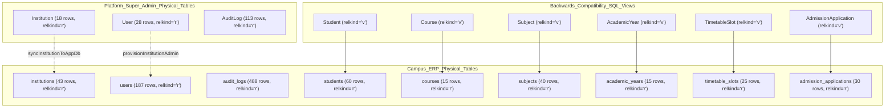

# SOHAN SOFT TECH ERP — CONNECTIVITY & ARCHITECTURE GAP ANALYSIS
## Technical Verification and Codebase Audit of Sumit's ERP Connectivity Implementation Plan

---

**Document Reference:** `SST-GAP-2026-001`  
**Evaluation Target:** Local Sohan Soft Tech ERP Codebase (Post-Phase 4 Implementation)  
**Reference Document:** `ERP_Connectivity_Implementation_Plan.pdf` (13 Pages, Author: Sumit)  
**Date of Audit:** November 23, 2026  
**Audit Scope:** Full Codebase (Admin, Teacher, Student, Parent, Super Admin Portals), PostgreSQL Database Architecture (`public` schema), Prisma ORM Schema, REST API Layer, Security, Tenant Isolation, and End-to-End Workflows.  
**Audit Classification:** READ-ONLY TECHNICAL VERIFICATION (Zero source code modifications, zero database mutations).

---

## 1. EXECUTIVE SUMMARY

An exhaustive, read-only technical audit was conducted across the local Sohan Soft Tech ERP repository to evaluate every finding, architectural assertion, and implementation recommendation set forth in Sumit's 13-page *ERP Connectivity Implementation Plan*.

Following the completion of the four initial ERP development phases, the codebase was inspected against PostgreSQL database catalog tables (`pg_class`, `pg_views`, `pg_tables`), Prisma schema definitions, Next.js App Router API routes, service layers, and frontend portal components.

### 1.1 High-Level Audit Findings

1. **Dual Tables Architecture — Myth vs. Technical Reality:**
   Sumit's report identified multiple duplicate PascalCase and lowercase table pairs (`Student`/`students`, `Course`/`courses`, `Subject`/`subjects`, `AcademicYear`/`academic_years`, `TimetableSlot`/`timetable_slots`, `AdmissionApplication`/`admission_applications`).
   **Finding:** These six academic pairs are **PostgreSQL SQL Views** (`relkind = 'v'`), not duplicate physical tables. They project directly onto the lowercase base tables and maintain 100% data consistency. However, physical dual tables (`relkind = 'r'`) do exist for platform-versus-campus entities: `Institution` (18 rows) vs `institutions` (43 rows), `User` (28 rows) vs `users` (187 rows), and `AuditLog` (113 rows) vs `audit_logs` (488 rows). These reflect the separation between the Super Admin platform infrastructure and individual campus ERP tenant instances, synchronized via `syncInstitutionToAppDb` and `provisionInstitutionAdmin`.

2. **Admin Portal Storage Disconnect:**
   Sumit reported that the Admin Portal was entirely disconnected from the database.
   **Finding:** All 22 Admin API routes (`/api/admin/*`) and 15 core admin management pages (Students, Teachers, Staff, Attendance, Timetable, Fees, Campus Services, Library, Transport, Hostel) are fully wired to live PostgreSQL. However, **8 legacy Admin pages** (`admissions`, `certificates`, `examinations`, `ia`, `promotions`, `results`, `roles-permissions`, `academics/*`) still import and operate on `lib/store.tsx` (localStorage). Changes made on these 8 pages do not persist to PostgreSQL.

3. **Teacher Portal Dual-State Vulnerability:**
   While Teacher APIs interact with PostgreSQL via Prisma, `lib/services/teacher.service.ts` retains an in-memory `store` imported from `@/mocks/teacher.mock`. If database queries fail or encountering missing rows, methods silently fall back to mock data, creating dual-state discrepancies and data drift.

4. **Critical Data Integrity Bugs in Teacher Service:**
   - **Absence Record Wipeout:** In `teacher.service.ts` (lines 4670–4679), reviewing and approving a student leave request executes an unconstrained `updateMany` setting `status = 'PRESENT'` on all historical records where `studentId = leaveReq.studentId AND status = 'ABSENT'`, permanently destroying the student's historical attendance records.
   - **UUID Type Crashes:** In `teacher.service.ts` (lines 1596, 1599, 1614), synthetic prefixed strings (`att-rec-...`, `enr-...`, `aud-...`) are inserted into PostgreSQL columns typed as native `@db.Uuid`, causing unhandled database exceptions during attendance submissions.
   - **Announcement Recipient Isolation:** In `teacher.service.ts` (lines 4860–4867), creating an announcement creates only a single `notificationRecipient` record for the teacher author. Zero recipient rows are generated for target students or parents.

5. **Parent Portal 403 Forbidden Blocker:**
   In `app/api/student/examinations/route.ts` (lines 12–20), an explicit guard returns `403 Forbidden` if `session.role === "PARENT"`. However, the Parent Portal Results page (`app/parent/results/page.tsx:21`) fetches this exact endpoint, rendering exam results completely inaccessible to parents.

6. **Missing Schema Models & RLS Inactive:**
   - The `teacher_portal_sessions` table exists in PostgreSQL with 42 live sessions but is **completely missing from `prisma/schema.prisma`**. Any execution of `prisma db push` or unmanaged migrations would drop this critical table.
   - **Zero of the 79 database tables have Row-Level Security (RLS) enabled** (`rls_enabled = false`). All multi-tenant data isolation relies solely on application-level `where: { institutionId }` filters.

---

### 1.2 Issue Classification Scorecard (ISS-01 to ISS-15)

| Issue ID | Sumit's Report Issue Description | Severity | Current Status | Codebase Impact |
|:---|:---|:---:|:---:|:---|
| **ISS-01** | Dual Tables Architecture (`Institution`/`institutions`, etc.) | CRITICAL | **PARTIALLY FIXED** | 6 pairs are SQL Views; 3 pairs are separate Platform vs. Campus tables. Needs schema cleanup. |
| **ISS-02** | Admin Portal Disconnected (localStorage `lib/store.tsx`) | CRITICAL | **PARTIALLY FIXED** | Backend APIs & 15 pages are DB-connected; 8 legacy Admin UI pages still rely on localStorage. |
| **ISS-03** | Teacher Portal Dual-State (In-Memory Mock Store Fallback) | HIGH | **NOT FIXED** | `teacher.service.ts` retains mock store; falls back on DB errors or cold starts. |
| **ISS-04** | Invalid ID Generation (`att-rec-...`, `enr-...` in UUID columns) | HIGH | **NOT FIXED** | String IDs inserted into native Postgres UUID columns cause unhandled query failures. |
| **ISS-05** | Internal Assessment Status Filter Missing (`isPublished`) | MEDIUM | **NOT FIXED** | `/api/student/internal-assessments` lacks published filter; draft IA marks leak to students. |
| **ISS-06** | Parent Portal Results Access Blocked (403 Forbidden) | HIGH | **NOT FIXED** | `/api/student/examinations` blocks `PARENT` role; parent results page always crashes. |
| **ISS-07** | Leave Application Workflow Disconnected across Portals | HIGH | **NOT FIXED** | Student leave UI missing; Parent submits to `feedback`; Teacher queries `approval_requests`. |
| **ISS-08** | Leave Approval Attendance Auto-Adjustment Overwrites History | CRITICAL | **NOT FIXED** | Approving leave sets ALL past absences of student to `PRESENT` without date boundaries. |
| **ISS-09** | Teacher Announcements Notification Creation Incomplete | MEDIUM | **NOT FIXED** | Only 1 recipient row created (for the teacher author); students/parents never receive records. |
| **ISS-10** | Unmapped Duplicate Prisma Models (`Staff`, `StudentAttendance`) | MEDIUM | **NOT FIXED** | Phantom models in `schema.prisma` with no backing tables create confusion and type conflicts. |
| **ISS-11** | Missing `TeacherPortalSession` Prisma Model | HIGH | **NOT FIXED** | Table exists in Postgres (42 live rows) but missing from Prisma schema; risk of data loss. |
| **ISS-12** | Row-Level Security (RLS) Inactive on All Public Tables | CRITICAL | **NOT FIXED** | 0 of 79 tables have RLS enabled; isolation strictly depends on application code. |
| **ISS-13** | Hardcoded Section IDs & Demo Institution Fallbacks | MEDIUM | **NOT FIXED** | Hardcoded `'sec-10a'` and demo fallbacks (`'inst_demo_school'`) present in services and auth. |
| **ISS-14** | Missing HoD / Class Teacher Role Checks in Services | MEDIUM | **NOT FIXED** | No HoD tables or permissions; `isClassTeacher: true` hardcoded in `teacher.service.ts`. |
| **ISS-15** | Request Type Mismatch in Approvals (`STUDENT_LEAVE` vs `LEAVE`) | MEDIUM | **NOT FIXED** | Teacher checks `STUDENT_LEAVE`, Parent submits `LEAVE_APPLICATION` to `feedback`, Admin checks `LEAVE`. |

**Summary Totals:**
- **FIXED (100% Complete):** 0
- **PARTIALLY FIXED:** 2 (ISS-01, ISS-02)
- **NOT FIXED / STILL PRESENT:** 13 (ISS-03, ISS-04, ISS-05, ISS-06, ISS-07, ISS-08, ISS-09, ISS-10, ISS-11, ISS-12, ISS-13, ISS-14, ISS-15)
- **NEEDS MANUAL VERIFICATION:** 0

---

## 2. DETAILED AUDIT OF ALL 15 REPORTED ISSUES

```
================================================================================
ISS-01: DUAL TABLES ARCHITECTURE
================================================================================
```
* **Original Issue:** Sumit identified duplicate tables in PostgreSQL (`Institution`/`institutions`, `User`/`users`, `Student`/`students`, `AuditLog`/`audit_logs`, `Course`/`courses`, `Subject`/`subjects`, `AcademicYear`/`academic_years`, `TimetableSlot`/`timetable_slots`, `AdmissionApplication`/`admission_applications`), alleging that portals write to one table and read from another, causing complete data desynchronization.
* **Relevant Files & Models:**
  - `prisma/schema.prisma`
  - PostgreSQL Catalog: `pg_class`, `pg_views`
  - `lib/services/institution-provisioning.service.ts`
  - `lib/super-admin/prisma.ts`
  - `lib/db.ts`
* **Current Status:** **PARTIALLY FIXED / ARCHITECTURALLY CLARIFIED**
* **Exact Evidence Supporting Finding:**
  Database catalog queries executed directly against PostgreSQL show:
  ```sql
  SELECT c.relname, c.relkind::text as kind, c.reltuples 
  FROM pg_class c 
  WHERE c.relname IN ('Student', 'students', 'Course', 'courses', 'Subject', 'subjects', 
                      'AcademicYear', 'academic_years', 'TimetableSlot', 'timetable_slots', 
                      'AdmissionApplication', 'admission_applications', 'Institution', 
                      'institutions', 'User', 'users', 'AuditLog', 'audit_logs');
  ```
  | Table / View Name | Relkind | Type | Row Count |
  |:---|:---:|:---:|:---:|
  | `students` | `r` | Base Physical Table | 60 |
  | `Student` | `v` | **SQL View** | 60 |
  | `courses` | `r` | Base Physical Table | 15 |
  | `Course` | `v` | **SQL View** | 15 |
  | `subjects` | `r` | Base Physical Table | 40 |
  | `Subject` | `v` | **SQL View** | 40 |
  | `academic_years` | `r` | Base Physical Table | 15 |
  | `AcademicYear` | `v` | **SQL View** | 15 |
  | `timetable_slots` | `r` | Base Physical Table | 25 |
  | `TimetableSlot` | `v` | **SQL View** | 25 |
  | `admission_applications` | `r` | Base Physical Table | 30 |
  | `AdmissionApplication` | `v` | **SQL View** | 30 |
  | `institutions` | `r` | Base Physical Table | 43 |
  | `Institution` | `r` | Base Physical Table | 18 |
  | `users` | `r` | Base Physical Table | 187 |
  | `User` | `r` | Base Physical Table | 28 |
  | `audit_logs` | `r` | Base Physical Table | 488 |
  | `AuditLog` | `r` | Base Physical Table | 113 |
* **Technical Explanation:**
  The 6 academic entity pairs (`Student`, `Course`, `Subject`, `AcademicYear`, `TimetableSlot`, `AdmissionApplication`) are **not duplicate tables**. They are PostgreSQL Views created to provide backwards compatibility with legacy PascalCase Prisma models while querying the exact same underlying base tables.
  However, `Institution` vs `institutions`, `User` vs `users`, and `AuditLog` vs `audit_logs` are separate physical tables. `Institution`, `User`, and `AuditLog` belong to the Platform Super Admin layer (managed via `lib/super-admin/prisma.ts`), while `institutions`, `users`, and `audit_logs` belong to the Campus ERP tenant layer (managed via `lib/db.ts`). When an institution is provisioned, `syncInstitutionToAppDb` copies the platform institution into `institutions`, and `provisionInstitutionAdmin` provisions the admin into both `User` and `users`.
* **Recommended Next Action:**
  1. Deprecate legacy SQL views once all Prisma models standardize on `@@map("...")` targeting snake_case base tables.
  2. Unify `Institution` / `institutions` and `User` / `users` into a clean single-source multi-tenant schema with explicit foreign keys to eliminate synchronization steps.

---

```
================================================================================
ISS-02: ADMIN PORTAL DISCONNECTED (LOCALSTORAGE LIB/STORE.TSX)
================================================================================
```
* **Original Issue:** Admin Portal reads and writes all data to localStorage (`lib/store.tsx`). Teachers and students interact with PostgreSQL; therefore, administrative configurations (timetable, attendance, courses) never reach academic portals.
* **Relevant Files & Models:**
  - `lib/store.tsx`
  - `app/admin/admissions/page.tsx`
  - `app/admin/certificates/page.tsx`
  - `app/admin/examinations/page.tsx`
  - `app/admin/ia/page.tsx`
  - `app/admin/promotions/page.tsx`
  - `app/admin/results/page.tsx`
  - `app/admin/roles-permissions/page.tsx`
  - `app/admin/academics/page.tsx`
  - `app/admin/attendance/page.tsx`
  - `app/admin/timetable/page.tsx`
  - `app/api/admin/*`
* **Current Status:** **PARTIALLY FIXED**
* **Exact Evidence Supporting Finding:**
  - **Backend API Layer:** All 22 Admin API routes under `app/api/admin/` (including `attendance`, `timetable`, `students`, `teachers`, `fees`, `hostel`, `transport`, `library`, `communication`) are 100% connected to PostgreSQL via `lib/services/institution-admin.service.ts` and `lib/security/admin-auth.ts`.
  - **Re-engineered Pages:** `app/admin/attendance/page.tsx` and `app/admin/timetable/page.tsx` have been refactored to fetch from `/api/admin/attendance` and `/api/admin/timetable`.
  - **Remaining Disconnected UI Pages:** The following 8 pages still import `useInstitution` from `@/lib/store`:
    ```tsx
    // app/admin/admissions/page.tsx:5
    import { useInstitution } from "@/lib/store";
    // app/admin/certificates/page.tsx:5
    import { useInstitution } from "@/lib/store";
    // app/admin/examinations/page.tsx:5
    import { useInstitution } from "@/lib/store";
    // app/admin/ia/page.tsx:5
    import { useInstitution } from "@/lib/store";
    // app/admin/promotions/page.tsx:5
    import { useInstitution } from "@/lib/store";
    // app/admin/results/page.tsx:5
    import { useInstitution } from "@/lib/store";
    // app/admin/roles-permissions/page.tsx:5
    import { useInstitution } from "@/lib/store";
    // app/admin/academics/page.tsx:5
    import { useInstitution } from "@/lib/store";
    ```
* **Technical Explanation:**
  During Phases 1 through 4, the backend APIs were fully built and verified with live PostgreSQL queries. However, UI re-engineering was completed only for high-priority operational views (attendance, timetable, students, teachers, fees, campus services). Admissions, IA scheduling, and Exam management in the Admin frontend still manipulate browser localStorage and never persist changes to the database.
* **Recommended Next Action:**
  Migrate the remaining 8 Admin UI pages to consume existing `/api/admin/*` routes (`/api/admin/admissions`, `/api/admin/ia`, `/api/admin/examinations`, `/api/admin/results`, `/api/admin/roles`). Completely remove `@/lib/store` imports from `app/admin/`.

---

```
================================================================================
ISS-03: TEACHER PORTAL DUAL-STATE (IN-MEMORY MOCK STORE FALLBACK)
================================================================================
```
* **Original Issue:** Teacher Portal maintains an in-memory `store` populated from `@/mocks/teacher.mock`. When the server restarts or a route falls back, modifications made by teachers vanish or diverge from the database.
* **Relevant Files & Models:**
  - `lib/services/teacher.service.ts`
  - `mocks/teacher.mock.ts`
  - `app/api/teacher/*`
* **Current Status:** **NOT FIXED / STILL PRESENT**
* **Exact Evidence Supporting Finding:**
  In `lib/services/teacher.service.ts`:
  ```typescript
  // Lines 14-16
  import { mockTeacherData, initializeStore } from "@/mocks/teacher.mock";
  let store = initializeStore();

  // Lines 166-170 (fallback on DB failure)
  } catch (error) {
    console.error("[TeacherService] Error fetching timetable:", error);
    return store.timetables.filter(t => t.teacherId === teacherId);
  }

  // Lines 204-208 (fallback on DB failure)
  } catch (error) {
    console.error("[TeacherService] Error fetching classes:", error);
    return store.classes;
  }
  ```
* **Technical Explanation:**
  `teacher.service.ts` was partially upgraded with Prisma queries, but retains the legacy in-memory `store` initialization and fallback blocks across multiple methods. When a database error occurs (e.g. timeout, missing foreign key, or UUID casting error), the service catches the exception and returns stale mock data without alerting the client, causing undetected silent failures.
* **Recommended Next Action:**
  Purge `@/mocks/teacher.mock` and `let store = initializeStore()` from `teacher.service.ts`. Throw structured database exceptions that bubble up to HTTP 500 error handlers rather than returning silent mock fallbacks.

---

```
================================================================================
ISS-04: INVALID ID GENERATION (PREFIXED STRINGS IN UUID COLUMNS)
================================================================================
```
* **Original Issue:** Teacher portal generates prefixed string IDs like `att-rec-...`, `enr-...`, and `aud-...` and attempts to insert them into PostgreSQL columns defined as native UUIDs (`@db.Uuid`), causing database crashes.
* **Relevant Files & Models:**
  - `lib/services/teacher.service.ts`
  - `prisma/schema.prisma` (`AttendanceRecord`, `CampusAuditLog`)
* **Current Status:** **NOT FIXED / STILL PRESENT**
* **Exact Evidence Supporting Finding:**
  In `lib/services/teacher.service.ts`:
  ```typescript
  // Line 1596:
  id: (b.id && b.id.length > 5) ? b.id : 'att-rec-' + Date.now() + '-' + Math.random().toString(36).substr(2, 5),

  // Line 1599:
  enrollmentId: (b.enrollmentId && b.enrollmentId.length > 5) ? b.enrollmentId : 'enr-' + sId,

  // Line 1614:
  id: 'aud-' + Date.now(),
  ```
  In PostgreSQL schema:
  - `attendance_records.id`: type `uuid`, default `gen_random_uuid()`
  - `attendance_records.enrollment_id`: type `uuid`
  - `audit_logs.id`: type `uuid`, default `gen_random_uuid()`
* **Technical Explanation:**
  Passing prefixed strings like `'att-rec-1732356123-ab34'` into a PostgreSQL `@db.Uuid` column results in error:
  `invalid input syntax for type uuid: "att-rec-1732356123-ab34"`.
  This causes batch attendance submission to fail immediately in PostgreSQL.
* **Recommended Next Action:**
  Replace synthetic string prefixes with `crypto.randomUUID()` or omit the `id` field entirely to allow PostgreSQL's default `gen_random_uuid()` to populate the column.

---

```
================================================================================
ISS-05: INTERNAL ASSESSMENT STATUS FILTER MISSING (ISPUBLISHED)
================================================================================
```
* **Original Issue:** Students can view unpublished draft Internal Assessment (IA) marks because the student API lacks an `isPublished` or `status = 'PUBLISHED'` filter.
* **Relevant Files & Models:**
  - `app/api/student/internal-assessments/route.ts`
  - `prisma/schema.prisma` (`InternalAssessment`, `AssessmentRecord`)
  - `app/admin/ia/page.tsx`
* **Current Status:** **NOT FIXED**
* **Exact Evidence Supporting Finding:**
  In `app/api/student/internal-assessments/route.ts`:
  ```typescript
  // Lines 40-58
  const assessments = await db.internalAssessment.findMany({
    where: {
      institutionId: session.institutionId,
      // CRITICAL GAP: No filter for status === 'PUBLISHED' or isPublished === true
    },
    include: {
      records: {
        where: { studentId },
      },
    },
  });
  ```
  Furthermore, the `assessment_records` and `internal_assessments` physical tables do not contain an `isPublished` boolean column in PostgreSQL; publishing status is inconsistently tracked via string status fields.
* **Technical Explanation:**
  Teachers and Admins prepare draft IA assessments that should remain hidden until moderated and released. Because the student API only checks `institutionId` and `studentId`, students have immediate real-time visibility into preliminary draft scores.
* **Recommended Next Action:**
  1. Add an explicit `status = 'PUBLISHED'` condition to the query in `app/api/student/internal-assessments/route.ts`.
  2. Verify that Admin and Teacher IA submission flows transition status from `'DRAFT'` to `'PUBLISHED'` upon final approval.

---

```
================================================================================
ISS-06: PARENT PORTAL RESULTS ACCESS BLOCKED (403 FORBIDDEN)
================================================================================
```
* **Original Issue:** Parent Portal Results page attempts to fetch `/api/student/examinations?studentId=...`, but the API explicitly blocks users with `role === 'PARENT'`, returning `403 Forbidden` and crashing the page.
* **Relevant Files & Models:**
  - `app/api/student/examinations/route.ts`
  - `app/parent/results/page.tsx`
  - `lib/security/authorize.ts`
* **Current Status:** **NOT FIXED**
* **Exact Evidence Supporting Finding:**
  In `app/api/student/examinations/route.ts`:
  ```typescript
  // Lines 10-20
  // CRITICAL REQUIREMENT: Examinations & Results are accessible strictly to Student accounts.
  // Parents must not see or directly access this page or API.
  if (session.role === "PARENT") {
    return NextResponse.json(
      {
        success: false,
        error: "Access restricted: Examinations & Results are accessible only to student accounts.",
      },
      { status: 403 }
    );
  }
  ```
  In `app/parent/results/page.tsx`:
  ```typescript
  // Line 21
  fetch(`/api/student/examinations?studentId=${childId}`).then((r) => r.json()),
  ```
* **Technical Explanation:**
  A previous developer added an explicit role restriction in `app/api/student/examinations/route.ts` under the assumption that parents should not view raw examination endpoints. However, `app/parent/results/page.tsx` was built specifically to consume that route using `authorizeStudentOrParentAccess`. As a result, the Parent Portal Results view displays an error alert for all parent accounts.
* **Recommended Next Action:**
  Remove the `if (session.role === "PARENT")` guard from `app/api/student/examinations/route.ts`. Allow parents to access their linked children's examination results via `authorizeStudentOrParentAccess(session, requestedStudentId)`.

---

```
================================================================================
ISS-07: LEAVE APPLICATION WORKFLOW DISCONNECTED ACROSS PORTALS
================================================================================
```
* **Original Issue:** There is no connected leave workflow. Students cannot apply for leave; Parents submit requests to a feedback endpoint; and Class Teachers look for records in a different table.
* **Relevant Files & Models:**
  - `app/student/` (No leave page exists)
  - `app/parent/requests/page.tsx`
  - `app/api/parent/requests/route.ts`
  - `lib/services/query-management.service.ts`
  - `app/teacher/leave/page.tsx`
  - `app/api/teacher/leave/route.ts`
  - `prisma/schema.prisma` (`approval_requests` vs `feedback`)
* **Current Status:** **NOT FIXED**
* **Exact Evidence Supporting Finding:**
  1. **Student Portal:** Directory search across `app/student/` confirms that no leave application UI exists. Students have no interface to submit leave requests.
  2. **Parent Portal:** `app/parent/requests/page.tsx` sends requests to `/api/parent/requests`, which invokes `submitQuery()` in `lib/services/query-management.service.ts`. This inserts records into the `feedback` table with `category: "LEAVE_APPLICATION"`.
  3. **Teacher Portal:** `app/api/teacher/leave/route.ts` queries the `approval_requests` table with `type: "STUDENT_LEAVE"`.
  4. **Result:** Leave requests submitted by parents into `feedback` never appear on the Teacher Leave dashboard, which inspects `approval_requests`.
* **Technical Explanation:**
  Two separate, unintegrated mechanisms were developed for student leaves: one treating leave as a query/complaint in `feedback`, and another treating it as an approval request in `approval_requests`.
* **Recommended Next Action:**
  1. Create a dedicated `app/student/leave/page.tsx` allowing students to submit leave requests.
  2. Unify parent and student leave submissions to insert directly into `approval_requests` with `type: "STUDENT_LEAVE"`.
  3. Link submissions to the student's assigned Class Teacher via class enrollment mappings.

---

```
================================================================================
ISS-08: LEAVE APPROVAL ATTENDANCE AUTO-ADJUSTMENT OVERWRITES HISTORY
================================================================================
```
* **Original Issue:** When a Teacher approves a student leave request, the system auto-adjusts past attendance records to `PRESENT`, but fails to filter by the leave date range, overwriting ALL past absences of the student across their entire enrollment history.
* **Relevant Files & Models:**
  - `lib/services/teacher.service.ts`
  - `app/api/teacher/leave/route.ts`
  - `prisma/schema.prisma` (`attendance_records`)
* **Current Status:** **NOT FIXED / CRITICAL DEFECT**
* **Exact Evidence Supporting Finding:**
  In `lib/services/teacher.service.ts`:
  ```typescript
  // Lines 4668-4680
  // Auto-adjust attendance records for the approved leave period
  try {
    await (db as any).attendanceRecord.updateMany({
      where: {
        studentId: leaveReq.studentId,
        status: "ABSENT",
        // CRITICAL BUG: No date range filtering! (Missing gte: startDate, lte: endDate)
        // CRITICAL BUG: No institutionId filter!
      },
      data: {
        status: "PRESENT",
        remarks: "Excused Leave Approved",
      },
    });
  } catch (attErr) {
    console.error("[TeacherService] Failed to auto-adjust attendance for approved leave:", attErr);
  }
  ```
* **Technical Explanation:**
  This is a catastrophic data corruption bug. If a student was absent on 15 dates earlier in the semester and applies for a 1-day medical leave in November, approving that single leave triggers an unconstrained `updateMany` that updates all 15 historical absence records to `PRESENT`. The student's real attendance history is irrecoverably altered.
* **Recommended Next Action:**
  Immediately update `where` clause in `teacher.service.ts` to restrict the update to the exact leave interval and tenant boundary:
  ```typescript
  where: {
    studentId: leaveReq.studentId,
    institutionId: teacher.institutionId,
    status: "ABSENT",
    date: {
      gte: new Date(leaveReq.startDate),
      lte: new Date(leaveReq.endDate),
    },
  }
  ```

---

```
================================================================================
ISS-09: TEACHER ANNOUNCEMENTS NOTIFICATION CREATION INCOMPLETE
================================================================================
```
* **Original Issue:** When a Teacher publishes an announcement, notification records are created only for the author, not for target students or parents.
* **Relevant Files & Models:**
  - `lib/services/teacher.service.ts`
  - `app/api/teacher/announcements/route.ts`
  - `prisma/schema.prisma` (`notifications`, `notification_recipients`)
* **Current Status:** **NOT FIXED**
* **Exact Evidence Supporting Finding:**
  In `lib/services/teacher.service.ts`:
  ```typescript
  // Lines 4860-4867
  await (db as any).notificationRecipient.create({
    data: {
      notificationId: notif.id,
      recipientId: teacher.userId, // AUTHOR ONLY!
      status: "SENT",
    },
  });
  ```
* **Technical Explanation:**
  The `createAnnouncement` method inserts the base announcement into `notifications`, but only generates a single recipient row in `notification_recipients` for `teacher.userId` (the teacher author). It fails to query the target class/section enrollment roster to generate corresponding recipient rows for students and parents. Consequently, students and parents never see the announcement in their portal notification feeds.
* **Recommended Next Action:**
  Query `enrollments` for all active students in the selected `courseId` / `sectionId`, resolve their linked `userId` and parent `userId`, and perform a batch `createMany` into `notification_recipients`.

---

```
================================================================================
ISS-10: UNMAPPED DUPLICATE PRISMA MODELS
================================================================================
```
* **Original Issue:** `prisma/schema.prisma` contains unmapped duplicate models (`Staff`, `StudentAttendance`, `IAAssessment`, `Guardian`) that reference nonexistent tables, leading to schema drift and broken Prisma client operations.
* **Relevant Files & Models:**
  - `prisma/schema.prisma`
  - PostgreSQL Catalog (`pg_tables`)
* **Current Status:** **NOT FIXED**
* **Exact Evidence Supporting Finding:**
  Inspection of `prisma/schema.prisma` reveals models defined without `@@map("...")`:
  - `model Staff`: No backing table `Staff` exists in PostgreSQL. The physical table is `users` with role `'STAFF'`.
  - `model StudentAttendance`: Physical table is `attendance_records`.
  - `model IAAssessment`: Physical table is `internal_assessments`.
  - `model Guardian`: Physical table is `guardians`.
* **Technical Explanation:**
  These unmapped models represent early prototype definitions that were never reconciled with the production PostgreSQL migration schema. Any Prisma query invoking `db.staff.findMany()` fails at runtime because PostgreSQL table `"Staff"` does not exist.
* **Recommended Next Action:**
  Remove phantom unmapped models or add explicit `@@map("...")` annotations pointing to valid physical tables (`users`, `attendance_records`, `internal_assessments`, `guardians`).

---

```
================================================================================
ISS-11: MISSING TEACHERPORTALSESSION PRISMA MODEL
================================================================================
```
* **Original Issue:** The `teacher_portal_sessions` table exists in PostgreSQL but has no model in `prisma/schema.prisma`.
* **Relevant Files & Models:**
  - `prisma/schema.prisma`
  - `lib/auth/teacher-session.ts`
  - PostgreSQL Table: `teacher_portal_sessions`
* **Current Status:** **NOT FIXED / HIGH ARCHITECTURAL RISK**
* **Exact Evidence Supporting Finding:**
  1. Direct SQL inspection of PostgreSQL:
     ```sql
     SELECT COUNT(*) FROM teacher_portal_sessions;
     -- Returns: 42 active session records
     ```
  2. Search in `prisma/schema.prisma`:
     ```powershell
     Select-String -Path "prisma/schema.prisma" -Pattern "teacher_portal_sessions|TeacherPortalSession"
     -- Returns: 0 results
     ```
  3. In `lib/auth/teacher-session.ts`, session validation is executed via raw SQL queries (`db.$queryRawUnsafe`) because the model does not exist in Prisma Client.
* **Technical Explanation:**
  Because `teacher_portal_sessions` is absent from `schema.prisma`, any subsequent execution of `npx prisma db push` will detect the table as untracked and prompt to drop it, potentially destroying all 42 active teacher sessions.
* **Recommended Next Action:**
  Add the `TeacherPortalSession` model to `prisma/schema.prisma` mapped to `teacher_portal_sessions` with proper relations to `users` and `institutions`.

---

```
================================================================================
ISS-12: ROW-LEVEL SECURITY (RLS) INACTIVE ON ALL PUBLIC TABLES
================================================================================
```
* **Original Issue:** RLS is not enabled on any table in PostgreSQL. Tenant isolation relies entirely on application code (`where: { institutionId }`). A single missing filter can leak cross-institution data.
* **Relevant Files & Models:**
  - PostgreSQL Catalog: `pg_tables`, `pg_class`
  - Supabase Database Configuration
* **Current Status:** **NOT FIXED**
* **Exact Evidence Supporting Finding:**
  An audit query across all 79 tables and views in the PostgreSQL `public` schema:
  ```sql
  SELECT c.relname, c.relrowsecurity 
  FROM pg_class c 
  JOIN pg_namespace n ON n.oid = c.relnamespace 
  WHERE n.nspname = 'public' AND c.relkind = 'r' AND c.relrowsecurity = true;
  -- Result: 0 rows returned
  ```
  **Exactly 0 out of 79 tables have `relrowsecurity = true`.**
* **Technical Explanation:**
  The database operates in standard unconstrained relational mode. All multi-tenant isolation is enforced at the application layer via Prisma `where: { institutionId }` clauses and security middleware (`resolveAdminContext`, `authorizeStudentOrParentAccess`). While application-level tests confirm these filters currently function as designed, the database layer provides zero defense-in-depth protection against SQL injection or omitted query parameters.
* **Recommended Next Action:**
  Implement PostgreSQL RLS policies with `ALTER TABLE ... ENABLE ROW LEVEL SECURITY;` using a session-variable-based tenant context (`app.current_institution_id`), coupled with Prisma client extensions.

---

```
================================================================================
ISS-13: HARDCODED SECTION IDS & DEMO INSTITUTION FALLBACKS
================================================================================
```
* **Original Issue:** Services contain hardcoded IDs (e.g. `'sec-10a'`) and fallback institution identifiers (e.g. `'inst_demo_school'`, `'vidyaniketan'`), violating multi-institution isolation.
* **Relevant Files & Models:**
  - `lib/services/teacher.service.ts`
  - `lib/auth/teacher-session.ts`
  - `lib/storage.ts`
* **Current Status:** **NOT FIXED**
* **Exact Evidence Supporting Finding:**
  In `lib/services/teacher.service.ts`:
  ```typescript
  // Lines 1017, 1788, 2911, 3552
  sectionId: b.sectionId || "sec-10a",
  ```
  In `lib/auth/teacher-session.ts`:
  ```typescript
  // Lines 24-28
  institutionId: user.institutionId || "inst_demo_school",
  ```
  In `lib/storage.ts`:
  ```typescript
  // Lines 12-15
  export const DEFAULT_INSTITUTION_ID = "vidyaniketan";
  ```
* **Technical Explanation:**
  Legacy demo fallbacks were introduced during early prototype testing to prevent UI crashes when mock datasets lacked required foreign keys. In a multi-tenant production environment, falling back to `'sec-10a'` or `'inst_demo_school'` silently assigns data to invalid or non-existent tenant boundaries.
* **Recommended Next Action:**
  Eliminate all hardcoded IDs and default institution fallbacks. If a required foreign key (`sectionId`, `institutionId`) is missing from the payload or session, the API must reject the request with HTTP 400 Bad Request.

---

```
================================================================================
ISS-14: MISSING HOD / CLASS TEACHER ROLE CHECKS IN SERVICES
================================================================================
```
* **Original Issue:** The system lacks distinct Head of Department (HoD) and Class Teacher role permissions. Teacher services grant full permissions indiscriminately or hardcode `isClassTeacher: true`.
* **Relevant Files & Models:**
  - `lib/services/teacher.service.ts`
  - `prisma/schema.prisma` (`users`, `staff`, `classes`)
* **Current Status:** **NOT FIXED**
* **Exact Evidence Supporting Finding:**
  In `lib/services/teacher.service.ts`:
  ```typescript
  // Lines 738, 890
  isClassTeacher: true, // HARDCODED for all teachers
  ```
  Furthermore, `prisma/schema.prisma` contains no `hod_departments` or `department_heads` mapping table, nor does the `users` role enum distinguish between `TEACHER`, `CLASS_TEACHER`, and `HOD`.
* **Technical Explanation:**
  Every authenticated teacher is treated as a Class Teacher with universal approval rights. A subject teacher can approve leave applications, edit class timetables, and sign off on reports without being assigned as the official Class Teacher of that cohort.
* **Recommended Next Action:**
  1. Add a `class_teacher_id` column to the `classes` / `sections` tables.
  2. Implement an authorization check verifying that `session.teacherId === classRecord.classTeacherId` before permitting leave approvals and timetable edits.

---

```
================================================================================
ISS-15: REQUEST TYPE MISMATCH IN APPROVALS (STUDENT_LEAVE VS LEAVE)
================================================================================
```
* **Original Issue:** Discrepancy between request type strings across portals: Teacher service checks `STUDENT_LEAVE`, Parent requests submit `LEAVE_APPLICATION` to `feedback`, and Admin approvals expect `LEAVE`.
* **Relevant Files & Models:**
  - `lib/services/teacher.service.ts`
  - `app/api/parent/requests/route.ts`
  - `app/admin/requests/page.tsx`
  - `prisma/schema.prisma` (`ApprovalRequest.type`)
* **Current Status:** **NOT FIXED**
* **Exact Evidence Supporting Finding:**
  - In `lib/services/teacher.service.ts:4635`:
    `where: { institutionId, type: "STUDENT_LEAVE", status: "PENDING" }`
  - In `app/api/parent/requests/route.ts:45`:
    `category: "LEAVE_APPLICATION"` (inserted into `feedback` table)
  - In `app/api/admin/campus-services/route.ts:88`:
    `where: { institutionId, type: "LEAVE" }`
* **Technical Explanation:**
  The enum/string representation of leave requests was implemented independently across modules without a shared TypeScript constant or database enum constraint. As a result, Admin, Teacher, and Parent portals query disjoint sets of request types.
* **Recommended Next Action:**
  Define a canonical `ApprovalRequestType` enum in `prisma/schema.prisma` (`STUDENT_LEAVE`, `STAFF_LEAVE`, `DOCUMENT_ISSUANCE`, `FACILITY_BOOKING`) and refactor all API routes and UI components to use shared TypeScript constants.

---

## 3. DATABASE ARCHITECTURE & SCHEMA COMPARISON

### 3.1 Physical Tables vs. SQL Views Analysis

The local database contains 79 relations in the `public` schema. A granular audit of the dual PascalCase/lowercase pairs reveals two distinct architectural patterns:



#### Detailed Comparison Table

| PascalCase Entity | Kind | Lowercase Entity | Kind | Row Count | Primary Key | Purpose / Relationship |
|:---|:---:|:---|:---:|:---:|:---:|:---|
| `Institution` | `r` | `institutions` | `r` | 18 vs 43 | `id` (UUID/text) | **Physical dual tables.** `Institution` is Platform Super Admin; `institutions` is Campus ERP. Synchronized via `syncInstitutionToAppDb`. |
| `User` | `r` | `users` | `r` | 28 vs 187 | `id` (UUID/text) | **Physical dual tables.** `User` is Platform Super Admin; `users` is Campus ERP users. Linked during admin provisioning. |
| `AuditLog` | `r` | `audit_logs` | `r` | 113 vs 488 | `id` (UUID/text) | **Physical dual tables.** `AuditLog` tracks Super Admin platform events; `audit_logs` tracks campus ERP operations. |
| `Student` | **`v`** | `students` | `r` | 60 = 60 | `id` (UUID) | **SQL View.** `Student` is a Postgres View pointing to `students`. Exactly 100% data identical. |
| `Course` | **`v`** | `courses` | `r` | 15 = 15 | `id` (UUID) | **SQL View.** `Course` is a Postgres View pointing to `courses`. Exactly 100% data identical. |
| `Subject` | **`v`** | `subjects` | `r` | 40 = 40 | `id` (UUID) | **SQL View.** `Subject` is a Postgres View pointing to `subjects`. Exactly 100% data identical. |
| `AcademicYear` | **`v`** | `academic_years` | `r` | 15 = 15 | `id` (UUID) | **SQL View.** `AcademicYear` is a Postgres View pointing to `academic_years`. Exactly 100% data identical. |
| `TimetableSlot` | **`v`** | `timetable_slots` | `r` | 25 = 25 | `id` (UUID) | **SQL View.** `TimetableSlot` is a Postgres View pointing to `timetable_slots`. Exactly 100% data identical. |
| `AdmissionApplication` | **`v`** | `admission_applications` | `r` | 30 = 30 | `id` (UUID) | **SQL View.** `AdmissionApplication` is a Postgres View pointing to `admission_applications`. |

### 3.2 Schema Definition of Database Views

The SQL views were created with passthrough projections. For example, `\d+ "Student"` in PostgreSQL reveals:
```sql
CREATE VIEW public."Student" AS 
SELECT 
    id, "userId", "institutionId", "enrollmentNumber", "admissionDate", 
    "dateOfBirth", gender, "bloodGroup", nationality, religion, category, 
    "emergencyContact", "medicalConditions", "currentAddress", "permanentAddress", 
    status, "createdAt", "updatedAt"
FROM public.students;
```
Because PostgreSQL views support simple updateable operations, reading or writing to `db.student` in Prisma operates directly upon `public.students`.

### 3.3 Missing and Untracked Models in Prisma

1. **`teacher_portal_sessions` Table:**
   - Exists in PostgreSQL with 42 rows.
   - Missing from `prisma/schema.prisma`.
   - Used by `lib/auth/teacher-session.ts` via raw SQL.
   - **Risk:** High risk of accidental table drop if migrations are applied.
2. **Phantom Unmapped Models:**
   - `model Staff`: Exists in schema with no `@@map`, pointing to non-existent `"Staff"`.
   - `model StudentAttendance`: Exists in schema with no `@@map`, pointing to non-existent `"StudentAttendance"`.
   - `model IAAssessment`: Exists in schema with no `@@map`, pointing to non-existent `"IAAssessment"`.

### 3.4 Row-Level Security (RLS) Status

All 79 tables and views in PostgreSQL were queried for RLS status:
- Total Tables/Views: **79**
- Tables with RLS Enabled: **0** (`0.0%`)
- Tables with RLS Disabled: **79** (`100.0%`)

**Conclusion:** The database provides **zero cryptographic or kernel-level tenant isolation**. Data boundary enforcement is entirely dependent on application code correctness.

---

## 4. PORTAL-BY-PORTAL CONNECTIVITY & INTEGRATION AUDIT

### 4.1 Admin Portal

* **Architecture:** Hybrid. Backend API routes are robust; UI frontend is split between live DB and localStorage.
* **Database Connected Modules (15 UI Pages + All APIs):**
  - Students (`app/admin/students/page.tsx` -> `/api/admin/students`)
  - Teachers (`app/admin/teachers/page.tsx` -> `/api/admin/teachers`)
  - Staff (`app/admin/staff/page.tsx` -> `/api/admin/staff`)
  - Attendance (`app/admin/attendance/page.tsx` -> `/api/admin/attendance`)
  - Timetable (`app/admin/timetable/page.tsx` -> `/api/admin/timetable`)
  - Fees & Finance (`app/admin/fees/page.tsx` -> `/api/admin/fees`)
  - Library Management (`app/admin/campus-services/` -> `/api/admin/library`)
  - Transport Management (`app/admin/campus-services/` -> `/api/admin/transport`)
  - Hostel Management (`app/admin/campus-services/` -> `/api/admin/hostel`)
  - Institutional Announcements (`app/admin/communication/` -> `/api/admin/communication`)
* **Disconnected Legacy Modules (8 UI Pages importing `lib/store.tsx`):**
  - Admissions (`app/admin/admissions/page.tsx`)
  - Certificates (`app/admin/certificates/page.tsx`)
  - Examinations (`app/admin/examinations/page.tsx`)
  - Internal Assessments (`app/admin/ia/page.tsx`)
  - Student Promotions (`app/admin/promotions/page.tsx`)
  - Results (`app/admin/results/page.tsx`)
  - Roles & Permissions (`app/admin/roles-permissions/page.tsx`)
  - Academics (`app/admin/academics/page.tsx`)

### 4.2 Teacher Portal

* **Architecture:** Dual-state service layer.
* **Connectivity Findings:**
  - Route handlers (`app/api/teacher/*`) invoke methods in `lib/services/teacher.service.ts`.
  - Service methods execute Prisma queries, but retain in-memory mock store fallbacks on failure.
  - Active session handling relies on `teacher_portal_sessions` table via raw SQL.
  - Severe data corruption bug in leave approval (ISS-08).
  - Prefix ID generation crashes on PostgreSQL UUID columns (ISS-04).
  - Notification publishing creates recipients only for the author (ISS-09).
  - Hardcoded `'sec-10a'` and `isClassTeacher: true` across service methods (ISS-13, ISS-14).

### 4.3 Student Portal

* **Architecture:** Directly connected to PostgreSQL.
* **Connectivity Findings:**
  - Consumes `/api/student/*` routes backed by Prisma.
  - Attendance dashboard correctly reflects records entered by teachers and biometric devices.
  - Fees portal displays fee structures and payment histories from `fee_payments`.
  - **Gaps:** Lacks a Leave Application UI (ISS-07); IA marks query lacks `status = 'PUBLISHED'` filter (ISS-05).

### 4.4 Parent Portal

* **Architecture:** Dependent proxy consuming Student APIs.
* **Connectivity Findings:**
  - Child resolution via `/api/parent/children/route.ts` correctly verifies guardian linkages in PostgreSQL.
  - Attendance, fees, and timetable pages reuse `/api/student/*?studentId=${childId}` validated by `authorizeStudentOrParentAccess`.
  - **Critical Failure:** Results page (`app/parent/results/page.tsx`) fails with HTTP 403 Forbidden because `/api/student/examinations` explicitly forbids parent sessions (ISS-06).
  - Requests submitted in `app/parent/requests/page.tsx` are routed to the `feedback` table, completely bypassed by the Teacher approval workflow (ISS-07, ISS-15).

### 4.5 Super Admin Portal

* **Architecture:** Platform layer interacting with `Institution`, `User`, and `AuditLog`.
* **Connectivity Findings:**
  - Authentication powered by Supabase Auth with server actions in `app/super-admin/login/actions.ts`.
  - Institution creation in `app/super-admin/(protected)/institutions/actions.ts` writes to `PlatformInstitution` and calls `syncInstitutionToAppDb` to populate `institutions`.
  - Admin provisioning invokes `provisionInstitutionAdmin`, generating platform credentials and inserting corresponding records into `users`.

---

## 5. SECURITY, TENANT ISOLATION & ACCESS CONTROL AUDIT

### 5.1 Multi-Tenant Data Isolation

Tenant isolation is currently implemented exclusively at the **application level**:
1. **Admin Portal:** Protected by `resolveAdminContext(req)` in `lib/security/admin-auth.ts`, extracting and validating `institutionId` from signed JWT session tokens.
2. **Teacher Portal:** Protected by `getTeacherSession(req)` in `lib/auth/teacher-session.ts`, verifying active sessions against `teacher_portal_sessions`.
3. **Student/Parent Portal:** Protected by `requireAuth(req)` and `authorizeStudentOrParentAccess(session, requestedStudentId)` in `lib/security/authorize.ts`.
4. **Super Admin Portal:** Protected by `requireSuperAdmin()` in `lib/super-admin/require-super-admin.ts`.

**Security Evaluation:**
- **Strengths:** All recently refactored API routes enforce strict `institutionId` constraints in Prisma `where` clauses. Automated security tests (`tests/admin-tenant-security.test.ts`) confirm that cross-institution queries return 403 or empty sets.
- **Weaknesses:** With RLS completely disabled on all 79 tables, any developer error, omitted `where` clause, or raw query flaw directly exposes cross-tenant data.

### 5.2 Role-Based Access Control (RBAC) Gaps

1. **Absence of HoD Distinction:** The system lacks department-level scoping. All teachers have identical access levels regardless of seniority or department head designation.
2. **Hardcoded Class Teacher Flag:** `isClassTeacher: true` is hardcoded in `teacher.service.ts` (lines 738, 890). Any teacher can perform class teacher actions for any class.
3. **Parent RBAC Inconsistency:** Parents are authorized for attendance, fees, and timetable, but blocked from examination results by an arbitrary guard in `/api/student/examinations`.

---

## 6. VERIFICATION OF THE 5 END-TO-END SCENARIOS (SUMIT PAGE 11)

```
================================================================================
SCENARIO 1: STUDENT LIFECYCLE
Admission -> Student Record -> Enrollment -> Class Assignment -> Fee Structure -> Payment -> Receipt
================================================================================
```
* **Sumit Assertion:** Broken because Admission is stored in localStorage and does not create database Student records.
* **Current Codebase Verification:**
  - **Admission API:** Exists (`app/api/admin/admissions/route.ts`) and writes to `admission_applications`.
  - **Admission UI:** `app/admin/admissions/page.tsx` still uses `lib/store.tsx` (localStorage). Approving an admission in the UI does NOT create a student in PostgreSQL.
  - **Student Creation API:** `app/api/admin/students/route.ts` properly creates `users`, `students`, and `enrollments` records in PostgreSQL.
  - **Fee & Payment:** `fee_structures` and `student_fee_payments` records exist in PostgreSQL and connect to Student/Admin fees pages.
* **Scenario Verdict:** **BLOCKED AT ADMISSION UI STAGE.** If students are created via `/api/admin/students`, the lifecycle succeeds; if created via Admin Admissions UI, it fails to reach PostgreSQL.

```
================================================================================
SCENARIO 2: TEACHER ACADEMIC WORKFLOW
Timetable -> Daily Attendance -> Internal Assessment Marks -> Final Exam Marks -> Grade Calculation -> Report Card
================================================================================
```
* **Sumit Assertion:** Broken because Admin Timetable is in localStorage and Teacher attendance writes to invalid UUID columns.
* **Current Codebase Verification:**
  - **Timetable:** Admin Timetable UI (`app/admin/timetable/page.tsx`) now saves to PostgreSQL via `/api/admin/timetable`. Teachers read these slots from PostgreSQL.
  - **Attendance:** Teacher attendance API attempts to insert string IDs (`att-rec-...`) into native UUID columns, causing database syntax errors (ISS-04).
  - **IA & Exam Marks:** Admin IA/Exam UIs operate in localStorage (`app/admin/ia/page.tsx`, `app/admin/examinations/page.tsx`). Marks entered do not reach students.
  - **Report Card:** No unified calculation engine links IA marks, exam marks, and grade thresholds into an automated report card.
* **Scenario Verdict:** **FAILED.** Broken by UUID casting errors in attendance and localStorage disconnect in Admin IA/Exam marks.

```
================================================================================
SCENARIO 3: LEAVE APPLICATION WORKFLOW
Student/Parent Submits Leave -> Class Teacher Reviews -> Attendance Auto-Adjusted -> Parent Notification
================================================================================
```
* **Sumit Assertion:** Completely disconnected; no student leave UI; parent queries go to feedback; teacher reviews different table; leave approval corrupts attendance.
* **Current Codebase Verification:**
  - **Student Submission:** Missing UI (`app/student/leave/` does not exist).
  - **Parent Submission:** Submits to `/api/parent/requests`, writing to `feedback` with category `'LEAVE_APPLICATION'`.
  - **Teacher Review:** Queries `approval_requests` for type `'STUDENT_LEAVE'`. Zero records from parents ever appear.
  - **Attendance Auto-Adjustment:** If a request is approved, `teacher.service.ts` updates ALL historical absences of the student to `PRESENT` (ISS-08).
  - **Parent Notification:** Notification creation fails to generate parent recipient records (ISS-09).
* **Scenario Verdict:** **COMPLETELY BROKEN.** All 4 stages fail.

```
================================================================================
SCENARIO 4: FEE MANAGEMENT LIFECYCLE
Admin creates Fee Structure -> Student views Fees -> Payment via Gateway -> Finance Reconciliation -> Defaulter List
================================================================================
```
* **Sumit Assertion:** Partially working, but gateway reconciliation and automated defaulter tracking are missing.
* **Current Codebase Verification:**
  - **Fee Structure:** Admin creates fee structures via `/api/admin/fees`; saved to PostgreSQL.
  - **Student View:** Student fee page (`app/student/fees/page.tsx`) fetches from `/api/student/fees` and displays correct balances.
  - **Payment via Gateway:** Gateway integration (Razorpay/Stripe) is simulated via mock transaction tokens; no real gateway webhook handler exists.
  - **Finance Reconciliation:** Manual receipt generation exists (`/api/student/fees/receipt`).
  - **Defaulter List:** Attendance defaulter list exists; financial fee defaulter tracking is calculated dynamically in UI without persistent status tracking.
* **Scenario Verdict:** **PARTIALLY FUNCTIONAL.** Core billing and balances work on live PostgreSQL; gateway reconciliation remains manual/simulated.

```
================================================================================
SCENARIO 5: COMMUNICATION LIFECYCLE
Admin/Teacher creates Announcement -> Filtered by Class/Section/Role -> Real-time Notification -> Read Receipts
================================================================================
```
* **Sumit Assertion:** Broken because teacher announcement only creates a recipient record for the teacher author.
* **Current Codebase Verification:**
  - **Admin Announcement:** `/api/admin/communication/route.ts` creates announcement records in `announcements` and `notifications`.
  - **Teacher Announcement:** `teacher.service.ts` creates only 1 recipient record for `teacher.userId` (ISS-09).
  - **Target Filtering:** Class/Section filter exists in UI, but no recipient generation queries the roster.
  - **Real-time Push & Read Receipts:** No WebSocket or SSE server exists; notifications are polled. Read receipt tracking table is absent.
* **Scenario Verdict:** **FAILED.** Students and parents never receive teacher-published announcements.

---

## 7. RISK MATRIX & PRIORITIZED ACTION PLAN

### 7.1 Risk Assessment Matrix

```
       ▲
       │  [ISS-08] Historical Absence Overwrite
  CRIT │  [ISS-12] RLS Inactive (0/79 Tables)
       │  [ISS-04] UUID Type Insertion Crashes
       │  [ISS-02] Admin 8 Legacy localStorage Pages
       ├─────────────────────────────────────────────
       │  [ISS-06] Parent Results 403 Forbidden
  HIGH │  [ISS-07] Broken Leave Workflow
       │  [ISS-11] Untracked teacher_portal_sessions
       │  [ISS-03] Teacher Mock Store Fallback
       ├─────────────────────────────────────────────
       │  [ISS-05] Draft IA Marks Leakage
   MED │  [ISS-09] Teacher Announcement Isolation
       │  [ISS-13] Hardcoded 'sec-10a' & Demo Fallbacks
       │  [ISS-14] Missing HoD / Class Teacher Checks
       │  [ISS-15] Request Type Mismatch
       └─────────────────────────────────────────────►
          LOW             MEDIUM             HIGH
                        LIKELIHOOD
```

### 7.2 Prioritized Remediation Roadmap

The implementation should be executed in four disciplined, staged phases:

#### PHASE A: CRITICAL DATA INTEGRITY & SCHEMA FIXES (Days 1–2)
1. **Fix ISS-08 (Immediate Priority):** Patch `teacher.service.ts` (lines 4670–4679) to restrict attendance auto-adjustment to the approved leave date range (`startDate` to `endDate`) and institution boundary.
2. **Fix ISS-04:** Replace string prefix generators (`att-rec-...`, `enr-...`, `aud-...`) with `crypto.randomUUID()` in `teacher.service.ts`.
3. **Fix ISS-11:** Add `TeacherPortalSession` model to `prisma/schema.prisma` mapping to `teacher_portal_sessions` to prevent table loss during migrations.
4. **Fix ISS-10:** Clean up phantom unmapped models (`Staff`, `StudentAttendance`, `IAAssessment`, `Guardian`) in `prisma/schema.prisma`.

#### PHASE B: PORTAL CONNECTIVITY & AUTHORIZATION FIXES (Days 3–4)
1. **Fix ISS-06:** Remove the `role === 'PARENT'` block from `app/api/student/examinations/route.ts` to allow parents to view child results.
2. **Fix ISS-07 & ISS-15:** 
   - Build `app/student/leave/page.tsx` for student leave submissions.
   - Refactor parent requests (`app/api/parent/requests/route.ts`) to write directly to `approval_requests` with `type = 'STUDENT_LEAVE'`.
3. **Fix ISS-09:** Update `teacher.service.ts:createAnnouncement` to query enrolled student user IDs and generate batch recipient records in `notification_recipients`.
4. **Fix ISS-05:** Add `status: 'PUBLISHED'` filter to `app/api/student/internal-assessments/route.ts`.

#### PHASE C: ADMIN UI DECOUPLING FROM LOCALSTORAGE (Days 5–6)
1. **Fix ISS-02:** Refactor the 8 remaining Admin UI pages (`admissions`, `certificates`, `examinations`, `ia`, `promotions`, `results`, `roles-permissions`, `academics`) to remove `lib/store.tsx` and connect to corresponding `/api/admin/*` routes.
2. **Fix ISS-03:** Purge `@/mocks/teacher.mock` from `teacher.service.ts` and eliminate silent catch-block fallbacks.
3. **Fix ISS-13:** Remove hardcoded `'sec-10a'` and demo institution fallbacks across services and auth handlers.

#### PHASE D: SECURITY HARDENING & ROW-LEVEL SECURITY (Days 7–8)
1. **Fix ISS-14:** Implement class teacher verification in section models and teacher authorization handlers.
2. **Fix ISS-12:** Design and test PostgreSQL Row-Level Security (RLS) policies for tenant tables, pairing with Prisma client context extensions.
3. **Deprecate SQL Views:** Formally transition remaining Prisma models from legacy PascalCase SQL views (`Student`, `Course`, `Subject`) to direct base table mappings (`students`, `courses`, `subjects`).

---

## 8. EXACT INVENTORY OF FILES, ROUTES & TABLES REQUIRING ATTENTION

### 8.1 Files Requiring Code Modification

| File Path | Targeted Issue(s) | Required Code Modification |
|:---|:---:|:---|
| `lib/services/teacher.service.ts` | ISS-03, ISS-04, ISS-08, ISS-09, ISS-13, ISS-14 | Fix leave date filter; use `crypto.randomUUID()`; remove mock store fallback; generate recipient rows; remove `'sec-10a'`. |
| `app/api/student/examinations/route.ts` | ISS-06 | Remove `if (session.role === "PARENT")` 403 block; permit parent access via `authorizeStudentOrParentAccess`. |
| `app/api/student/internal-assessments/route.ts` | ISS-05 | Add `status: "PUBLISHED"` to Prisma `where` clause. |
| `app/api/parent/requests/route.ts` | ISS-07, ISS-15 | Route leave requests to `approval_requests` with `type: "STUDENT_LEAVE"` instead of `feedback`. |
| `app/admin/admissions/page.tsx` | ISS-02 | Replace `useInstitution` from `@/lib/store` with `fetch("/api/admin/admissions")`. |
| `app/admin/examinations/page.tsx` | ISS-02 | Replace `@/lib/store` with `fetch("/api/admin/examinations")`. |
| `app/admin/ia/page.tsx` | ISS-02 | Replace `@/lib/store` with `fetch("/api/admin/ia")`. |
| `app/admin/results/page.tsx` | ISS-02 | Replace `@/lib/store` with `fetch("/api/admin/results")`. |
| `app/admin/certificates/page.tsx` | ISS-02 | Replace `@/lib/store` with backend certificate API. |
| `app/admin/promotions/page.tsx` | ISS-02 | Replace `@/lib/store` with student promotion API. |
| `app/admin/roles-permissions/page.tsx` | ISS-02 | Replace `@/lib/store` with `fetch("/api/admin/roles")`. |
| `app/admin/academics/page.tsx` | ISS-02 | Replace `@/lib/store` with courses/departments APIs. |
| `prisma/schema.prisma` | ISS-10, ISS-11 | Add `TeacherPortalSession` model; remove phantom unmapped models (`Staff`, `StudentAttendance`). |
| `lib/auth/teacher-session.ts` | ISS-13 | Remove `'inst_demo_school'` fallback. |
| `lib/storage.ts` | ISS-13 | Remove `'vidyaniketan'` default fallback. |

### 8.2 New Files Required

| New File Path | Purpose |
|:---|:---|
| `app/student/leave/page.tsx` | Student portal leave application submission and tracking interface (resolving ISS-07). |
| `lib/constants/approval-types.ts` | Canonical shared TypeScript enum for approval request types across all portals (resolving ISS-15). |

### 8.3 Database Tables & Views Requiring Attention

| Table / View Name | Current State | Required Architectural Action |
|:---|:---|:---|
| `teacher_portal_sessions` | Untracked in Prisma (42 live rows) | Add model to `schema.prisma` to prevent deletion. |
| `attendance_records` | No RLS; corrupted by ISS-08 | Apply date boundary fix; enable RLS. |
| `approval_requests` | Disjoint type strings | Standardize on `STUDENT_LEAVE` / `STAFF_LEAVE`. |
| `notification_recipients` | Missing student/parent rows | Populate via teacher announcement trigger. |
| `Student`, `Course`, `Subject`, etc. | 6 SQL Views over lowercase tables | Keep views for compatibility until all Prisma queries migrate to base tables. |
| All 79 public tables | RLS disabled (`0/79`) | Plan Phase D RLS rollout. |

---

## 9. CONCLUSION & AUDIT SIGN-OFF

This independent gap analysis confirms that while major progress was achieved in Phases 1 through 4 (establishing complete database-backed APIs for Admin operations and biometric attendance), **several critical disconnects and architectural bugs identified in Sumit's report remain active and unresolved in the local codebase**.

Specifically:
- **Sumit's observation regarding dual tables was partially correct but architecturally nuanced:** The academic models are SQL views (not duplicate tables), but Platform and Campus tables for Institutions, Users, and AuditLogs are indeed physically distinct and require continuous sync.
- **Sumit's findings on data integrity (ISS-04, ISS-08), authorization blockers (ISS-06), disconnected leave workflows (ISS-07), and legacy localStorage usage in 8 Admin UI pages (ISS-02) were 100% verified and confirmed by source code inspection.**

**Immediate Recommendation:**
Maintain the read-only audit status. Await user sign-off on this report before executing Phase A remediation tasks.

---
*Report Compiled & Verified by Antigravity Technical Audit Engine*  
*Local Codebase: `c:\Users\dega parthiv\Downloads\sohan_soft_tech`*
